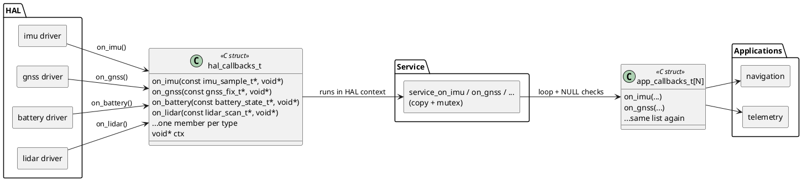
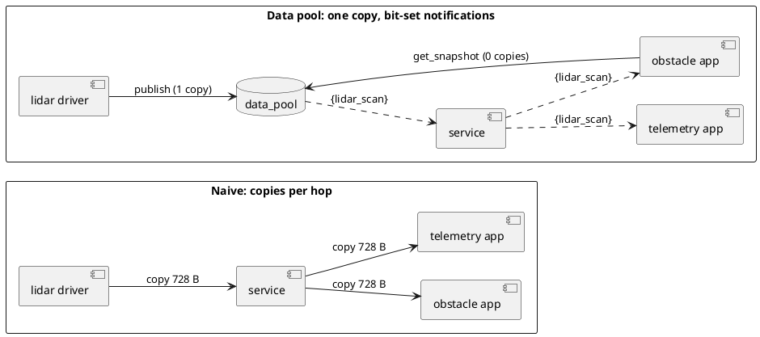
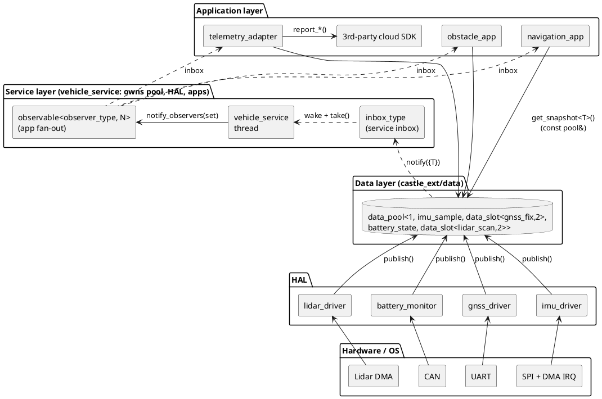
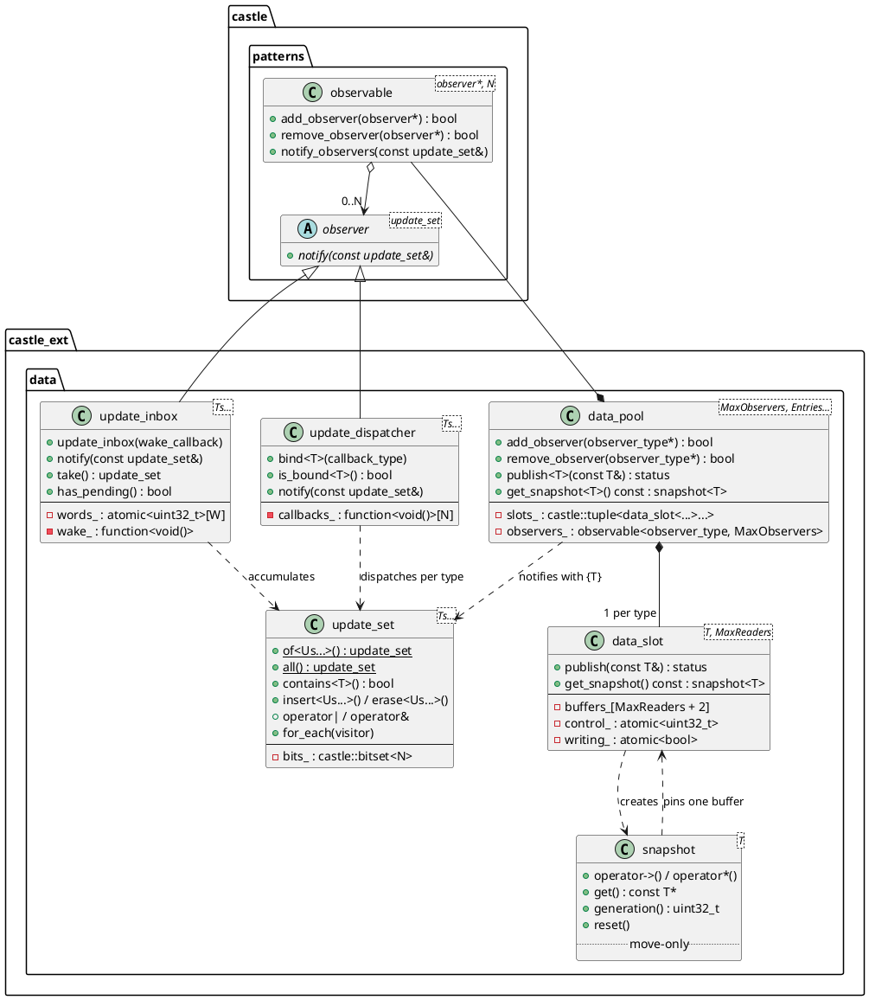
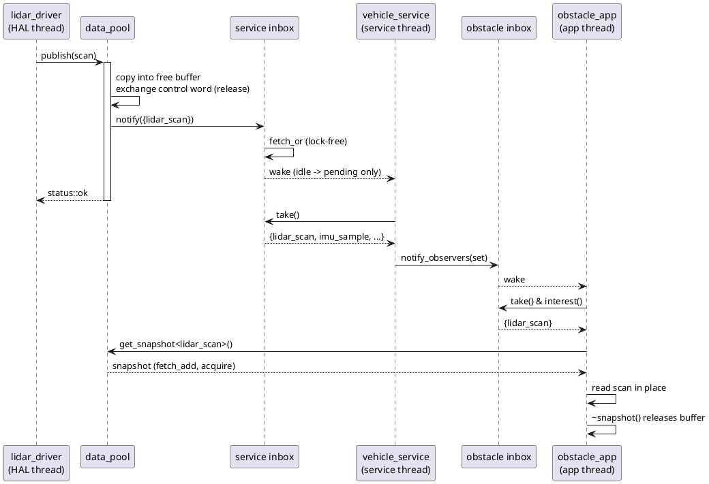
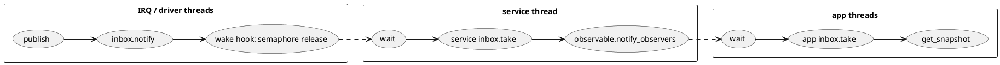
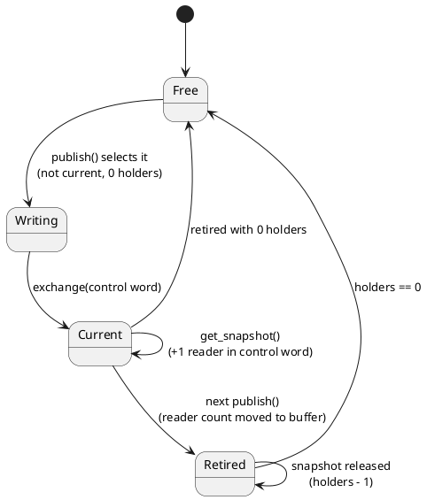
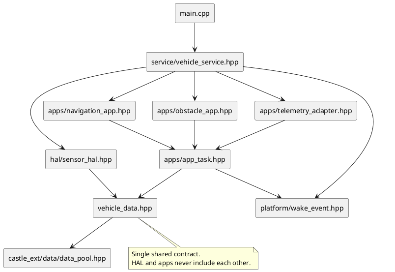
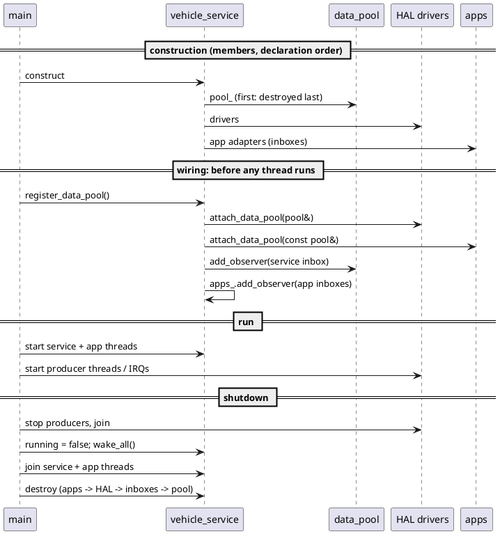

# Common Data Pool (`castle_ext/data`)

## Contents
1. [Why a common data pool](#1-why-a-common-data-pool)
2. [Building blocks](#2-building-blocks)
3. [Architecture](#3-architecture)
4. [Data flow](#4-data-flow)
5. [Snapshot buffers and `MaxReaders` sizing](#5-snapshot-buffers-and-maxreaders-sizing)
6. [Practical demonstration: vehicle sensor platform](#6-practical-demonstration-vehicle-sensor-platform)
7. [Porting the wake event](#7-porting-the-wake-event)
8. [Design rules](#8-design-rules)
9. [Status codes](#9-status-codes)
10. [Per-header reference](#10-per-header-reference)

## 1. Why a common data pool

An embedded product usually has several producers of hardware data (IMU, GNSS, battery management, lidar) and several consumers (navigation, safety monitors, cloud telemetry, diagnostics). How the data travels from HAL to the service and on to the applications decides how well the system survives growth.

### 1.1 Common designs that do not scale

| Design | Problem |
|---|---|
| C adapter struct of callback function pointers | One hard-coded callback per data type. Every new type changes the struct and every layer that uses it; consumer code runs in HAL context. See [1.2](#12-anti-pattern-c-callback-table-between-hal-and-service). |
| Producers call consumers directly | Every driver depends on every application. Callbacks run in driver context, and adding a consumer means changing a driver. |
| Producers push copies through queues | Each layer copies each structure. A 728-byte lidar scan sent to three consumers through two layers costs six copies per revolution, and queues must be sized for the worst case. |

### 1.2 Anti-pattern: C callback table between HAL and service

A common legacy design: the HAL exposes a C "adapter" struct with one function pointer per data type. The service fills it in, registers it, and the HAL passes each data structure through its own callback:

```c
/* hal_adapter.h: shared by HAL and service */
typedef struct
{
    void (*on_imu)(const imu_sample_t* sample, void* ctx);
    void (*on_gnss)(const gnss_fix_t* fix, void* ctx);
    void (*on_battery)(const battery_state_t* state, void* ctx);
    void (*on_lidar)(const lidar_scan_t* scan, void* ctx);
    /* ... one more member for every new data type ... */
    void* ctx;
} hal_callbacks_t;

void hal_register_callbacks(const hal_callbacks_t* callbacks);

/* HAL: driver thread or interrupt bottom half */
static const hal_callbacks_t* g_callbacks;               /* set by hal_register_callbacks() */

void imu_data_ready(void)
{
    imu_sample_t sample;
    imu_read(&sample);
    if ((g_callbacks != NULL) && (g_callbacks->on_imu != NULL))
    {
        g_callbacks->on_imu(&sample, g_callbacks->ctx);   /* service code runs here, in the HAL context */
    }
}

/* Service: copies, locks, and repeats the pattern towards the applications */
static void service_on_imu(const imu_sample_t* sample, void* ctx)
{
    service_t* self = (service_t*)ctx;                     /* untyped context */
    mutex_lock(&self->lock);
    self->last_imu = *sample;                              /* copy: the pointer dies after return */
    mutex_unlock(&self->lock);
    for (size_t i = 0U; i < self->app_count; ++i)
    {
        if (self->apps[i]->on_imu != NULL)                 /* a second callback table, per app */
        {
            self->apps[i]->on_imu(sample, self->apps[i]->ctx);
        }
    }
}
```



Why it hurts:

| Problem | Consequence |
|---|---|
| **Hard-coded interface.** The struct lists every data type by name. | Adding, removing or renaming a type changes a header shared by every layer: an interface (and often ABI) change, and every component is rebuilt and retested. |
| **The same list is repeated per layer.** HAL → service has one table, service → applications another, often per application. | One new type is edited in several places that must stay in sync by hand; a forgotten member fails silently (a `NULL` pointer means the data is silently dropped). |
| **Consumer code runs in the producer's context.** | Service and application logic executes on the driver thread or in an interrupt bottom half: unbounded HAL latency, mutexes inside callbacks, priority inversion and re-entrancy hazards. |
| **No type safety.** `void* ctx` casts and positional initialisers. | A wrong cast or a swapped initialiser compiles and fails at runtime. |
| **Borrowed pointers.** The `const T*` argument is only valid during the call. | Every receiver copies the struct, usually under a mutex. Large structures are copied once per layer and per consumer. |
| **No current state.** Data exists only while it is being delivered. | A consumer that starts late, or misses a callback while busy, has nothing to read until the next update and cannot tell how stale its copy is. |
| **One subscriber per member.** | Fan-out to several consumers is hand-written in the service, with its own loops and `NULL` checks. |
| **Hard to test.** | Each test fakes the whole table, plus the threading behaviour of whoever calls it. |

Change impact of adding one data type, `wheel_speed`, used by navigation only:

| Step | C callback table | Data pool |
|---|---|---|
| Declare the type | `wheel_speed_t` | `wheel_speed` |
| Interface | Add `on_wheel_speed` to `hal_callbacks_t` **and** to `app_callbacks_t` | Add `wheel_speed` to the `vehicle_pool` alias |
| HAL | Call `g_callbacks->on_wheel_speed(...)` with a `NULL` check | `pool.publish(wheel_speed{...})` |
| Service | New handler, new storage, mutex, forwarding loop, registration | **No data-path change**: it forwards whatever changed (it only owns the new driver) |
| Other applications | Edit their tables: initialise the new member to `NULL`, then rebuild | **No source change** (rebuild only): their `interest()` filter ignores the new type |
| Navigation | Implement and register the new callback | `if (changed.contains<wheel_speed>()) { ... pool.get_snapshot<wheel_speed>() ... }` |
| A forgotten step | Fails silently at runtime (`NULL` or unregistered callback) | Publishing or reading a type missing from the pool fails at compile time |

### 1.3 What the data pool changes

The common data pool separates **data** from **notification**:

* **Data** lives in one place. A producer copies a value into the pool **once**. Consumers read it **in place** through a `snapshot`, so readers make no copies, and the latest value is always available, with a generation number that shows how fresh it is.
* **Notification** carries only **which types changed** (`update_set`, one bit per type) through one generic interface, `observer<update_set>`, for any number of types. The service forwards that small set to the applications without knowing what the types are, and each application reads only the types it needs, on its own thread.


## 2. Building blocks

| Header | Type | Role |
|---|---|---|
| [`data_pool.hpp`](data_pool.md) | `data_pool<MaxObservers, Entries...>` | Fixed set of typed slots. `publish()` stores a value and notifies observers with `{T}`; `get_snapshot<T>()` reads it. |
| [`data_slot.hpp`](data_slot.md) | `data_slot<T, MaxReaders>`, `snapshot<T>` | Lock-free latest-value cell for one type: a heap-free equivalent of an atomically swapped `shared_ptr<const T>`. |
| [`update_set.hpp`](update_set.md) | `update_set<Ts...>` | Value-type bit set of changed types: `of`, `contains`, `\|`, `&`, `for_each`. |
| [`update_inbox.hpp`](update_inbox.md) | `update_inbox<Ts...>` | Thread-safe `observer<update_set>` that accumulates pending types for one consumer thread and wakes it. |
| [`update_dispatcher.hpp`](update_dispatcher.md) | `update_dispatcher<Ts...>` | `observer<update_set>` that calls one bound callback per changed type, directly in the publisher's context. No pending state, no coalescing. |

Propagation uses the core [`castle::patterns::observer` / `observable`](../../patterns/observer.md); the module adds no second publish/subscribe mechanism.

Properties shared by all of them: no heap, no exceptions, no RTTI, no STL. The type set is fixed at compile time, so a slot is selected by the compiler rather than looked up at runtime, and using an unknown type does not compile.

## 3. Architecture

### 3.1 Layers and ownership



Responsibilities:

| Layer | Owns | May call | Must not |
|---|---|---|---|
| HAL driver | Its staging data | `pool.publish()` | Know about the service or the applications |
| Data pool | Slot buffers, observer list | Observers (`notify`) | Run application logic |
| Service | Pool, HAL, app adapters, app fan-out | `inbox.take()`, `observable.notify_observers()` | Copy pool data to forward it |
| Application / adapter | Its own state and thread | `const pool.get_snapshot<T>()` | Publish (it holds a `const` pool) |

### 3.2 Class model



## 4. Data flow

### 4.1 Publish, propagate, read



### 4.2 Coalescing

Inboxes OR the incoming sets together. If the IMU publishes five samples while the navigation thread is busy, the next `take()` reports `{imu_sample}` once and `get_snapshot()` returns the newest sample. Nothing is queued, so a slow consumer can never overflow anything. It sees the latest state and skips intermediate values.

That is the right behaviour for **state** data (positions, temperatures, battery level, the latest scan). For **event** data where every item matters (key presses, CAN frames to log, protocol messages), use a queue such as `castle::container::mirrored_ring_buffer` next to the pool.

### 4.3 Thread and context map



| Call | Context | Cost | Blocking |
|---|---|---|---|
| `pool.publish(v)` | Driver thread (or deferred ISR work) | 1 copy of `T` + O(MaxReaders) atomic loads + observer calls | Never |
| `inbox.notify(set)` | Inside `publish` | 1 `fetch_or` per 32 types + optional wake hook | Never |
| `inbox.take()` | Owner thread | 1 `exchange` per 32 types | Never |
| `pool.get_snapshot<T>()` | Any thread | 1 `fetch_add` | Never (wait-free) |
| `~snapshot()` | Holder thread | 1 CAS or 1 `fetch_sub` | Never |

Only the application's own `wait()` on its wake event blocks.

## 5. Snapshot buffers and `MaxReaders` sizing

Each `data_slot<T, MaxReaders>` owns `MaxReaders + 2` buffers. Any buffer is in exactly one of these states:



The writer needs a buffer that is neither current nor held. One buffer is current, so `publish()` returns `status::full` only when all `MaxReaders + 1` other buffers are still held by snapshots of **older** values.

Sizing rule: **`MaxReaders` = the number of snapshots of older values that may be held at the same time** while the producer keeps publishing. Usually that is one per reader thread that keeps its snapshot across a publish.

| Entry in the demo | Readers | Holds across publish? | `MaxReaders` | Memory |
|---|---|---|---|---|
| `imu_sample` (28 B) | navigation | Briefly | 1 (default) | 3 × 28 B |
| `gnss_fix` (32 B) | navigation, telemetry | Both may | 2 | 4 × 32 B |
| `battery_state` (6 B) | telemetry | Briefly | 1 (default) | 3 × 6 B |
| `lidar_scan` (728 B) | obstacle (+ future logger) | Yes, during processing | 2 | 4 × 728 B |

The whole demo pool is 3344 bytes (`sizeof(vehicle_pool)` on x86-64), all static.

Snapshots of the **current** value never block the writer, however many there are. Every reader holding a snapshot at the same instant without a publish in between shares one buffer.

## 6. Practical demonstration: vehicle sensor platform

### 6.1 Scenario

A small autonomous vehicle controller:

| Producer (HAL) | Rate | Type | Consumers |
|---|---|---|---|
| IMU over SPI + DMA | 1 kHz | `imu_sample` | navigation |
| GNSS receiver over UART | 10 Hz | `gnss_fix` | navigation, telemetry |
| Battery management over CAN | 2 Hz | `battery_state` | telemetry |
| 2D lidar over DMA | 20 Hz | `lidar_scan` (728 B) | obstacle detection |

The `vehicle_service` owns the pool, the HAL drivers and the application adapters. `register_data_pool()` hands the pool to the HAL (read-write) and to the applications (read-only), then wires the notification path. The telemetry adapter is the only code that knows the third-party cloud SDK.

The demonstration builds and runs on a Linux host. `std::thread` stands in for RTOS tasks and hardware interrupts, and nothing in the data layer depends on it. [Section 7](#7-porting-the-wake-event) shows the RTOS mapping.

### 6.2 Project layout

```
vehicle_demo/
  vehicle_data.hpp              # data contract: types + pool alias (shared by every layer)
  platform/wake_event.hpp       # the only OS-specific piece
  hal/sensor_hal.hpp            # imu_driver, gnss_driver, battery_monitor, lidar_driver
  apps/app_task.hpp             # CRTP application loop: inbox + wake + interest filter
  apps/navigation_app.hpp
  apps/obstacle_app.hpp
  apps/telemetry_adapter.hpp    # third-party SDK adapter
  service/vehicle_service.hpp   # owns everything, register_data_pool(), fan-out
  main.cpp                      # host simulation: threads + fake hardware
```



### 6.3 Data contract

The pool alias is the system's data contract. Adding a type means adding one entry here; publishing or reading a type that is not listed does not compile.

```cpp
// vehicle_data.hpp
#ifndef DEMO_VEHICLE_DATA_HPP
#define DEMO_VEHICLE_DATA_HPP

#include "castle_ext/data/data_pool.hpp"

#include <stdint.h>

// ---- Data contract shared by HAL, service and applications ------------------

struct imu_sample
{
    uint32_t timestamp_us = 0U;
    float accel_mps2[3]{};
    float gyro_dps[3]{};
};

struct gnss_fix
{
    uint32_t timestamp_us = 0U;
    double latitude_deg = 0.0;
    double longitude_deg = 0.0;
    float speed_mps = 0.0F;
    uint8_t satellites = 0U;
    bool valid = false;
};

struct battery_state
{
    uint16_t voltage_mv = 0U;
    int16_t current_ma = 0;
    uint8_t soc_percent = 0U;
};

struct lidar_scan                       // 728 bytes: read in place, never copied by readers
{
    uint32_t timestamp_us = 0U;
    uint32_t sequence = 0U;
    uint16_t range_mm[360]{};
};

using vehicle_pool = castle_ext::data::data_pool<
    1U,                                              // observers: the service inbox
    imu_sample,                                      // data_slot<imu_sample, 1>
    castle_ext::data::data_slot<gnss_fix, 2U>,       // navigation + telemetry may hold old fixes
    battery_state,
    castle_ext::data::data_slot<lidar_scan, 2U>>;    // obstacle app + a second reader (e.g. logger)

using vehicle_updates = vehicle_pool::update_set_type;

#endif // DEMO_VEHICLE_DATA_HPP
```

### 6.4 Platform wake event

The only OS-dependent code. The inbox wake hook calls `signal()` from the producer's context; the consumer thread blocks in `wait()`.

```cpp
// platform/wake_event.hpp
#ifndef DEMO_PLATFORM_WAKE_EVENT_HPP
#define DEMO_PLATFORM_WAKE_EVENT_HPP

#include "castle/sync/semaphore.hpp"

#include <sched.h>

// Lets a waiting thread yield the CPU instead of spinning (POSIX host build).
struct yield_wait
{
    static void wait() noexcept
    {
        (void)sched_yield();
    }
};

// Binary wake-up event: any thread may signal, one thread waits.
// Port: Zephyr k_sem (0, 1), FreeRTOS task notification, CMSIS-RTOS2 osThreadFlags.
class wake_event
{
public:
    void signal() noexcept
    {
        (void)sem_.release();   // false when already signaled: the waiter wakes once anyway
    }

    void wait() noexcept
    {
        sem_.acquire();
    }

private:
    castle::semaphore<1U, yield_wait> sem_{0U};
};

#endif // DEMO_PLATFORM_WAKE_EVENT_HPP
```

### 6.5 HAL drivers

Drivers turn raw hardware data into contract types and publish them. They do not know who consumes the data. `status::full` is counted, not retried: the next sample replaces the dropped one.

```cpp
// hal/sensor_hal.hpp
#ifndef DEMO_HAL_SENSOR_HAL_HPP
#define DEMO_HAL_SENSOR_HAL_HPP

#include "vehicle_data.hpp"

#include "castle/sync/atomic.hpp"

// ---- HAL: converts raw hardware data into contract types and publishes them --
// A driver only knows the pool. It never knows the service or the applications.

class sensor_driver_base
{
public:
    void attach_data_pool(vehicle_pool& pool) noexcept
    {
        pool_ = &pool;
    }

    uint32_t published() const noexcept
    {
        return published_.load(castle::memory_order_relaxed);
    }

    uint32_t dropped() const noexcept
    {
        return dropped_.load(castle::memory_order_relaxed);
    }

protected:
    template <typename T>
    void publish(const T& value) noexcept
    {
        if (pool_->publish(value) == castle::status::ok)
        {
            (void)published_.fetch_add(1U, castle::memory_order_relaxed);
        }
        else
        {
            // status::full: readers hold every spare buffer of T. The next sample replaces this one.
            (void)dropped_.fetch_add(1U, castle::memory_order_relaxed);
        }
    }

private:
    vehicle_pool* pool_ = nullptr;
    castle::atomic_uint32_t published_{0U};
    castle::atomic_uint32_t dropped_{0U};
};

class imu_driver : public sensor_driver_base
{
public:
    // Called from the IMU data-ready thread (deferred from the SPI/DMA interrupt).
    void on_data_ready(uint32_t now_us, const int16_t raw[6]) noexcept
    {
        imu_sample sample{};
        sample.timestamp_us = now_us;
        for (uint32_t axis = 0U; axis < 3U; ++axis)
        {
            sample.accel_mps2[axis] = static_cast<float>(raw[axis]) * accel_scale;
            sample.gyro_dps[axis] = static_cast<float>(raw[axis + 3U]) * gyro_scale;
        }
        publish(sample);
    }

private:
    static constexpr float accel_scale = 9.80665F / 4096.0F;   // +/-8 g range
    static constexpr float gyro_scale = 1.0F / 65.5F;          // +/-500 dps range
};

class gnss_driver : public sensor_driver_base
{
public:
    // Called by the UART parser thread for every decoded navigation solution.
    void on_navigation_solution(uint32_t now_us, double lat, double lon, float speed, uint8_t sats) noexcept
    {
        publish(gnss_fix{now_us, lat, lon, speed, sats, sats >= 4U});
    }
};

class battery_monitor : public sensor_driver_base
{
public:
    // Called from the CAN RX thread when the BMS frame arrives.
    void on_bms_frame(uint16_t voltage_mv, int16_t current_ma, uint8_t soc) noexcept
    {
        publish(battery_state{voltage_mv, current_ma, soc});
    }
};

class lidar_driver : public sensor_driver_base
{
public:
    // Called when a DMA transfer of one revolution completes.
    void on_revolution(uint32_t now_us, const uint16_t (&dma_ranges)[360]) noexcept
    {
        scan_.timestamp_us = now_us;
        ++scan_.sequence;
        for (uint32_t i = 0U; i < 360U; ++i)
        {
            scan_.range_mm[i] = dma_ranges[i];
        }
        publish(scan_);   // the single copy of the scan, into a pool buffer
    }

private:
    lidar_scan scan_{};   // staging object owned by the driver thread (keeps 728 bytes off the stack)
};

#endif // DEMO_HAL_SENSOR_HAL_HPP
```

### 6.6 Application loop

One CRTP base gives every application an inbox, a wake event, an interest filter and a thread loop, without virtual functions. Applications receive a `const vehicle_pool&`, so the compiler rejects `publish()` from application code.

```cpp
// apps/app_task.hpp
#ifndef DEMO_APPS_APP_TASK_HPP
#define DEMO_APPS_APP_TASK_HPP

#include "platform/wake_event.hpp"
#include "vehicle_data.hpp"

#include "castle/sync/atomic.hpp"

// ---- Common application loop (CRTP, no virtual functions) --------------------
// Derived must provide:
//   static vehicle_updates interest();                 types the application consumes
//   void on_updates(const vehicle_updates& changed);   called with changed & interest()

template <typename Derived>
class app_task
{
public:
    app_task() noexcept
        : inbox_{[this]() noexcept { wake_.signal(); }}
    {
    }

    app_task(const app_task&) = delete;
    app_task& operator=(const app_task&) = delete;

    // Applications get read-only access: they can take snapshots but cannot publish.
    void attach_data_pool(const vehicle_pool& pool) noexcept
    {
        pool_ = &pool;
    }

    vehicle_pool::observer_type* inbox() noexcept
    {
        return &inbox_;
    }

    // Thread body of the application.
    void run(const castle::atomic_bool& running) noexcept
    {
        while (running.load(castle::memory_order_acquire))
        {
            wake_.wait();
            const vehicle_updates changed = inbox_.take() & Derived::interest();
            if (!changed.empty())
            {
                static_cast<Derived*>(this)->on_updates(changed);
            }
        }
    }

    void wake() noexcept
    {
        wake_.signal();
    }

protected:
    const vehicle_pool& pool() const noexcept
    {
        return *pool_;
    }

private:
    const vehicle_pool* pool_ = nullptr;
    wake_event wake_;
    vehicle_pool::inbox_type inbox_;
};

#endif // DEMO_APPS_APP_TASK_HPP
```

### 6.7 Applications

Navigation reads only the types that changed:

```cpp
// apps/navigation_app.hpp
#ifndef DEMO_APPS_NAVIGATION_APP_HPP
#define DEMO_APPS_NAVIGATION_APP_HPP

#include "apps/app_task.hpp"

// Fuses IMU and GNSS. Reads only the types that changed since its last cycle.
class navigation_app : public app_task<navigation_app>
{
public:
    static vehicle_updates interest() noexcept
    {
        return vehicle_updates::of<imu_sample, gnss_fix>();
    }

    void on_updates(const vehicle_updates& changed) noexcept
    {
        if (changed.contains<imu_sample>())
        {
            const castle_ext::data::snapshot<imu_sample> imu = pool().get_snapshot<imu_sample>();
            heading_rate_dps_ = imu->gyro_dps[2];
            ++imu_cycles;
        }

        if (changed.contains<gnss_fix>())
        {
            const castle_ext::data::snapshot<gnss_fix> fix = pool().get_snapshot<gnss_fix>();
            if (fix->valid)
            {
                latitude_deg = fix->latitude_deg;
                longitude_deg = fix->longitude_deg;
            }
            last_fix_generation = fix.generation();
            ++gnss_cycles;
        }
    }

    uint32_t imu_cycles = 0U;
    uint32_t gnss_cycles = 0U;
    uint32_t last_fix_generation = 0U;
    double latitude_deg = 0.0;
    double longitude_deg = 0.0;

private:
    float heading_rate_dps_ = 0.0F;
};

#endif // DEMO_APPS_NAVIGATION_APP_HPP
```

Obstacle detection processes the 728-byte scan **in place**. The snapshot pins one pool buffer for the duration of `on_updates()` while the driver keeps publishing. One held scan fits the default `MaxReaders = 1`; the entry uses `data_slot<lidar_scan, 2U>` to leave room for a second reader such as a data logger.

```cpp
// apps/obstacle_app.hpp
#ifndef DEMO_APPS_OBSTACLE_APP_HPP
#define DEMO_APPS_OBSTACLE_APP_HPP

#include "apps/app_task.hpp"

// Processes the large lidar scan in place: the snapshot pins one pool buffer while it runs.
class obstacle_app : public app_task<obstacle_app>
{
public:
    static vehicle_updates interest() noexcept
    {
        return vehicle_updates::of<lidar_scan>();
    }

    void on_updates(const vehicle_updates&) noexcept
    {
        const castle_ext::data::snapshot<lidar_scan> scan = pool().get_snapshot<lidar_scan>();
        uint16_t nearest = 0xFFFFU;
        for (uint32_t angle = 330U; angle < 390U; ++angle)   // +/-30 degrees in front
        {
            const uint16_t range = scan->range_mm[angle % 360U];
            nearest = (range < nearest) ? range : nearest;
        }
        nearest_front_mm = nearest;
        last_sequence = scan->sequence;
        ++scans_processed;
    }   // snapshot released here: the buffer returns to the lidar driver

    uint32_t scans_processed = 0U;
    uint32_t last_sequence = 0U;
    uint16_t nearest_front_mm = 0U;
};

#endif // DEMO_APPS_OBSTACLE_APP_HPP
```

The telemetry adapter is the boundary to a third-party SDK. Only this class maps pool types to external calls, so replacing the SDK touches nothing else:

```cpp
// apps/telemetry_adapter.hpp
#ifndef DEMO_APPS_TELEMETRY_ADAPTER_HPP
#define DEMO_APPS_TELEMETRY_ADAPTER_HPP

#include "apps/app_task.hpp"

// ---- Third-party SDK (C API), e.g. a fleet-management cloud client ----------
extern "C" void cloud_sdk_report_position(double lat, double lon, float speed_mps);
extern "C" void cloud_sdk_report_battery(unsigned soc_percent, unsigned voltage_mv);

// Adapter: the only place that maps pool types to the external SDK.
class telemetry_adapter : public app_task<telemetry_adapter>
{
public:
    static vehicle_updates interest() noexcept
    {
        return vehicle_updates::of<gnss_fix, battery_state>();
    }

    void on_updates(const vehicle_updates& changed) noexcept
    {
        if (changed.contains<gnss_fix>())
        {
            const castle_ext::data::snapshot<gnss_fix> fix = pool().get_snapshot<gnss_fix>();
            if (fix->valid)
            {
                cloud_sdk_report_position(fix->latitude_deg, fix->longitude_deg, fix->speed_mps);
                ++position_reports;
            }
        }

        if (changed.contains<battery_state>())
        {
            const castle_ext::data::snapshot<battery_state> battery = pool().get_snapshot<battery_state>();
            cloud_sdk_report_battery(battery->soc_percent, battery->voltage_mv);
            ++battery_reports;
        }
    }

    uint32_t position_reports = 0U;
    uint32_t battery_reports = 0U;
};

#endif // DEMO_APPS_TELEMETRY_ADAPTER_HPP
```

### 6.8 Service

The service owns every component and their lifetimes, implements `register_data_pool()`, and forwards updated types. It never copies pool data.

```cpp
// service/vehicle_service.hpp
#ifndef DEMO_SERVICE_VEHICLE_SERVICE_HPP
#define DEMO_SERVICE_VEHICLE_SERVICE_HPP

#include "apps/navigation_app.hpp"
#include "apps/obstacle_app.hpp"
#include "apps/telemetry_adapter.hpp"
#include "hal/sensor_hal.hpp"
#include "platform/wake_event.hpp"
#include "vehicle_data.hpp"

#include "castle/patterns/observer.hpp"
#include "castle/sync/atomic.hpp"

// ---- Service: owns pool, HAL and application adapters; propagates updated types ----
class vehicle_service
{
public:
    vehicle_service() noexcept
        : inbox_{[this]() noexcept { wake_.signal(); }}
    {
    }

    vehicle_service(const vehicle_service&) = delete;
    vehicle_service& operator=(const vehicle_service&) = delete;

    // Hands the pool to every layer and wires the notification path. Call before any thread starts.
    bool register_data_pool() noexcept
    {
        imu_.attach_data_pool(pool_);              // HAL: read-write
        gnss_.attach_data_pool(pool_);
        battery_.attach_data_pool(pool_);
        lidar_.attach_data_pool(pool_);

        navigation_.attach_data_pool(pool_);       // applications: read-only
        obstacle_.attach_data_pool(pool_);
        telemetry_.attach_data_pool(pool_);

        return pool_.add_observer(&inbox_)                      // HAL -> service
            && apps_.add_observer(navigation_.inbox())         // service -> apps
            && apps_.add_observer(obstacle_.inbox())
            && apps_.add_observer(telemetry_.inbox());
    }

    // Thread body of the service.
    void run(const castle::atomic_bool& running) noexcept
    {
        while (running.load(castle::memory_order_acquire))
        {
            wake_.wait();
            const vehicle_updates changed = inbox_.take();
            if (!changed.empty())
            {
                ++forwarded_cycles;
                apps_.notify_observers(changed);   // apps filter by their own interest()
            }
        }
    }

    // Wakes every thread so it can observe running == false.
    void wake_all() noexcept
    {
        wake_.signal();
        navigation_.wake();
        obstacle_.wake();
        telemetry_.wake();
    }

    imu_driver& imu() noexcept { return imu_; }
    gnss_driver& gnss() noexcept { return gnss_; }
    battery_monitor& battery() noexcept { return battery_; }
    lidar_driver& lidar() noexcept { return lidar_; }
    navigation_app& navigation() noexcept { return navigation_; }
    obstacle_app& obstacle() noexcept { return obstacle_; }
    telemetry_adapter& telemetry() noexcept { return telemetry_; }

    uint32_t forwarded_cycles = 0U;

private:
    // Declaration order is construction order. The pool is declared first, so it is destroyed
    // last: no snapshot or observer outlives it.
    vehicle_pool pool_;

    wake_event wake_;
    vehicle_pool::inbox_type inbox_;
    castle::patterns::observable<vehicle_pool::observer_type, 4U> apps_;

    imu_driver imu_;
    gnss_driver gnss_;
    battery_monitor battery_;
    lidar_driver lidar_;

    navigation_app navigation_;
    obstacle_app obstacle_;
    telemetry_adapter telemetry_;
};

#endif // DEMO_SERVICE_VEHICLE_SERVICE_HPP
```

Startup and shutdown order:



### 6.9 Host simulation

```cpp
// main.cpp
// Host simulation: std::thread stands in for RTOS tasks and hardware interrupts.
#include "service/vehicle_service.hpp"

#include <chrono>
#include <cstdio>
#include <thread>

namespace
{
uint32_t g_position_reports_sent = 0U;
uint32_t g_battery_reports_sent = 0U;

uint32_t now_us()
{
    using namespace std::chrono;
    return static_cast<uint32_t>(duration_cast<microseconds>(steady_clock::now().time_since_epoch()).count());
}

// Runs `body` every `period` until `running` becomes false.
template <typename Body>
std::thread periodic(const castle::atomic_bool& running, std::chrono::microseconds period, Body body)
{
    return std::thread([&running, period, body]() mutable
    {
        while (running.load(castle::memory_order_acquire))
        {
            body();
            std::this_thread::sleep_for(period);
        }
    });
}
} // namespace

extern "C" void cloud_sdk_report_position(double, double, float)
{
    ++g_position_reports_sent;
}

extern "C" void cloud_sdk_report_battery(unsigned, unsigned)
{
    ++g_battery_reports_sent;
}

int main()
{
    using namespace std::chrono_literals;

    static vehicle_service service;   // static: ~4.7 KB (pool buffers, staging scan) stays off the stack
    if (!service.register_data_pool())
    {
        std::puts("wiring failed");
        return 1;
    }

    castle::atomic_bool running{true};

    // Consumer threads first, so no notification is missed.
    std::thread service_thread([&] { service.run(running); });
    std::thread navigation_thread([&] { service.navigation().run(running); });
    std::thread obstacle_thread([&] { service.obstacle().run(running); });
    std::thread telemetry_thread([&] { service.telemetry().run(running); });

    // Simulated hardware: IMU 1 kHz, lidar 20 Hz, GNSS 10 Hz, BMS 2 Hz.
    std::thread imu_hw = periodic(running, 1000us, [] {
        const int16_t raw[6] = {12, -8, 4096, 0, 0, 131};
        service.imu().on_data_ready(now_us(), raw);
    });
    std::thread lidar_hw = periodic(running, 50ms, [] {
        static uint16_t ranges[360];
        for (uint32_t i = 0U; i < 360U; ++i)
        {
            ranges[i] = static_cast<uint16_t>(2000U + (i * 7U) % 900U);
        }
        service.lidar().on_revolution(now_us(), ranges);
    });
    std::thread gnss_hw = periodic(running, 100ms, [] {
        static double lat = 48.137154;
        lat += 0.00001;
        service.gnss().on_navigation_solution(now_us(), lat, 11.576124, 4.2F, 11U);
    });
    std::thread bms_hw = periodic(running, 500ms, [] {
        service.battery().on_bms_frame(48120U, -3500, 87U);
    });

    std::this_thread::sleep_for(2s);

    running.store(false, castle::memory_order_release);
    imu_hw.join();
    lidar_hw.join();
    gnss_hw.join();
    bms_hw.join();
    service.wake_all();
    service_thread.join();
    navigation_thread.join();
    obstacle_thread.join();
    telemetry_thread.join();

    std::printf("HAL published  : imu=%u gnss=%u battery=%u lidar=%u (dropped lidar=%u)\n",
                service.imu().published(), service.gnss().published(),
                service.battery().published(), service.lidar().published(),
                service.lidar().dropped());
    std::printf("service cycles : %u\n", service.forwarded_cycles);
    std::printf("navigation     : imu cycles=%u gnss cycles=%u last fix gen=%u lat=%.6f\n",
                service.navigation().imu_cycles, service.navigation().gnss_cycles,
                service.navigation().last_fix_generation, service.navigation().latitude_deg);
    std::printf("obstacle       : scans=%u last seq=%u nearest=%u mm\n",
                service.obstacle().scans_processed, service.obstacle().last_sequence,
                service.obstacle().nearest_front_mm);
    std::printf("telemetry      : position=%u battery=%u (sdk calls %u/%u)\n",
                service.telemetry().position_reports, service.telemetry().battery_reports,
                g_position_reports_sent, g_battery_reports_sent);
    return 0;
}
```

### 6.10 Build and run

```bash
# from the directory that contains vehicle_demo/
g++ -std=c++17 -O2 -Wall -Wextra -Werror -pedantic -fno-exceptions -fno-rtti \
    -I<castle>/include -Ivehicle_demo vehicle_demo/main.cpp -o vehicle_demo/vehicle_demo -lpthread
./vehicle_demo/vehicle_demo

# race check
g++ -std=c++17 -O1 -g -fsanitize=thread -fno-exceptions -fno-rtti \
    -I<castle>/include -Ivehicle_demo vehicle_demo/main.cpp -o vehicle_demo/vehicle_demo_tsan -lpthread
./vehicle_demo/vehicle_demo_tsan
```

Typical output (counts vary with scheduling):

```
HAL published  : imu=1865 gnss=20 battery=4 lidar=40 (dropped lidar=0)
service cycles : 1929
navigation     : imu cycles=1865 gnss cycles=20 last fix gen=20 lat=48.137354
obstacle       : scans=40 last seq=40 nearest=2000 mm
telemetry      : position=20 battery=4 (sdk calls 20/4)
```

How to read it:

* `dropped lidar=0`: the obstacle thread holds at most one older scan, within `MaxReaders = 2`. `status::full` drops appear only when more than `MaxReaders` older scans are held at once, for example if the app kept a history of snapshots in members.
* `last fix gen=20` equals `gnss=20` published: each application sees the newest value, and the generation tells it how many publications happened.
* On an idle host every IMU sample is processed (`imu cycles` equals `imu`). On a loaded target `imu cycles` drops below `imu` as updates coalesce. This is intended: navigation always reads the newest sample, and nothing queues.
* The telemetry adapter received only `gnss_fix` and `battery_state`, because of its `interest()` filter, although the service forwarded every update.

## 7. Porting the wake event

Only `wake_event` changes between platforms. Its `signal()` must be callable from the producer's context; it is called at most once per idle-to-pending transition.

| Platform | `signal()` | `wait()` | Producer in ISR? |
|---|---|---|---|
| POSIX host (demo) | `castle::semaphore<1, yield_wait>::release()` | `acquire()` | No |
| Zephyr | `k_sem_give(&sem)` | `k_sem_take(&sem, K_FOREVER)` | Yes, `k_sem_give` is ISR-safe |
| FreeRTOS | `xTaskNotifyGive(task)` / `vTaskNotifyGiveFromISR` | `ulTaskNotifyTake(pdTRUE, portMAX_DELAY)` | Use the `FromISR` variant |
| CMSIS-RTOS2 | `osThreadFlagsSet(tid, 1U)` | `osThreadFlagsWait(1U, osFlagsWaitAny, osWaitForever)` | Yes |
| Bare-metal super-loop | set a flag / pend a low-priority IRQ | poll `inbox.has_pending()` | Yes |

Zephyr version:

```cpp
#include <zephyr/kernel.h>

class wake_event
{
public:
    wake_event() noexcept
    {
        k_sem_init(&sem_, 0, 1);
    }

    void signal() noexcept
    {
        k_sem_give(&sem_);
    }

    void wait() noexcept
    {
        (void)k_sem_take(&sem_, K_FOREVER);
    }

private:
    struct k_sem sem_;
};
```

Publishing from an interrupt is allowed (`publish()` never blocks or allocates), but it runs observer callbacks and copies `T` inside the ISR. For large types, prefer to have the ISR wake a driver thread that publishes.

## 8. Design rules

* **One writer per type.** A second `publish()` that overlaps on the same type is rejected with `status::data_loss`, and slot state stays consistent. Different types may be published concurrently from different threads.
* **Wire before running.** Call `add_observer()` / `remove_observer()` only while no producer is publishing; the observer list is not synchronized.
* **Observers are short.** Pool observers run in the publisher's context. Use `inbox_type`; put application work in the application thread, never in `notify()`. A `dispatcher_type` callback also runs there: limit it to a short, thread-safe hand-off or reaction.
* **Read-only consumers.** Give applications a `const pool&`; only the HAL gets the mutable reference.
* **Do not keep snapshots longer than needed.** A held snapshot pins one buffer. Size `MaxReaders` for the number of old values held at the same time, or release earlier.
* **Lifetime.** Declare the pool before everything that holds snapshots or observers, so it is destroyed last. Snapshots and attached inboxes must not outlive the pool.
* **State, not events.** Updates coalesce. Use a queue for streams where every item matters.
* **Self-describing staleness.** `snapshot::generation() == 0` means the type was never published; comparing generations tells a consumer how many publications it skipped.

## 9. Status codes

| Status | Returned by | Meaning | Typical reaction |
|---|---|---|---|
| `ok` | `publish` | Value stored, observers notified | — |
| `full` | `publish` | Readers hold every spare buffer of `T` | Count and drop; increase `MaxReaders` for the entry |
| `data_loss` | `publish` | Another `publish()` of the same type is in progress | Design error: two writers for one type |

`get_snapshot()` cannot fail.

## 10. Per-header reference

| Header | Documentation | Sample | Test |
|---|---|---|---|
| `castle_ext/data/data_pool.hpp` | [data_pool.md](data_pool.md) | [data_pool.cpp](../../../samples/castle_ext/data/data_pool.cpp) | [data_pool.cpp](../../../test/castle_ext/data/data_pool.cpp) |
| `castle_ext/data/data_slot.hpp` | [data_slot.md](data_slot.md) | [data_slot.cpp](../../../samples/castle_ext/data/data_slot.cpp) | [data_slot.cpp](../../../test/castle_ext/data/data_slot.cpp) |
| `castle_ext/data/update_set.hpp` | [update_set.md](update_set.md) | [update_set.cpp](../../../samples/castle_ext/data/update_set.cpp) | [update_set.cpp](../../../test/castle_ext/data/update_set.cpp) |
| `castle_ext/data/update_inbox.hpp` | [update_inbox.md](update_inbox.md) | [update_inbox.cpp](../../../samples/castle_ext/data/update_inbox.cpp) | [update_inbox.cpp](../../../test/castle_ext/data/update_inbox.cpp) |
| `castle_ext/data/update_dispatcher.hpp` | [update_dispatcher.md](update_dispatcher.md) | [update_dispatcher.cpp](../../../samples/castle_ext/data/update_dispatcher.cpp) | [update_dispatcher.cpp](../../../test/castle_ext/data/update_dispatcher.cpp) |
