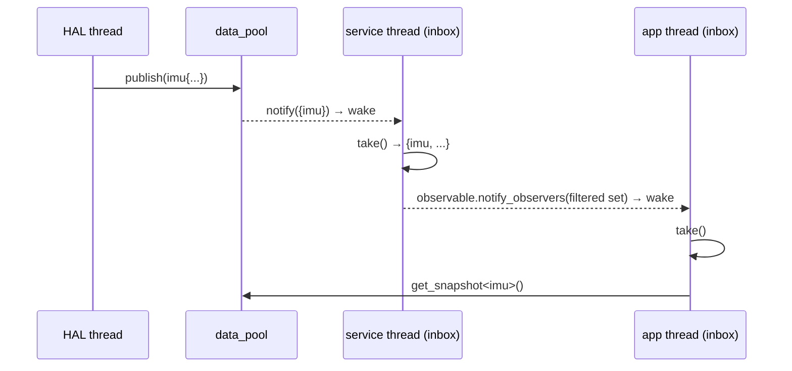

# DataPool

## Overview

`castle_ext::data::data_pool<MaxObservers, Entries...>` is the shared data layer between HAL producers and service/application consumers. It stores the latest value of every type in a compile-time type set, one [`data_slot`](data_slot.md) per type, and reports which types changed through [`update_set`](update_set.md) notifications.

Producers copy a value into the pool once. Consumers learn only *which* types changed and read just those types through zero-copy [`snapshot`](data_slot.md)s. A large structure is never copied per consumer or per layer.



The service owns the pool, hands it to the HAL (as `data_pool&`) and to the applications (as `const data_pool&`, read-only), and registers its own inbox as a pool observer. Application inboxes are attached to a `castle::patterns::observable<pool_type::observer_type, N>` owned by the service.

## Header

`#include "castle_ext/data/data_pool.hpp"`

## Dependencies

- [`castle/core/compiler.hpp`](../../../include/castle/core/compiler.hpp)
- [`castle/core/traits.hpp`](../../../include/castle/core/traits.hpp)
- [`castle/core/types.hpp`](../../../include/castle/core/types.hpp)
- [`castle/patterns/observer.hpp`](../../patterns/observer.md)
- [`castle/core/status.hpp`](../../../include/castle/core/status.hpp)
- [`castle/utility/tuple.hpp`](../../utility/tuple.md)
- [`castle_ext/data/data_slot.hpp`](data_slot.md)
- [`castle_ext/data/update_inbox.hpp`](update_inbox.md)
- [`castle_ext/data/update_dispatcher.hpp`](update_dispatcher.md)
- [`castle_ext/data/update_set.hpp`](update_set.md)

## Public API

| API | Description |
|---|---|
| `data_pool<MaxObservers, Entries...>` | Each entry is either `T` (stored as `data_slot<T>`, one held old snapshot) or `data_slot<T, MaxReaders>` (snapshot buffers sized per type). Value types must be unique. |
| `update_set_type` | `update_set<T...>` over the value types, in declaration order. |
| `observer_type` | `castle::patterns::observer<update_set_type>`. |
| `inbox_type` | `update_inbox<T...>`: a ready-made, thread-safe observer for one consumer thread. |
| `dispatcher_type` | `update_dispatcher<T...>`: observer that calls one bound callback per changed type, in the publisher's context. |
| `data_pool()` | Every slot holds a default-constructed value with generation 0. |
| `add_observer(observer_type*)` | Registers an observer. Returns `false` for `nullptr`, a duplicate, or when `MaxObservers` observers are already registered. |
| `remove_observer(observer_type*)` | Unregisters an observer. Returns `false` if it was not registered. |
| `publish(const T& value)` | Stores `value` as the latest `T` (deduced). On `status::ok`, notifies every observer with `update_set_type::of<T>()`. Otherwise returns the `data_slot::publish()` status (`full`, `data_loss`) and notifies nobody. |
| `get_snapshot<T>() const` | Returns a zero-copy `snapshot<T>` of the latest value. Wait-free. |

Using a type that is not in the pool causes a `static_assert` failure.

## Usage Example

See [`samples/castle_ext/data/data_pool.cpp`](../../../samples/castle_ext/data/data_pool.cpp) for a complete HAL / service / application setup.

```cpp
using sensor_pool = castle_ext::data::data_pool<
    1U,                                          // observers: the service inbox
    imu_sample,
    castle_ext::data::data_slot<gnss_fix, 2U>,   // two readers may hold old fixes
    battery_state>;

sensor_pool pool;
sensor_pool::inbox_type service_inbox{[&]() noexcept { (void)service_wake.release(); }};
pool.add_observer(&service_inbox);

// HAL thread
(void)pool.publish(imu_sample{9.81F});

// Service thread
const sensor_pool::update_set_type changed = service_inbox.take();
app_observable.notify_observers(changed & sensor_pool::update_set_type::of<imu_sample, gnss_fix>());

// Application thread (holds const sensor_pool&)
if (app_inbox.take().contains<imu_sample>())
{
    const castle_ext::data::snapshot<imu_sample> sample = pool.get_snapshot<imu_sample>();
    use(sample->accel_z);
}
```

## Constraints & Notes

- **Storage:** fully static, a `castle::tuple` of `data_slot`s plus a `castle::patterns::observable` with `MaxObservers` pointers. No heap, no RTTI, and no runtime type lookup: the slot for each type is selected at compile time.
- **Threads:** each type has one writer at a time; an overlapping `publish()` of the same type returns `status::data_loss`. Different types can be published concurrently from different threads. Any number of threads can call `get_snapshot()`.
- **Observers:** `publish()` notifies observers synchronously in the publisher's context, through the virtual call of `castle::patterns::observer`. Observers must be short and thread-safe; `inbox_type` only performs an atomic OR and an optional wake hook, while `dispatcher_type` runs its bound callbacks, which inherit the same requirement. Register and unregister observers before producers start publishing, because the observer list is not synchronized.
- **Coalescing:** consumers see the latest value of each changed type; intermediate values published between two reads are skipped by design. Use a queue for data where every sample matters.
- **Back-pressure:** `status::full` means readers hold more old snapshots of that type than its `MaxReaders`. Increase `MaxReaders` for that entry, or release snapshots sooner.
- **Initial state:** `get_snapshot<T>().generation() == 0` means nothing has been published for `T` yet.
- **Lifetime:** the pool cannot be copied or moved. Snapshots and attached observers must not outlive it.
