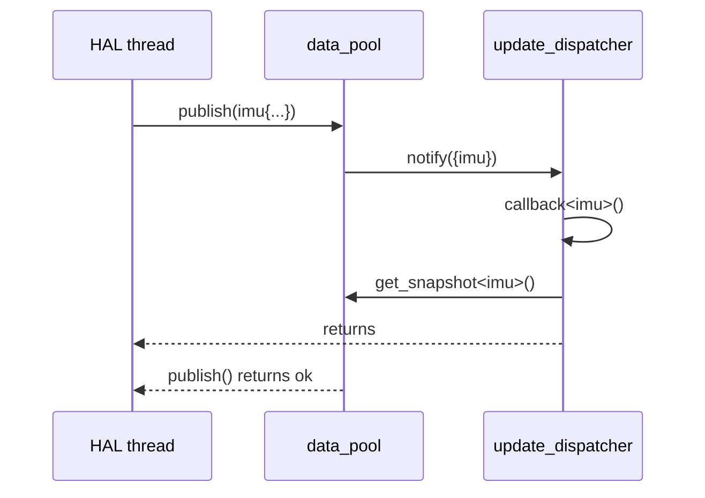

# UpdateDispatcher

## Overview

`castle_ext::data::update_dispatcher<Ts...>` is the push-style receiving end of data-layer notifications. Like [`update_inbox`](update_inbox.md), it implements `castle::patterns::observer<update_set<Ts...>>`, so it can be attached to a [`data_pool`](data_pool.md) (as `pool_type::dispatcher_type`) or to any `castle::patterns::observable` that forwards update sets.

It records nothing. Each type has its own `castle::callbacks::function<void()>` slot. `notify()` calls the callback of every type in the incoming set, directly, in the notifier's context. The callback knows its type from the binding and reads the latest value from the pool itself with `get_snapshot<T>()`. Types without a callback are ignored.



| | `update_inbox` | `update_dispatcher` |
|---|---|---|
| Delivery | Pull: consumer thread calls `take()` | Push: callback per type inside `notify()` |
| Consumer code runs in | Consumer thread | Publisher's context (HAL thread, ISR-deferred task) |
| Coalescing | Yes, until the next `take()` | No: one call per notification |
| State | Atomic pending bits | None besides the callback table |
| Suits | Consumers with their own thread | Short reactions: event-flag set, queue push, counters, watchdog kick, forwarding to an RTOS message queue |

## Header

`#include "castle_ext/data/update_dispatcher.hpp"`

## Dependencies

- [`castle/core/compiler.hpp`](../../../include/castle/core/compiler.hpp)
- [`castle/core/traits.hpp`](../../../include/castle/core/traits.hpp)
- [`castle/core/types.hpp`](../../../include/castle/core/types.hpp)
- [`castle/callbacks/function.hpp`](../../callbacks/function.md)
- [`castle/patterns/observer.hpp`](../../patterns/observer.md)
- [`castle/utility/move.hpp`](../../../include/castle/utility/move.hpp)
- [`castle/utility/tuple.hpp`](../../utility/tuple.md)
- [`castle_ext/data/update_set.hpp`](update_set.md)

## Public API

| API | Description |
|---|---|
| `update_dispatcher<Ts...>` | Dispatcher for `update_set<Ts...>`; `final`, derives from `observer<update_set<Ts...>>`. Not copyable. |
| `set_type` | `update_set<Ts...>`. |
| `callback_type` | `castle::callbacks::function<void()>`. |
| `update_dispatcher()` | No callback bound; every notification is ignored. |
| `bind<T>(callback_type callback)` | Binds or replaces the callback of `T`; `nullptr` clears it. Not synchronized; call before the dispatcher is attached. Naming a type outside `Ts...` fails to compile. |
| `is_bound<T>()` | Returns whether a callback is bound to `T`. |
| `notify(const set_type& updates)` | Calls the bound callback of every type in `updates`, in declaration order of `Ts...`. Overrides `observer::notify`. |

## Usage Example

See [`samples/castle_ext/data/update_dispatcher.cpp`](../../../samples/castle_ext/data/update_dispatcher.cpp).

```cpp
sensor_pool pool;
sensor_pool::dispatcher_type dispatcher;

dispatcher.bind<imu_sample>([&pool, &events]() noexcept
{
    if (pool.get_snapshot<imu_sample>()->accel_z > 40.0F)
    {
        events.post(event::impact);      // short, thread-safe hand-off
    }
});
dispatcher.bind<gnss_fix>([&gnss_ready]() noexcept
{
    (void)gnss_ready.release();          // wake the thread that reads the fix
});
pool.add_observer(&dispatcher);

// HAL thread: the matching callback runs before publish() returns.
(void)pool.publish(imu_sample{9.81F});
```

## Constraints & Notes

- **Context.** Callbacks run synchronously in the publisher's context and extend `publish()` by their run time. Keep them short, non-blocking and thread-safe. This is the trade-off the [README](README.md#12-anti-pattern-c-callback-table-between-hal-and-service) warns about for C callback tables; use it where an immediate reaction is the requirement, and prefer `update_inbox` when the work belongs on a consumer thread.
- **Concurrency.** Callbacks of different types can run at the same time when different threads publish them. With the pool's one-writer-per-type rule, the pool never re-enters the callback of one type. State shared between callbacks needs atomics or other synchronization.
- **No coalescing.** Every successful `publish()` of a bound type produces one call. Because the snapshot is read inside the call, it normally returns the value that triggered it; if the producer publishes again before the read, the callback sees the newer value.
- **Re-entrancy.** A callback may read any type from the pool. Publishing from a callback notifies every observer again, recursively, in the same context; avoid it or bound the recursion.
- **Wiring.** `bind()` and the pool's observer list are not synchronized. Bind every callback and attach the dispatcher before producers start publishing. Do not destroy the dispatcher, or objects its callbacks capture, while it is attached.
- **Storage.** One `callback_type` per type of `Ts...`; with the default `castle::inplace_storage_reserved` (8 machine words) each slot is 8 words of capture storage plus 4 function pointers. A capture larger than that fails to compile.
- **Cost.** `notify()` tests `sizeof...(Ts)` bits and makes one indirect call per bound type in the set. No locks, no allocation.
