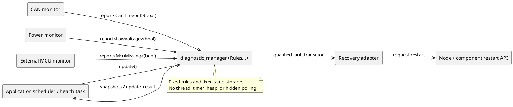
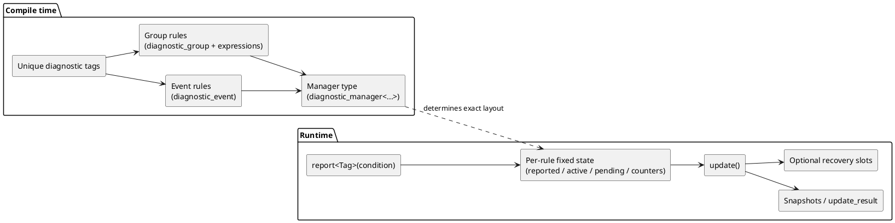
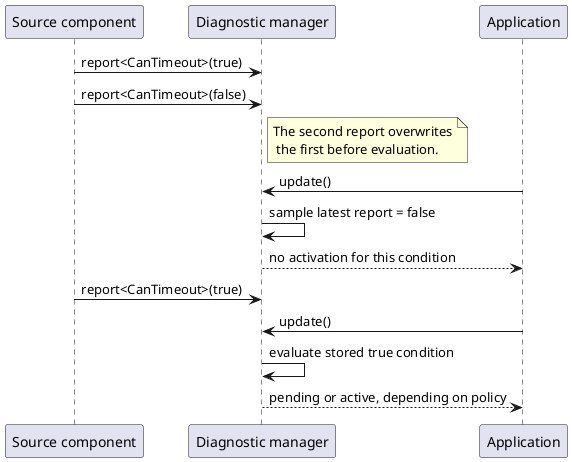
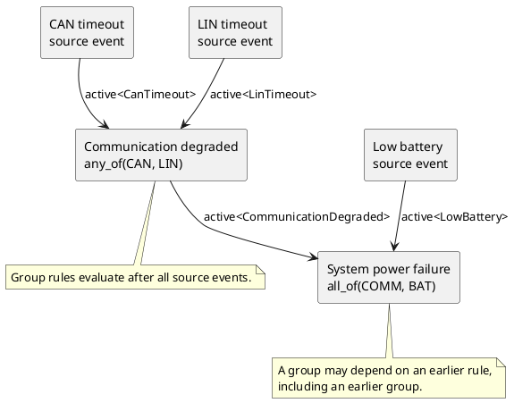
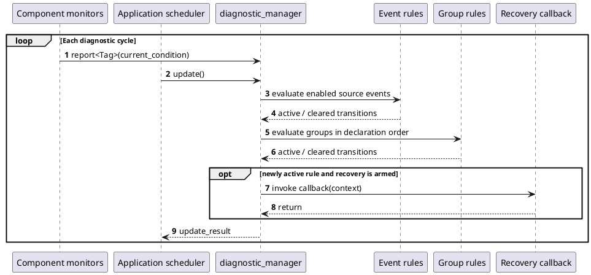
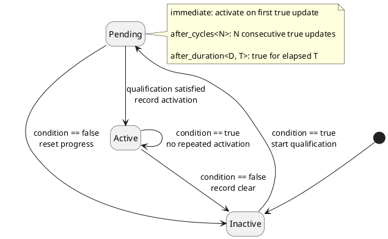
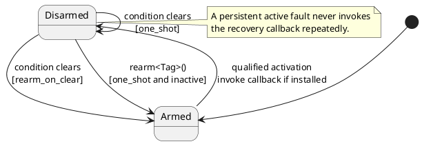
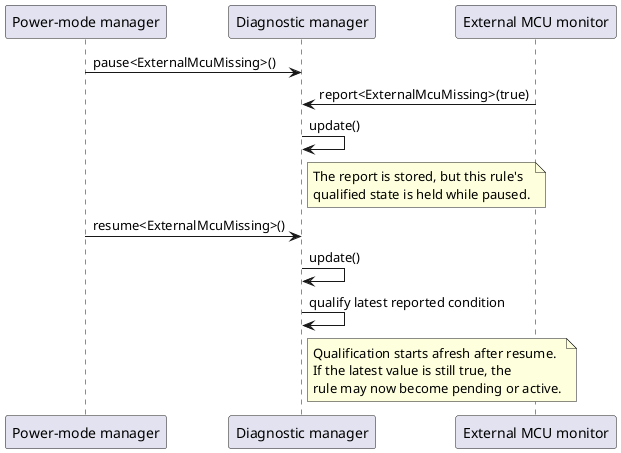

# CASTLE Common Diagnostics Module

## 1. Introduction

The CASTLE common diagnostics module provides a small, deterministic way to collect health information from independent software components, qualify fault conditions, combine related faults, and request recovery actions.

In an embedded system, a fault is not always a single instantaneous event. A communication timeout may need to persist for a configured period before it is considered a real failure. A low-voltage indication may need to be observed for several diagnostic cycles to avoid reacting to a short transient. A system-level failure may only exist when multiple lower-level faults occur together. Monitoring may also need to be suspended while a subsystem is intentionally unavailable, such as when an external MCU is placed into a low-power mode.

The module addresses these problems through a **compile-time rule configuration** and a **centrally polled runtime evaluator**. Components report their current fault conditions; the manager evaluates the configured rules at the application's chosen diagnostic cadence.

The module is deliberately independent of a particular ECU, network, sensor, operating system, or recovery strategy. It does not know how to read a CAN controller, inspect a voltage sensor, restart a node, or schedule a task. Those responsibilities remain with the application and its components.

### 1.1 Design goals

- **Fixed configuration:** all diagnostic rules and their relationships are declared in the manager's template arguments.
- **Deterministic resource usage:** one fixed state record is stored per configured rule; the manager never grows at runtime.
- **No dynamic allocation:** no heap, owning type-erased callback storage, or runtime registration container is used.
- **Explicit execution:** the application controls when `update()` executes; there are no hidden threads, timers, or background tasks.
- **Composable diagnostics:** a group can combine the qualified state of other diagnostics with Boolean expressions.
- **Controlled recovery:** a recovery callback is invoked on a transition into a qualified failure, not on every update while that failure remains active.
- **Monitor control:** individual rules or the complete manager can be paused and resumed.
- **Testability:** an explicit steady-clock time point can be supplied to `update()` for deterministic tests.

### 1.2 The central idea

Think of the module as three layers:

1. **Sources** observe hardware or software behavior and translate it into Boolean fault conditions.
2. **Diagnostic rules** qualify those conditions and optionally combine already-qualified diagnostics into higher-level faults.
3. **The application** schedules evaluation, reads diagnostic state, and decides how recovery requests are carried out.

A source does not call a recovery action directly. It only reports its condition. This keeps fault detection separate from fault policy and makes it possible to change qualification, grouping, or recovery behavior without rewriting the source component.

## 2. Header and dependencies

### Header

```cpp
#include "castle_ext/diag/diagnostic_manager.hpp"
```

### Dependencies

- [`castle/chrono/clocks.hpp`](../../../include/castle/chrono/clocks.hpp) — Castle `steady_clock` and time-point support.
- [`castle/core/compiler.hpp`](../../../include/castle/core/compiler.hpp) — compiler and `noexcept` portability macros.
- [`castle/core/traits.hpp`](../../../include/castle/core/traits.hpp) — compile-time callable and type traits.
- [`castle/core/types.hpp`](../../../include/castle/core/types.hpp) — Castle fixed-width and size types.
- [`castle/error/status.hpp`](../../../include/castle/error/status.hpp) — status return values.
- [`castle/utility/tuple.hpp`](../../../include/castle/utility/tuple.hpp) — fixed-size heterogeneous state storage.

The simplified CASTLE core snapshot used with this component also includes small implementations of `castle/math/gcd.hpp`, `castle/math/lcm.hpp`, and `castle/math/ratio.hpp`, which are required by its existing chrono headers.

## 3. Architecture and operating model

### 3.1 Component architecture

The manager is the central evaluator, not the owner of the monitored hardware or software. Each component reports a Boolean condition using the tag assigned to its source event. The application calls `update()` periodically. Optional recovery callbacks are associated with individual events or groups.



A practical recovery callback should usually **request** a recovery operation rather than perform a long or blocking restart sequence inside `update()`. For example, it can set a flag or enqueue a request into an application-owned fixed-capacity mechanism. The application can then execute the actual recovery procedure in the appropriate task or state machine.

### 3.2 Configuration versus runtime

The rule topology is fixed at compile time. Runtime code only updates the current raw reports and the state associated with those rules.



For example, a manager configured with four events and two groups always contains exactly six rule-state records. There is no runtime `add_event()` operation and no unbounded list of registered diagnostics.

### 3.3 The reporting model is level-based

`report<Tag>(condition)` stores the **latest Boolean condition** for a source event. It does not append an item to an event queue and does not preserve every transition.

- `true` means the source currently reports that its fault condition is present.
- `false` means the source currently reports that its fault condition is absent.
- Multiple calls to `report<Tag>()` before `update()` are coalesced; the last value wins.
- If no new report is submitted, the last reported value remains stored and is sampled again by subsequent calls to `update()`.
- A group does not accept reports. Its condition is derived from the qualified states of other rules.

This level-based model is suitable for periodic health monitoring. It is not intended to be an edge-event recorder. A transient that occurs and clears entirely between two diagnostic updates may not be observed unless the source component latches it and reports the latched condition.



## 4. Diagnostic rule types

All public types are in the `castle::diag` namespace.

### 4.1 Source event: `diagnostic_event`

A source event represents a fault condition reported by a component.

```cpp
struct can_timeout_tag {};

using can_timeout_rule = castle::diag::diagnostic_event<
    can_timeout_tag,
    castle::diag::after_duration<castle::chrono::milliseconds, 250>>;
```

Template parameters:

```cpp
diagnostic_event<Tag, Qualification = immediate, Rearm = rearm_on_clear>
```

- `Tag` is a unique type used to address this diagnostic.
- `Qualification` determines when a continuously true condition becomes active.
- `Rearm` determines when the recovery slot becomes armed again after it has been used.

Only event rules can be targets of `report<Tag>()`.

### 4.2 Qualification policies

The qualification policy is applied by `update()`, not by `report()`.

| Policy | Behavior | Typical use |
|---|---|---|
| `immediate` | Activates on the first update that evaluates the condition as true. | Latched hardware fault, explicit component failure. |
| `after_cycles<N>` | Activates after `N` consecutive update evaluations return true. The first true evaluation counts as cycle one. A false evaluation resets progress. | Debouncing, repeated missed-message checks, stable status confirmation. |
| `after_duration<Duration, Count>` | Activates after the condition remains true continuously for the configured duration. | Communication timeout, watchdog deadline, stale-data detection. |

Duration example:

```cpp
castle::diag::after_duration<castle::chrono::milliseconds, 500>
```

The condition must remain true from the first qualifying update until the elapsed steady-clock time reaches 500 milliseconds. A false evaluation clears the pending qualification. The manager uses Castle's `steady_clock`, which is monotonic; the explicit-time overload requires timestamps from the same monotonic time base.

`after_cycles<N>` counts calls to `update()` while the stored condition is true. It does not count calls to `report()`. The application should therefore choose a known diagnostic cadence when cycle-based thresholds are used.

### 4.3 Composite rule: `diagnostic_group`

A group derives a fault condition from other diagnostic states. It uses the same qualification and recovery policies as a source event.

```cpp
diagnostic_group<Tag, Expression,
                 Qualification = immediate,
                 Rearm = rearm_on_clear>
```

The supported expressions are:

- `active<Tag>` — true when the referenced diagnostic is currently qualified and active.
- `all_of<A, B, ...>` — true only when every child expression is true.
- `any_of<A, B, ...>` — true when at least one child expression is true.
- `not_<A>` — logical negation of one child expression.

Example: declare a system-level fault when communication is degraded **and** the battery is low.

```cpp
struct can_timeout_tag {};
struct lin_timeout_tag {};
struct low_battery_tag {};
struct communication_degraded_tag {};
struct system_power_failure_tag {};

using diagnostics = castle::diag::diagnostic_manager<
    castle::diag::diagnostic_event<can_timeout_tag>,
    castle::diag::diagnostic_event<lin_timeout_tag>,
    castle::diag::diagnostic_event<low_battery_tag>,
    castle::diag::diagnostic_group<
        communication_degraded_tag,
        castle::diag::any_of<
            castle::diag::active<can_timeout_tag>,
            castle::diag::active<lin_timeout_tag>>>,
    castle::diag::diagnostic_group<
        system_power_failure_tag,
        castle::diag::all_of<
            castle::diag::active<communication_degraded_tag>,
            castle::diag::active<low_battery_tag>>>>;
```

The dependency must be declared before the group that uses it. This is checked at compile time. The manager processes all source events first, then processes groups in declaration order. This permits a group to depend on a previously declared group, forming a diagnostic chain without a runtime graph traversal.



**Important when using `not_`:** expressions describe the fault condition, not the healthy condition. Since a diagnostic is inactive at startup, `not_<active<SomeTag>>` is true at startup. A group containing only that negation can therefore activate immediately. Usually pair a negative condition with positive evidence, for example `all_of<active<PrimaryFault>, not_<active<ConflictingFault>>>`, or ensure the source state is initialized appropriately by application design.

## 5. How an update works

The application owns the schedule. A typical integration calls `update()` from a periodic health-monitor task or from the main loop at a known cadence.

For each enabled rule, the manager:

1. Reads the current raw Boolean value for a source event, or evaluates a group's Boolean expression.
2. Resets pending qualification if the condition is false.
3. Starts qualification timing on the first true evaluation if the rule was not already pending.
4. Advances the cycle count and checks the selected qualification policy.
5. On qualification, changes the rule from inactive to active and records the transition.
6. Invokes an armed recovery callback, if one is installed, and disarms that recovery slot for the current failure episode.
7. On a later false evaluation, clears an active rule and applies its configured re-arm policy.

The evaluation order is significant:

- Every enabled `diagnostic_event` is evaluated first.
- Every enabled `diagnostic_group` is then evaluated in declaration order.
- Groups see the current qualified state of source events and any earlier groups evaluated during the same update.



### 5.1 Qualification and activation state

Each rule has a simple qualification lifecycle. A true condition starts or continues a pending qualification. A false condition resets pending progress and clears an active rule. Once active, further true evaluations do not create new activation transitions.



This state machine describes qualification only. Monitoring enable/disable and recovery arming are separate controls, described below.

### 5.2 Result and snapshot data

`update()` returns an `update_result` with:

- `activated` — number of diagnostics that became active during this update, including groups.
- `cleared` — number of diagnostics that became inactive during this update, including groups.
- `recoveries_executed` — number of non-null recovery callbacks actually invoked during this update.

Use `get_state<Tag>()` to obtain a `diagnostic_snapshot` containing:

- `reported` — last raw report; meaningful for source events and always false for groups.
- `active` — qualified fault state.
- `pending` — a true condition is being qualified but has not activated yet.
- `enabled` — effective enable state, considering both local and global pause.
- `recovery_armed` — whether the recovery slot is armed for a future activation.
- `consecutive_samples` — current qualification sample count.
- `activation_count` and `clear_count` — saturated transition counters.
- `last_transition` — steady-clock time point of the most recent activation or clear.

The query helpers `is_active<Tag>()`, `is_pending<Tag>()`, and `is_enabled<Tag>()` are convenient when a full snapshot is not required.

## 6. Recovery actions

A recovery callback is associated with an event or group tag using `set_recovery<Tag>()`. The manager invokes it only when that diagnostic transitions from inactive to active and its recovery slot is armed.

### 6.1 One action per failure episode

The recovery slot is disarmed when an activation occurs. The manager does not invoke the callback again while the same diagnostic remains active, even if `update()` is called many times.

With the default `rearm_on_clear` policy, clearing the diagnostic automatically re-arms the recovery slot. A later, separate failure episode can therefore invoke the callback again.

With `one_shot`, clearing the diagnostic does not automatically re-arm the slot. The application must call `rearm<Tag>()` while the diagnostic is inactive. Calling it while the diagnostic is still active returns `castle::status::invalid_argument`.



A subtle but important behavior: an armed slot is disarmed on activation **even if no callback is currently installed**. Installing a callback later while the diagnostic is already active does not cause a late invocation. Configure recovery callbacks during initialization, before monitoring starts.

### 6.2 Callback forms

The manager supports two allocation-free forms.

**Function pointer and context pointer** — useful for C-style embedded interfaces:

```cpp
void request_node_restart(void* context) noexcept
{
    bool* restart_requested = static_cast<bool*>(context);
    *restart_requested = true;
}

bool restart_requested = false;
diag.set_recovery<system_failure_tag>(
    &request_node_restart,
    &restart_requested);
```

**Lvalue callable** — useful for a small lambda or function object:

```cpp
bool restart_requested = false;
auto request_restart = [&restart_requested]() noexcept
{
    restart_requested = true;
};

diag.set_recovery<system_failure_tag>(request_restart);
```

Both forms are **non-owning**:

- The callable object or context must remain alive for as long as the manager may invoke it.
- Temporary callable objects are not accepted by the lvalue-callable overload.
- The callback must be `noexcept`.
- `clear_recovery<Tag>()` removes the callback binding without changing the diagnostic's active state.

Keep callback execution short and deterministic. Avoid blocking operations, unbounded loops, or direct long-duration restart sequences from inside `update()`.

## 7. Pausing and resuming monitoring

A monitor may need to be disabled temporarily without interpreting an expected absence of activity as a fault. For example, an external MCU may intentionally stop transmitting while the main ECU is in a low-power mode.

The manager offers local and global control:

```cpp
diag.pause<external_mcu_missing_tag>();
diag.resume<external_mcu_missing_tag>();

diag.pause();   // pause all rules
diag.resume(); // resume all rules
```

### 7.1 Per-rule pause

While one rule is paused:

- The rule does not qualify a new failure or clear an existing failure.
- Its currently confirmed active/inactive state is held.
- Any pending qualification progress is discarded.
- `report<Tag>()` can still update the raw source value.
- On resume, qualification starts afresh using the latest stored report (or current dependency states for a group).

A dependent group continues to see the paused rule's held qualified state. For example, if a paused source was active before it was paused, groups continue to see it as active until it is resumed and subsequently clears.

### 7.2 Global pause

When the manager is globally paused:

- `report<Tag>()` calls are still accepted and update the stored source value.
- `update()` returns an all-zero result without evaluating any rule.
- Confirmed states are held.
- Pending qualification progress for all rules is discarded.
- After global resume, the next `update()` evaluates the latest source reports and begins fresh qualification where needed.

A global pause does not overwrite local enable settings. If a particular rule was locally paused before the global pause, it remains locally paused after global resume.



Pause is a monitoring control, not an acknowledgement or a fault clear. Do not use pause to hide a fault that should remain visible to the system. Use it only when the monitored condition is intentionally not meaningful for the current operating mode.

## 8. Common usage scenarios

### 8.1 Debounce a noisy status

Use `after_cycles<N>` when the application has a stable diagnostic update cadence and a fault must be observed repeatedly.

```cpp
struct sensor_invalid_tag {};

using sensor_diagnostics = castle::diag::diagnostic_manager<
    castle::diag::diagnostic_event<
        sensor_invalid_tag,
        castle::diag::after_cycles<3U>>>;

sensor_diagnostics diag;

diag.report<sensor_invalid_tag>(sensor_value_is_invalid);
const auto result = diag.update();
```

Three consecutive `update()` evaluations with the stored condition true are required. A single false evaluation resets qualification to zero.

### 8.2 Detect a communication timeout

Use `after_duration` when the fault must persist for a real elapsed time rather than a number of polls.

```cpp
struct can_rx_timeout_tag {};

using communication_diagnostics = castle::diag::diagnostic_manager<
    castle::diag::diagnostic_event<
        can_rx_timeout_tag,
        castle::diag::after_duration<castle::chrono::milliseconds, 250>>>;

communication_diagnostics diag;
diag.report<can_rx_timeout_tag>(can_timeout_detected);
diag.update(); // Uses Castle steady_clock.
```

The diagnostic manager does not measure message arrival itself. A CAN monitor or communication stack must calculate or detect the timeout and report its current condition.

### 8.3 Combine several faults into a system-level condition

Use `all_of` and `any_of` to express combinations. This example declares communication degraded when either CAN or LIN is faulty, then declares a system power failure when communication is degraded at the same time as low battery.

```cpp
struct can_fault_tag {};
struct lin_fault_tag {};
struct low_battery_tag {};
struct communication_degraded_tag {};
struct system_power_failure_tag {};

using system_diagnostics = castle::diag::diagnostic_manager<
    castle::diag::diagnostic_event<can_fault_tag>,
    castle::diag::diagnostic_event<lin_fault_tag>,
    castle::diag::diagnostic_event<low_battery_tag>,
    castle::diag::diagnostic_group<
        communication_degraded_tag,
        castle::diag::any_of<
            castle::diag::active<can_fault_tag>,
            castle::diag::active<lin_fault_tag>>>,
    castle::diag::diagnostic_group<
        system_power_failure_tag,
        castle::diag::all_of<
            castle::diag::active<communication_degraded_tag>,
            castle::diag::active<low_battery_tag>>>>;
```

Attach a recovery callback to either a leaf event or a composite group depending on the desired policy. For example, restarting an individual peripheral may belong to its event, while requesting a whole-node restart may belong to a system-level group.

### 8.4 Suppress a heartbeat timeout during intentional low-power mode

The application should pause only the diagnostic whose source is expected to go silent. Other diagnostics can continue running.

```cpp
// Entering a mode in which the external MCU is allowed to sleep.
diag.pause<external_mcu_missing_tag>();

// ... low-power operation ...

// Leaving that mode; qualification starts from fresh progress.
diag.resume<external_mcu_missing_tag>();
```

If the raw report remains `true` while paused, the next update after resume will start qualifying the fault. If the monitor can determine that the external MCU has resumed and is healthy, it should report `false` before or after resuming according to the application's sequencing requirements.

### 8.5 Request one restart per failure episode

The default recovery policy is usually appropriate for a restart request that may be retried for a future, separate fault episode.

```cpp
struct watchdog_failure_tag {};
struct node_restart_tag {};

using watchdog_diagnostics = castle::diag::diagnostic_manager<
    castle::diag::diagnostic_event<watchdog_failure_tag>,
    castle::diag::diagnostic_group<
        node_restart_tag,
        castle::diag::all_of<
            castle::diag::active<watchdog_failure_tag>>>>;

bool restart_requested = false;
auto request_restart = [&restart_requested]() noexcept
{
    restart_requested = true;
};

watchdog_diagnostics diag;
diag.set_recovery<node_restart_tag>(request_restart);
```

The callback is invoked once when `node_restart_tag` first becomes active. A continuously active watchdog failure does not repeatedly invoke it. Once the group clears, the default `rearm_on_clear` policy makes the callback eligible for the next activation.

For a strict one-shot action, use `diagnostic_event<Tag, Qualification, one_shot>` or `diagnostic_group<Tag, Expression, Qualification, one_shot>`, and call `rearm<Tag>()` explicitly after the diagnostic has cleared and the application is ready to permit another action.

## 9. Complete example

The following compact example combines a time-qualified communication timeout, a cycle-qualified low-battery event, two composite rules, and a recovery callback.

```cpp
#include "castle_ext/diag/diagnostic_manager.hpp"

struct can_timeout_tag {};
struct low_battery_tag {};
struct communication_degraded_tag {};
struct system_restart_tag {};

using diagnostics_type = castle::diag::diagnostic_manager<
    castle::diag::diagnostic_event<
        can_timeout_tag,
        castle::diag::after_duration<castle::chrono::milliseconds, 250>>,
    castle::diag::diagnostic_event<
        low_battery_tag,
        castle::diag::after_cycles<3U>>,
    castle::diag::diagnostic_group<
        communication_degraded_tag,
        castle::diag::active<can_timeout_tag>>,
    castle::diag::diagnostic_group<
        system_restart_tag,
        castle::diag::all_of<
            castle::diag::active<communication_degraded_tag>,
            castle::diag::active<low_battery_tag>>>>;

int main()
{
    diagnostics_type diagnostics;
    bool restart_requested = false;
    auto request_restart = [&restart_requested]() noexcept
    {
        restart_requested = true;
    };
    diagnostics.set_recovery<system_restart_tag>(request_restart);

    diagnostics.report<can_timeout_tag>(true);
    diagnostics.report<low_battery_tag>(true);

    // Call update() from the application's periodic diagnostic task.
    // Once the CAN timeout has persisted for 250 ms and low battery has
    // been observed on three update cycles, system_restart_tag activates.
    const castle::diag::update_result result = diagnostics.update();
    (void)result;

    // The application handles the request in its own execution context.
    if (restart_requested)
    {
        // Schedule or perform the platform-specific restart procedure here.
    }

    return 0;
}
```

The example uses `update()` for simplicity. For deterministic unit tests, prefer `update(time_point)` and explicitly advance a time point from the manager's `time_point` and `duration` aliases.

A broader sample that demonstrates groups, pause/resume, recovery re-arming, snapshots, and explicit timestamps is available at [`samples/castle_ext/diag/diagnostic_manager.cpp`](../../../samples/castle_ext/diag/diagnostic_manager.cpp).

## 10. Public API reference

| API | Purpose |
|---|---|
| `immediate` | Immediate qualification policy. |
| `after_cycles<N>` | Consecutive update-cycle qualification policy. `N` must be greater than zero. |
| `after_duration<Duration, Count>` | Elapsed-time qualification policy. `Count` must be non-negative. |
| `rearm_on_clear` | Automatically re-arm recovery when a fault clears. |
| `one_shot` | Require explicit re-arming after a fault clears. |
| `diagnostic_event<Tag, Qualification, Rearm>` | Declare a source event. |
| `active<Tag>` | Reference a diagnostic's qualified active state in an expression. |
| `all_of<...>` / `any_of<...>` / `not_<...>` | Compose Boolean expressions. |
| `diagnostic_group<Tag, Expression, Qualification, Rearm>` | Declare a composite diagnostic. |
| `diagnostic_manager<Rules...>` | Own the fixed diagnostic state and evaluate rules. |
| `report<Tag>(bool)` | Store a source event's latest raw condition. |
| `set_recovery<Tag>(callback, context)` | Bind a `noexcept` function pointer and user-owned context. |
| `set_recovery<Tag>(callable)` | Bind a non-owning lvalue callable with a `noexcept` nullary call operator. |
| `clear_recovery<Tag>()` | Remove a recovery callback binding. |
| `pause<Tag>()` / `resume<Tag>()` | Pause or resume one rule. |
| `pause()` / `resume()` | Pause or resume the complete manager. |
| `rearm<Tag>()` | Re-arm a `one_shot` slot while the diagnostic is inactive. |
| `is_active<Tag>()` | Query whether a diagnostic is qualified and active. |
| `is_pending<Tag>()` | Query whether qualification is in progress. |
| `is_enabled<Tag>()` | Query the effective enable state. |
| `get_state<Tag>()` | Obtain a `diagnostic_snapshot`. |
| `update()` | Evaluate all enabled rules using Castle steady clock. |
| `update(time_point)` | Evaluate all enabled rules at an explicit steady-clock timestamp. |
| `rule_count` | Compile-time number of configured rules. |
| `update_result` | Per-update activation, clear, and recovery counts. |
| `diagnostic_snapshot` | Read-only view of one rule's state and counters. |

All tag-based APIs require the tag to be configured exactly once in that manager. Invalid tag use and invalid group dependency order are compile-time errors. `report<Tag>()` is valid only for `diagnostic_event` rules, not groups.

## 11. Constraints, integration notes, and best practices

### 11.1 Determinism and complexity

- Rule types and count are fixed at compile time.
- State is stored in a fixed `castle::tuple`, with one monitor-state record per rule.
- There is no heap allocation, exception handling, RTTI, virtual dispatch, thread creation, or internal timer.
- One update is bounded by the number of configured rules plus the total number of nodes in the configured group expressions. Boolean expressions short-circuit.
- Transition and update counters use saturating increments rather than wrapping around.

### 11.2 Scheduling

- Call `update()` from a known application context and at a suitable cadence.
- `after_cycles<N>` is tied to the number of update calls, not wall-clock time.
- `after_duration` uses Castle `steady_clock`; it is not a count of scheduler ticks.
- The explicit-time overload expects timestamps sampled from one consistent monotonic time base. Supplying earlier timestamps than previous updates violates the intended steady-clock usage and can delay duration qualification.

### 11.3 Concurrency

The manager is not internally synchronized. The application must externally serialize calls that access or mutate the same manager, including `report()`, `update()`, `pause()`, `resume()`, recovery configuration, and state-changing operations. Do not call these concurrently from unsynchronized tasks or interrupt contexts.

### 11.4 Callback lifetime and execution

- The manager stores only a callback function pointer and a context pointer.
- The callable or context is owned by the application and must outlive every possible callback invocation.
- Recovery callbacks must be `noexcept` and should execute quickly.
- Prefer callbacks that set flags or issue bounded requests; perform complex recovery state machines outside the callback.
- Configure callbacks before a diagnostic can activate, because activation disarms the recovery slot even if no callback was installed.

### 11.5 Choosing the right rule

- Use an **event** when a component can directly report a fault condition.
- Use a **group** when system policy depends on combinations of qualified faults.
- Use **`after_cycles`** for stable-cycle/debounce semantics where the update cadence is known.
- Use **`after_duration`** for real elapsed-time requirements such as communication timeouts.
- Use **`pause<Tag>()`** when a specific monitor is intentionally irrelevant in a known operating mode.
- Use **global `pause()`** only when all diagnostic evaluation should be frozen.
- Use **`rearm_on_clear`** for one recovery action per fault episode; use **`one_shot`** when application policy must explicitly permit a later action.

### 11.6 What the module intentionally does not do

The common diagnostics module is not a complete diagnostic trouble code (DTC) manager, event logger, fault-memory persistence layer, OBD/UDS service implementation, watchdog, scheduler, or hardware abstraction layer. It does not assign DTC identifiers, store freeze-frame data, debounce raw electrical signals, detect network timeouts, or define platform-specific restart semantics. These can be implemented by surrounding components and connected through the small Boolean-report and recovery interfaces.

## 12. Related files

- Header: [`include/castle_ext/diag/diagnostic_manager.hpp`](../../../include/castle_ext/diag/diagnostic_manager.hpp)
- Header reference: [`diagnostic_manager.md`](diagnostic_manager.md)
- Sample: [`samples/castle_ext/diag/diagnostic_manager.cpp`](../../../samples/castle_ext/diag/diagnostic_manager.cpp)
- Tests: [`test/castle_ext/diag/diagnostic_manager.cpp`](../../../test/castle_ext/diag/diagnostic_manager.cpp)
