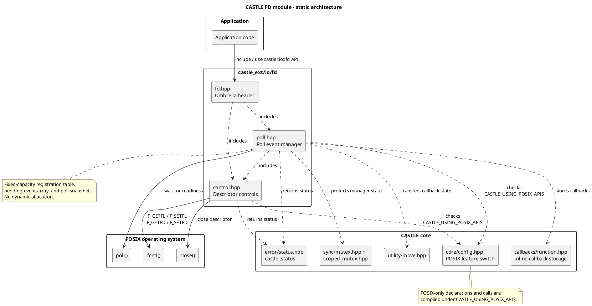
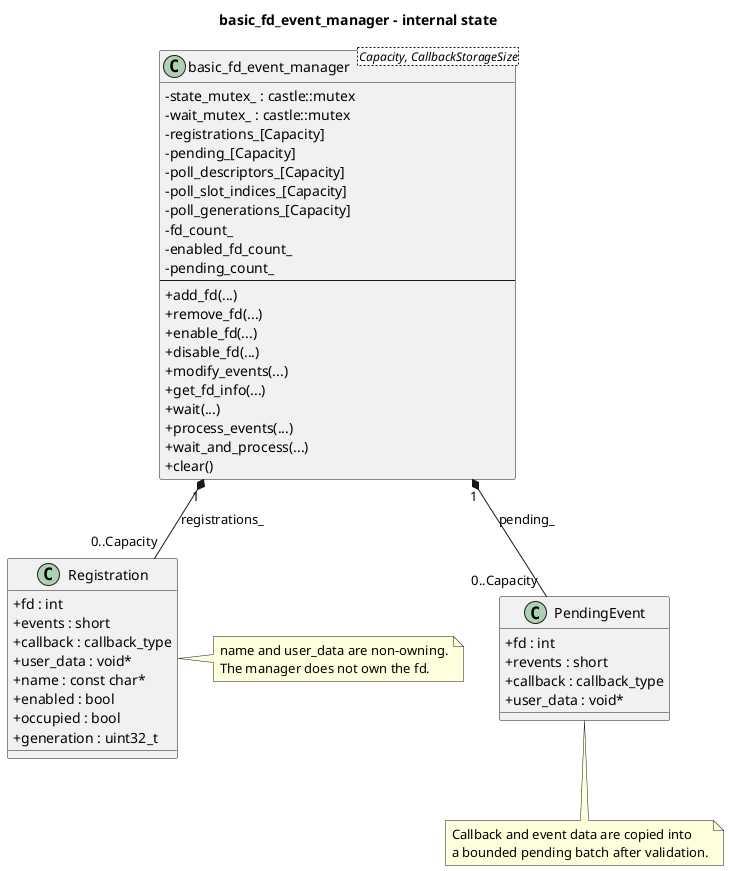
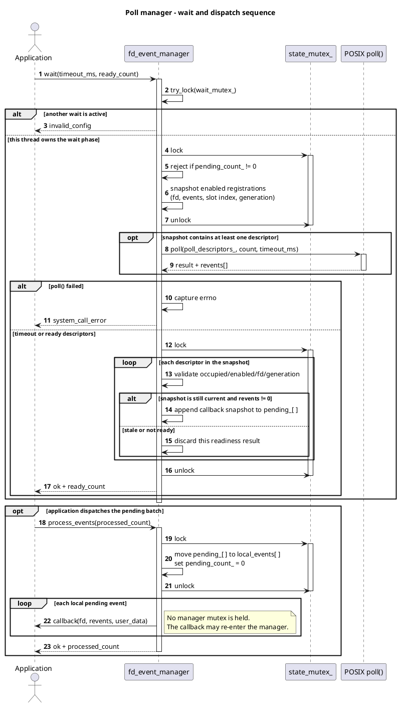

# CASTLE File Descriptor (FD) Module

## Overview

The `castle_ext/io/fd` module provides a small POSIX file-descriptor utility and event-dispatch layer for CASTLE applications. It is intended for embedded Linux and other POSIX environments where an application needs to configure descriptors and wait for I/O readiness without introducing dynamic allocation or an event-loop dependency.

The module is exposed in the `castle::io::fd` namespace and is split into two functional parts:

- **Descriptor controls (`control.hpp`)** — status-returning helpers around `fcntl()` and `close()`.
- **Descriptor owner and byte I/O (`descriptor.hpp`)** — move-only RAII ownership plus partial/exact read and write wrappers. They read and update file-status flags, toggle non-blocking mode, toggle close-on-exec, check whether a descriptor is valid, and close a descriptor.
- **Poll event manager (`poll.hpp`)** — a fixed-capacity manager that registers descriptors with a `poll()` interest mask and callback, waits for readiness, and dispatches callbacks in a separate phase.

The umbrella header, `fd.hpp`, includes both parts:

```cpp
#include "castle_ext/io/fd/fd.hpp"
```

The implementation follows CASTLE's resource constraints: registration and event storage are statically bounded by a template capacity, callbacks are stored in CASTLE's inline `callbacks::function` wrapper, and the module introduces no heap allocation, exceptions, RTTI, or virtual functions. POSIX declarations and system calls are included only when `CASTLE_USING_POSIX_APIS` is enabled in `castle/core/config.hpp`.

## Module Structure

```text
castle_ext/io/fd/
├── fd.hpp          # Umbrella include
├── control.hpp     # fcntl()/close() descriptor helpers
├── descriptor.hpp  # RAII descriptor owner and read/write helpers
└── poll.hpp        # Fixed-capacity poll() event manager
```

### Header responsibilities

| Header | Responsibility | Main public API |
|---|---|---|
| `control.hpp` | Descriptor flag control and close operations | `get_status_flags()`, `set_status_flags()`, `set_nonblocking()`, `set_blocking()`, `get_descriptor_flags()`, `set_descriptor_flags()`, `set_close_on_exec()`, `is_valid_fd()`, `close_fd()` |
| `descriptor.hpp` | Descriptor ownership and byte I/O | `basic_fd`, `open_fd()`, `read_fd()`, `write_fd()`, exact/all transfer helpers |
| `poll.hpp` | Readiness registration, waiting, and callback dispatch | `basic_fd_event_manager<Capacity, CallbackStorageSize>`, `fd_event_manager`, `poll_*` event constants |
| `fd.hpp` | Convenience include; adds no runtime state | Includes `control.hpp`, `descriptor.hpp` and `poll.hpp` |

All operational functions return `castle::status`. Descriptor-control operations optionally report the underlying system error through an `int* system_error` output parameter. The event manager also reports `errno` when its call to `poll()` fails.

## Architecture Design

### 1. Static module architecture

The application normally includes `fd.hpp`, or includes `control.hpp` / `poll.hpp` independently when only one facility is needed. The control layer delegates to POSIX descriptor operations. The poll manager uses CASTLE's callback and synchronization facilities while delegating readiness detection to POSIX `poll()`.



### 2. Poll manager internal design

`basic_fd_event_manager<Capacity, CallbackStorageSize>` owns a compile-time-sized set of internal arrays:

- **Registration table** — descriptor, requested event mask, callback, user-data pointer, optional name, enabled/occupied flags, and a generation counter.
- **Poll snapshot arrays** — `pollfd` entries plus the corresponding registration-slot index and generation captured for the current wait.
- **Pending-event array** — callback snapshots and the descriptor/readiness/user-data values to dispatch after the wait completes.

The default alias `fd_event_manager` is `basic_fd_event_manager<16U>`. Applications with different descriptor limits can instantiate `basic_fd_event_manager` with an explicit capacity. Each callback must fit the configured inline callback storage and be copy-constructible because the manager copies it into the pending dispatch batch.



### 3. Wait and dispatch lifecycle

The manager deliberately separates readiness detection from callback execution. This keeps application code out of the manager's critical sections and permits callbacks to call manager methods such as `add_fd()`, `remove_fd()`, `enable_fd()`, or `disable_fd()`.

1. `wait()` acquires `wait_mutex_` with `try_lock()`. If another wait is active, it returns `castle::status::invalid_config` rather than blocking behind that waiter.
2. Under `state_mutex_`, it rejects a new wait if a previous pending batch has not been processed. It then snapshots every occupied, enabled registration into the fixed `pollfd` arrays, recording the slot index and generation.
3. It releases `state_mutex_` before calling `poll()`. Registration changes can therefore proceed while the calling thread is blocked in the operating system.
4. After `poll()` returns, it reacquires `state_mutex_`. A readiness result is accepted only if the registration is still occupied and enabled and its descriptor and generation still match the snapshot. Stale readiness from a registration changed during the wait is discarded.
5. Accepted events are copied into the bounded pending-event array. `wait()` returns without invoking application callbacks.
6. `process_events()` moves the pending batch into a local fixed-size array while holding `state_mutex_`, clears the manager's pending count, releases the lock, and then invokes the callbacks.



`wait_and_process()` is the convenience operation that calls `wait()` and, when that succeeds, immediately calls `process_events()`. A timeout is a successful wait with no callbacks to process. If there are no enabled descriptors, `wait()` returns successfully with zero ready events without calling `poll()`.

## Thread-Safety and Event Semantics

### Locking model

| Internal lock | Protects | Held while `poll()` blocks? | Held while callbacks run? |
|---|---|---:|---:|
| `state_mutex_` | Registrations, counts, pending-event queue, and snapshot validation | No | No |
| `wait_mutex_` | Ensures only one active `wait()` per manager | Yes, for the duration of `wait()` | No; released when `wait()` returns |

The manager protects its own registration and pending-queue state. This does not make the underlying file descriptor or the objects referenced by `user_data` and `name` independently thread-safe.

### Generation validation versus queued callback snapshots

There are two distinct moments in the event lifecycle:

- **Before queuing:** a registration modified or removed while `poll()` is blocked has its generation incremented. When `poll()` returns, the snapshot no longer matches, so that readiness is ignored.
- **After queuing:** the callback and its arguments are a committed event snapshot. A later `remove_fd()`, `disable_fd()`, or `modify_events()` does not retract it. Use `clear()` to discard queued callbacks when necessary before closing a descriptor that a pending callback may reference.

`clear()` removes registrations and pending callbacks from the manager, but it does not close the registered descriptors. The manager's destructor calls `clear()`.

## Public API Summary

### Descriptor controls (`control.hpp`)

| Function | Description |
|---|---|
| `get_status_flags(fd, flags, system_error)` | Reads file status flags using `F_GETFL`. |
| `set_status_flags(fd, flags, system_error)` | Sets file status flags using `F_SETFL`. |
| `set_nonblocking(fd, enabled, system_error)` | Enables/disables `O_NONBLOCK` while preserving other status flags. |
| `set_blocking(fd, system_error)` | Convenience wrapper to disable `O_NONBLOCK`. |
| `get_descriptor_flags(fd, flags, system_error)` | Reads descriptor flags using `F_GETFD`. |
| `set_descriptor_flags(fd, flags, system_error)` | Sets descriptor flags using `F_SETFD`. |
| `set_close_on_exec(fd, enabled, system_error)` | Enables/disables `FD_CLOEXEC` while preserving other descriptor flags. |
| `is_valid_fd(fd)` | Checks whether `F_GETFD` succeeds. |
| `close_fd(fd, system_error)` | Calls `close()` once and reports its result. |

### Poll manager (`poll.hpp`)

| Function or type | Description |
|---|---|
| `basic_fd_event_manager<Capacity, CallbackStorageSize>` | Fixed-capacity event manager. `Capacity` must be greater than zero. |
| `fd_event_manager` | Alias for `basic_fd_event_manager<16U>`. |
| `add_fd(fd, events, callback, user_data, name)` | Adds a unique descriptor registration. |
| `remove_fd(fd)` | Removes the registration without closing the descriptor. |
| `enable_fd(fd)` / `disable_fd(fd)` | Enables or disables monitoring. |
| `modify_events(fd, events)` | Changes the `poll()` interest mask. |
| `has_fd(fd)` | Tests whether a descriptor is registered. |
| `get_fd_count()` / `get_enabled_fd_count()` | Returns total and enabled registration counts. |
| `get_fd_info(fd, info)` | Retrieves registration metadata without exposing its callback. |
| `wait(timeout_ms, ready_count, system_error)` | Waits for readiness and queues callbacks without invoking them. A negative timeout means infinite wait. |
| `process_events(processed_count)` / `process_events()` | Invokes and consumes the pending callback batch. |
| `wait_and_process(timeout_ms, processed_count, system_error)` | Combines one wait with callback dispatch. |
| `wait_and_process()` | Waits indefinitely and dispatches the resulting batch. |
| `pending_event_count()` | Returns the number of queued callbacks. |
| `clear()` | Removes all registrations and drops pending callbacks. |

The `poll_*` constants expose the platform's supported `poll()` masks, including common interest bits (`poll_read`, `poll_write`, `poll_priority`) and result bits (`poll_error`, `poll_hangup`, `poll_invalid`). Additional constants are declared only when the corresponding platform macro is available. Inspect `poll.hpp` for the complete platform-conditional set.

## Usage Example

This example registers the read end of a pipe, makes it readable, and dispatches the resulting callback. It uses the default manager capacity of 16 descriptors.

```cpp
#include "castle_ext/io/fd/fd.hpp"

#include <assert.h>
#include <unistd.h>

int main()
{
    int pipe_fds[2] = {-1, -1};
    assert(::pipe(pipe_fds) == 0);

    int callback_count = 0;
    castle::io::fd::fd_event_manager manager;

    assert(manager.add_fd(
        pipe_fds[0],
        castle::io::fd::poll_read,
        [](int fd, short revents, void* user_data)
        {
            if ((revents & castle::io::fd::poll_read) != 0)
            {
                char value = 0;
                (void)::read(fd, &value, 1U);
                ++*static_cast<int*>(user_data);
            }
        },
        &callback_count,
        "pipe-read") == castle::status::ok);

    const char value = 'x';
    assert(::write(pipe_fds[1], &value, 1U) == 1);

    castle::size_type processed = 0U;
    assert(manager.wait_and_process(1000, processed) == castle::status::ok);
    assert(processed == 1U);
    assert(callback_count == 1);

    manager.clear();
    assert(castle::io::fd::close_fd(pipe_fds[0]) == castle::status::ok);
    assert(castle::io::fd::close_fd(pipe_fds[1]) == castle::status::ok);
    return 0;
}
```

## Constraints & Notes

- **POSIX gating:** `control.hpp` and `poll.hpp` include POSIX headers and call POSIX APIs only inside `#if CASTLE_USING_POSIX_APIS`. `posix_available` and `poll_available` report availability. When POSIX APIs are disabled, control functions remain available as stubs and return `castle::status::not_configured` (after rejecting negative descriptors). The poll manager and poll-mask constants are not declared in that configuration; `poll_requires_posix` is declared instead.
- **No ownership of registered descriptors:** `add_fd()` borrows the descriptor. `remove_fd()`, `clear()`, and manager destruction do not close it. The application owns descriptor lifetime and must avoid closing/reusing a descriptor while a queued callback can still refer to it.
- **Non-owning metadata:** `user_data` and `name` are stored as pointers. Their targets must remain valid for as long as the manager or a queued callback may use them.
- **Bounded storage:** registration, poll-snapshot, and pending-event capacities are fixed at compile time. Registration lookup and mutation are linear in `Capacity`; poll preparation and validation are also linear in the number of enabled registrations. Callback dispatch is linear in the number of queued events.
- **Stack usage:** `process_events()` creates a local array sized to `Capacity` so callback execution can occur after releasing `state_mutex_`. Choose `Capacity` with both object memory and stack budget in mind.
- **Callback constraints:** callbacks use `castle::callbacks::function<void(int, short, void*), CallbackStorageSize>`. A callback must fit the configured inline storage and be copy-constructible. Since the callback is copied into the queued batch, persistent mutable state should generally live behind `user_data` or a stable pointer/reference captured by the callback.
- **Concurrency boundary:** the manager serializes its own state, but callers remain responsible for synchronization around descriptor use, descriptor close/reuse, shared callback context, and concurrent descriptor-flag changes.
- **Flag updates:** `set_nonblocking()` and `set_close_on_exec()` use read-modify-write sequences. Those sequences are not atomic relative to unrelated code changing flags on the same descriptor; externally coordinate such updates.
- **Close interruption:** `close_fd()` does not retry `close()` after `EINTR`, because descriptor state after an interrupted close can be platform-dependent and retrying may close a descriptor that has already been reused.
- **Timeout units:** poll manager timeouts are integer milliseconds. A negative timeout requests an indefinite wait; zero performs a non-blocking poll when at least one descriptor is enabled.
- **Error handling:** normal failures are reported with `castle::status`. The optional `system_error` output receives `errno` for a failed POSIX system call; it is cleared before the operation when supplied.

## Related Documentation

- [File Descriptor Controls](control.md)
- [File Descriptor Poll Event Manager](poll.md)
- [FD Umbrella Header](fd.md)
