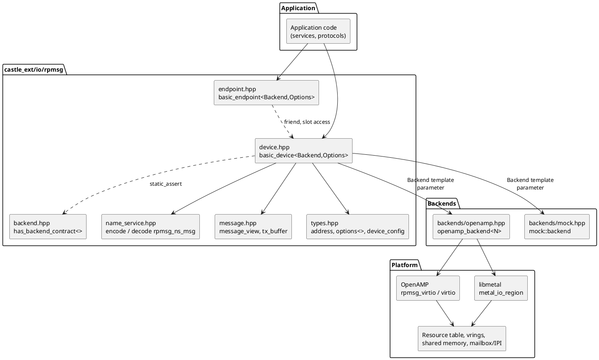
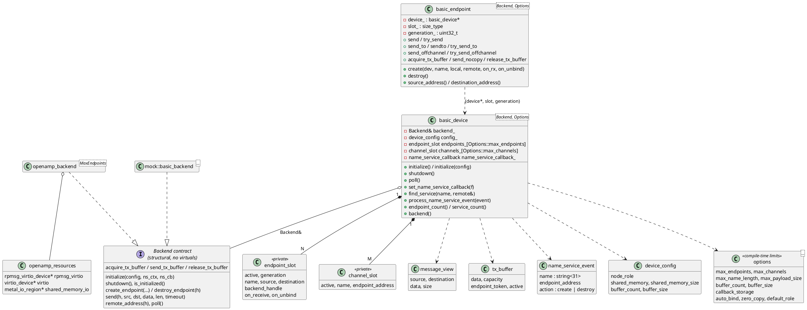
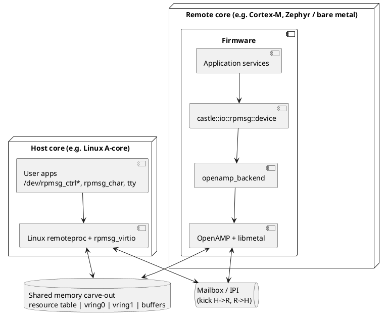
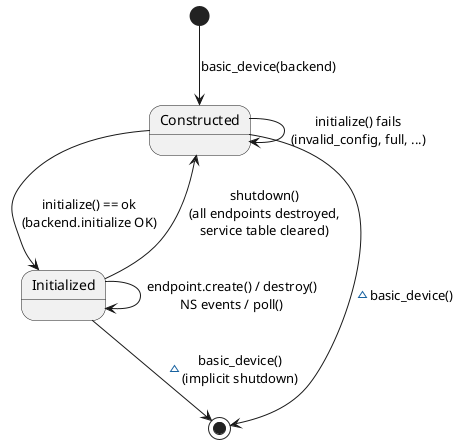
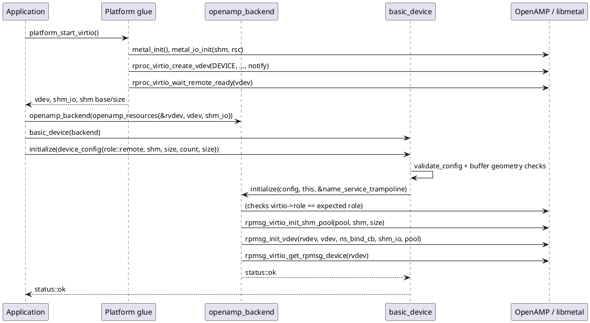
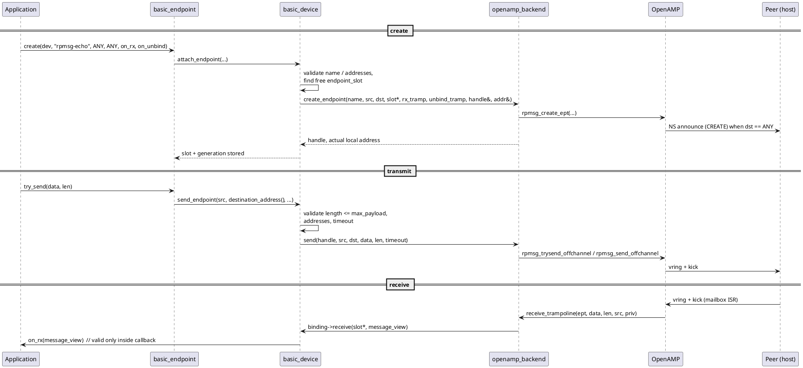
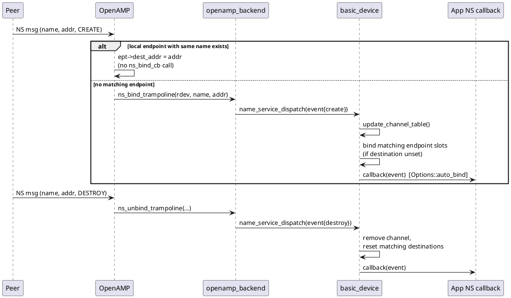
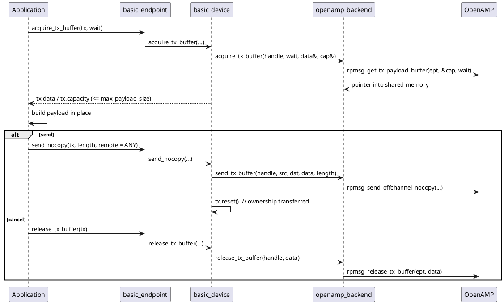
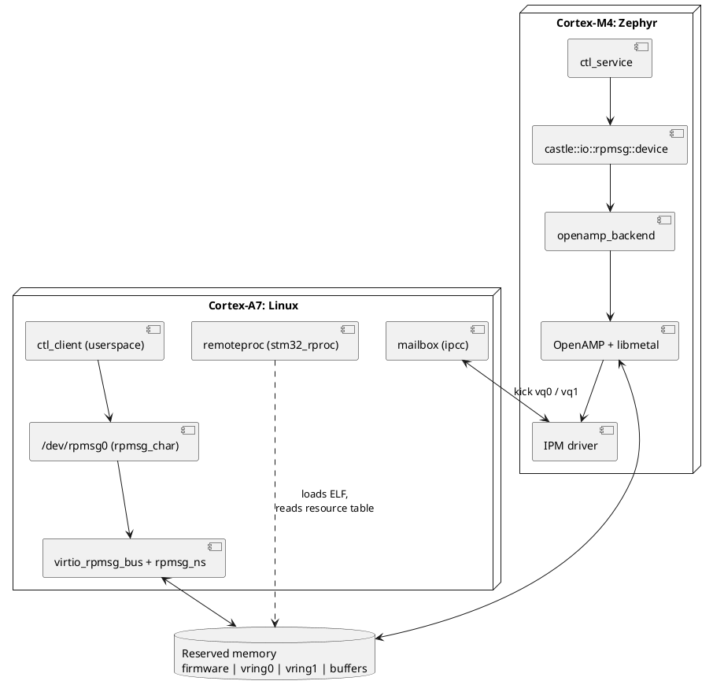
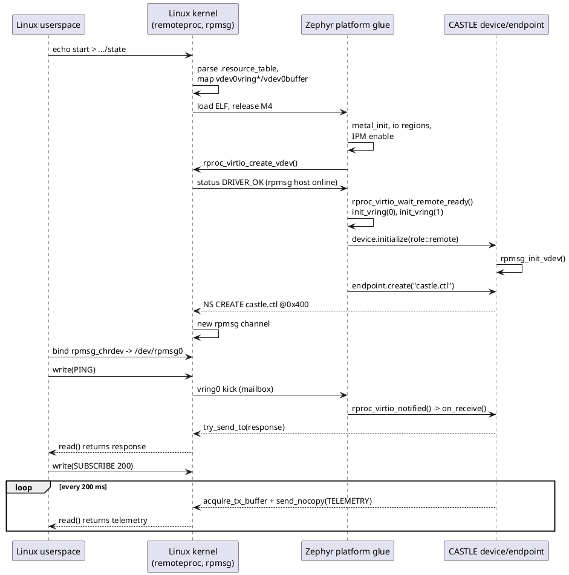

# RPMsg Communication (`castle_ext/io/rpmsg`)

## Contents
1. [What is RPMsg](#1-what-is-rpmsg)
2. [Module architecture](#2-module-architecture)
3. [Design rules](#3-design-rules)
4. [Installing OpenAMP / libmetal](#4-installing-openamp--libmetal)
5. [Enabling the OpenAMP backend](#5-enabling-the-openamp-backend)
6. [Bring-up: VirtIO + RPMsg + CASTLE device](#6-bring-up-virtio--rpmsg--castle-device)
7. [Endpoints, sending and receiving](#7-endpoints-sending-and-receiving)
8. [Name Service](#8-name-service)
9. [Zero-copy TX](#9-zero-copy-tx)
10. [Configuration (`options<>`)](#10-configuration-options)
11. [Status codes](#11-status-codes)
12. [Threading and context rules](#12-threading-and-context-rules)
13. [Testing without hardware (mock backend)](#13-testing-without-hardware-mock-backend)
14. [Limitations and troubleshooting](#14-limitations-and-troubleshooting)
15. [Per-header reference](#15-per-header-reference)
16. [End-to-end demonstration: Embedded Linux host <-> Zephyr remote](#16-end-to-end-demonstration-embedded-linux-host---zephyr-remote)

---

## 1. What is RPMsg

**RPMsg** (Remote Processor Messaging) is a message-passing protocol between processors that share memory, typically a Linux/application core and a Cortex-M / DSP / second Cortex-A running Zephyr, FreeRTOS or bare metal. It is layered on **VirtIO**:

| Layer | Role |
|---|---|
| Shared memory | Carve-out holding the vrings and the message buffers |
| Mailbox / IPI | "Kick" interrupt telling the peer a vring has new entries |
| VirtIO (vrings) | Two virtqueues: host->remote and remote->host |
| RPMsg | 16-byte header (`src`, `dst`, `len`, `flags`) + payload, addressed by 32-bit endpoint addresses |
| Name Service (NS) | Special endpoint `0x35` announcing service names (`CREATE` / `DESTROY`) |

Terminology used throughout:

* **Host / driver** (`role::host`, `RPMSG_HOST`): allocates the buffers and drives the virtqueues. Usually Linux (remoteproc) or the master core.
* **Remote / device** (`role::remote`, `RPMSG_REMOTE`): consumes the resource table the host provides. Usually the MCU firmware.
* **Endpoint**: a `(name, local address)` pair with an RX callback. A message is delivered to the endpoint whose local address equals the packet destination.
* **Reserved addresses**: `0 .. 1023` belong to the protocol (NS = `0x35`). Dynamic addresses start at `1024`. `RPMSG_ADDR_ANY` (`0xFFFFFFFF`) means "allocate / not bound yet".

Default buffer layout used by this module: 512-byte buffer = 16-byte header + **496-byte payload**.

```
 0        4        8        12  14   16
 +--------+--------+--------+---+----+-----------------------------+
 |  src   |  dst   |reserved|len|flag|        payload (<=496)      |
 +--------+--------+--------+---+----+-----------------------------+
```

## 2. Module architecture

CASTLE RPMsg is a thin, **allocation-free, compile-time-polymorphic** facade over a *backend*. The backend owns every platform/OpenAMP resource; CASTLE only keeps fixed tables of endpoints and cached services.

### 2.1 Layering



### 2.2 Class model



Key points:

* `basic_device` is **non-copyable and non-movable**; it holds a reference to a backend that must outlive it.
* `basic_endpoint` is a **move-only handle** `(device, slot, generation)`. The generation counter makes stale handles detectable after the slot is reused.
* The backend contract is a **structural trait** (`detail::has_backend_contract`) checked with `static_assert`; there is no base class and no virtual dispatch.
* Callbacks are `castle::callbacks::function<..., Options::callback_storage>` (inline small-buffer storage, no heap). The backend only sees plain function pointers + a `void*` context (`receive_dispatch`, `unbind_dispatch`, `name_service_dispatch`).

### 2.3 Deployment (typical AMP system)



### 2.4 Device lifecycle



### 2.5 Initialization sequence (OpenAMP backend, remote role)



### 2.6 Endpoint creation and message flow



### 2.7 Name Service flow



### 2.8 Zero-copy TX sequence



## 3. Design rules

* No heap, no exceptions, no RTTI, no virtual functions; every call returns `castle::status` (`CASTLE_NODISCARD` where it matters).
* All capacities are compile-time (`options<>`); the facade performs `O(MaxEndpoints)` / `O(MaxChannels)` scans.
* Backends are plugged by template parameter and verified structurally.
* RX payloads are **non-owning views** (`message_view`) valid only during the callback.
* Platform bring-up (resource table, vrings, memory regions, mailbox) is **not** done by CASTLE. The caller provides prepared OpenAMP objects through `openamp_resources`.

## 4. Installing OpenAMP / libmetal

OpenAMP depends on libmetal. Pick one path.

**Linux userspace (host build, cross build or target rootfs)**

```bash
# Distribution packages, when your distro ships them
sudo apt install libmetal-dev libopen-amp-dev

# Or from source
git clone https://github.com/OpenAMP/libmetal.git
cmake -S libmetal -B build-metal -DCMAKE_BUILD_TYPE=Release -DWITH_DOC=OFF -DWITH_EXAMPLES=OFF
cmake --build build-metal -j && sudo cmake --install build-metal

git clone https://github.com/OpenAMP/open-amp.git
cmake -S open-amp -B build-openamp -DCMAKE_BUILD_TYPE=Release -DWITH_APPS=OFF
cmake --build build-openamp -j && sudo cmake --install build-openamp
```

Installed artifacts: headers `<openamp/*.h>` and `<metal/*.h>`, libraries `libopen_amp` and `libmetal`.

**Zephyr**

```
# prj.conf
CONFIG_OPENAMP=y
CONFIG_LIBMETAL=y
```

Zephyr also needs its own shared-memory region, resource table and IPM/mailbox device-tree nodes (see Zephyr's `samples/subsys/ipc/openamp`).

**Bare metal / RTOS**: build libmetal and OpenAMP with the toolchain file of your target and the matching `MACHINE` / `PROJECT_SYSTEM`.

## 5. Enabling the OpenAMP backend

The adapter is compiled only when `CASTLE_RPMSG_ENABLE_OPENAMP` is defined. Without it the header exposes nothing, so desktop builds stay independent of OpenAMP.

```cmake
find_path(OPEN_AMP_INCLUDE openamp/rpmsg.h REQUIRED)
find_path(METAL_INCLUDE    metal/io.h      REQUIRED)
find_library(OPEN_AMP_LIB open_amp REQUIRED)
find_library(METAL_LIB    metal    REQUIRED)

add_executable(rpmsg_app main.cpp)
target_include_directories(rpmsg_app PRIVATE ${CASTLE_ROOT}/include ${OPEN_AMP_INCLUDE} ${METAL_INCLUDE})
target_compile_definitions(rpmsg_app PRIVATE CASTLE_RPMSG_ENABLE_OPENAMP)
target_link_libraries(rpmsg_app PRIVATE ${OPEN_AMP_LIB} ${METAL_LIB} pthread rt)
```

For Zephyr add `zephyr_compile_definitions(CASTLE_RPMSG_ENABLE_OPENAMP)` and the CASTLE include directory in your application `CMakeLists.txt`.

Headers to include:

```cpp
#include "castle_ext/io/rpmsg/rpmsg.hpp"                    // types, message, NS, backend contract, endpoint, device
#include "castle_ext/io/rpmsg/backends/openamp.hpp"         // adapter (needs CASTLE_RPMSG_ENABLE_OPENAMP)
```

## 6. Bring-up: VirtIO + RPMsg + CASTLE device

The work is split into two parts:

1. **Platform glue (your code, plain OpenAMP/libmetal):** map shared memory, create the `metal_io_region`s, create the `virtio_device`, wire the mailbox.
2. **CASTLE (this module):** pass the prepared objects through `openamp_resources`; `basic_device::initialize()` then performs `rpmsg_virtio_init_shm_pool()` + `rpmsg_init_vdev()` for you.

> Do **not** call `rpmsg_init_vdev()` / `rpmsg_virtio_init_shm_pool()` yourself when using `openamp_backend`; the backend does it. Pass a zero-initialised `rpmsg_virtio_device`.

### 6.1 Remote role (firmware side, e.g. Zephyr / bare metal)

The remote receives vrings and the resource table from the host. `rpmsg_init_vdev()` blocks until the host sets the driver-ready status.

```cpp
#include "castle_ext/io/rpmsg/rpmsg.hpp"
#include "castle_ext/io/rpmsg/backends/openamp.hpp"

#include <metal/sys.h>
#include <metal/device.h>
#include <openamp/open_amp.h>   // remoteproc, remoteproc_virtio, rpmsg_virtio

using namespace castle::io::rpmsg;

// ---- 1. CASTLE types (compile-time configuration) --------------------------
using ipc_options = options<
    /*MaxEndpoints*/ 4U, /*MaxChannels*/ 4U, /*MaxNameLength*/ max_name_length,
    /*MaxPayload*/ 496U, /*BufferCount*/ 16U, /*BufferSize*/ 512U,
    /*CallbackStorage*/ 48U, /*AutoBind*/ true, /*ZeroCopy*/ true, role::remote>;

using ipc_backend = backends::openamp_backend<4U>;   // >= ipc_options::max_endpoints
using ipc_device  = device<ipc_backend, ipc_options>;
using ipc_ept     = endpoint<ipc_backend, ipc_options>;

// ---- 2. Platform glue (board specific) ------------------------------------
struct platform_virtio
{
    struct virtio_device* vdev;
    struct metal_io_region* shm_io;
    void* shm_base;          // RPMsg buffer pool: host role only, nullptr for the remote role
    size_t shm_size;
};

// Implement per board: map shm and resource table, register metal devices,
// route the mailbox RX interrupt to platform_wait_for_kick().
extern bool platform_start_virtio(platform_virtio& out);
extern void platform_wait_for_kick();   // blocks until the peer kicked a vring (ISR -> semaphore)

// Typical body of platform_start_virtio() with OpenAMP (remote role):
//   metal_init(&params);
//   shm_io  = metal_device_io_region(shm_device, 0);
//   rsc_io  = metal_device_io_region(rsc_device, 0);
//   vdev    = rproc_virtio_create_vdev(VIRTIO_DEV_DEVICE, VDEV_ID,
//                                      &rsc_table->rpmsg_vdev, rsc_io,
//                                      nullptr, mailbox_notify, nullptr);
//   rproc_virtio_wait_remote_ready(vdev);
//   rproc_virtio_init_vring(vdev, 0, ...); rproc_virtio_init_vring(vdev, 1, ...);   // both, before dev.initialize()
//   shm_base = nullptr; shm_size = 0;   // remote buffers come from the host's vrings

// ---- 3. Application --------------------------------------------------------
static struct rpmsg_virtio_device g_rvdev;   // zero-initialised; filled by rpmsg_init_vdev()

int main()
{
    platform_virtio pv{};
    if (!platform_start_virtio(pv))
    {
        return 1;
    }

    ipc_backend backend(backends::openamp_resources(&g_rvdev, pv.vdev, pv.shm_io));
    ipc_device  dev(backend);

    // Optional: observe announcements that have no local endpoint of the same name.
    (void)dev.set_name_service_callback([](name_service_event const& e) {
        // e.action == name_service_action::create / destroy; e.name, e.endpoint_address
        (void)e;
    });

    device_config cfg(role::remote, pv.shm_base, pv.shm_size,
                      ipc_options::buffer_count, ipc_options::buffer_size);

    castle::status st = dev.initialize(cfg);   // may block until the host is ready
    if (!castle::succeeded(st))
    {
        return 2;
    }

    // Echo service: creating an endpoint with dst == ANY announces "rpmsg-echo" to the host.
    ipc_ept echo;
    st = echo.create(dev, "rpmsg-echo", rpmsg_addr_any, rpmsg_addr_any,
        [&echo](message_view const& m) {
            // Reply to whoever sent the message; m.data is valid only inside this callback.
            (void)echo.try_send_to(m.data, m.size, m.source);
        },
        [] { /* peer destroyed the channel */ });
    if (!castle::succeeded(st))
    {
        return 3;
    }

    for (;;)
    {
        platform_wait_for_kick();                          // mailbox ISR posts, thread waits
        rproc_virtio_notified(pv.vdev, RSC_NOTIFY_ID_ANY); // RX callbacks run here
        (void)dev.poll();                                  // no-op for OpenAMP, keeps code backend-agnostic
    }
}
```

### 6.2 Host role (driver side)

Differences from the remote sketch:

```cpp
using host_options = options<4U, 4U, max_name_length, 496U, 16U, 512U, 48U, true, true, role::host>;
using host_device  = device<ipc_backend, host_options>;

// Platform glue:
//   vdev = rproc_virtio_create_vdev(VIRTIO_DEV_DRIVER, ...);   // host drives the virtqueues
//   <load/start the remote firmware, share the resource table, enable the mailbox>
//
// Shared-memory region given to CASTLE becomes the RPMsg buffer pool.
// Size it for every TX and RX buffer of the configured vring depth.

device_config cfg(role::host, pool_base, pool_size, host_options::buffer_count, host_options::buffer_size);
castle::status st = host_dev.initialize(cfg);
```

`openamp_backend` verifies `config.node_role` against the role of the supplied `virtio_device` and fails with `invalid_config` when they differ. The role is fixed by `rproc_virtio_create_vdev()`; `device_config::node_role` must agree with it.

### 6.3 Initialization checklist

| Requirement | Checked by | Failure |
|---|---|---|
| `rvdev`, `vdev`, `shm_io` non-null | `openamp_backend::initialize` | `invalid_config` |
| `shared_memory != nullptr`, `shared_memory_size > 0` (host role only) | `openamp_backend::initialize` | `invalid_config` |
| `node_role` equals the virtio device role | `openamp_backend::initialize` | `invalid_config` |
| `buffer_size >= max_payload_size + 16`, `1 <= buffer_count <= Options::buffer_count`, `buffer_size <= Options::buffer_size` | `basic_device::initialize` | `invalid_config` |
| Free slot in the global NS router (max 4 backends) | `openamp_backend::initialize` | `full` |
| Not already initialized | device and backend | `invalid_config` |

Shut down in reverse order: destroy endpoints (or let handles go out of scope), `dev.shutdown()`, then release platform resources. `~basic_device()` and `~basic_endpoint()` clean up automatically.

## 7. Endpoints, sending and receiving

```cpp
ipc_ept ept;
castle::status st = ept.create(dev, "my.service",
                               rpmsg_addr_any,     // local address: allocate (>= 1024)
                               rpmsg_addr_any,     // remote address: learn from NS / first message
                               [](message_view const& m) { /* m.source, m.destination, m.data, m.size */ },
                               [] { /* optional unbind callback */ });
```

| Call | Behavior |
|---|---|
| `ept.send(data, len, timeout = wait_forever)` | Sends to the current destination (updated by NS binding) |
| `ept.try_send(data, len)` | Same with `no_wait` |
| `ept.send_to(data, len, remote, timeout)` / `sendto` | Explicit remote address |
| `ept.try_send_to` / `try_sendto` | Non-blocking variants |
| `ept.send_offchannel(data, len, local, remote, timeout)` | Explicit source and destination |
| `ept.source_address()` / `destination_address()` | `rpmsg_addr_any` when the handle is invalid or unbound |
| `ept.is_created()` / `ept.destroy()` | Handle state / explicit teardown |

Rules enforced by the facade:

* `len <= Options::max_payload_size` (default 496) else `out_of_range`; `data == nullptr` only with `len == 0`.
* Destination must be bound (`not_configured` otherwise) and not in the reserved range (`invalid_argument`).
* Explicit local addresses must be `ANY` or `>= 1024`; duplicates return `already_exists`.
* Service names are 1..31 characters (`out_of_range` if longer).
* **OpenAMP backend timeouts:** only `no_wait` (0) and `wait_forever` (-1). Positive millisecond timeouts return `invalid_config`.
* Endpoint handles are move-only; assigning over a live endpoint destroys the old one first.

## 8. Name Service

Name Service lets a peer announce that a service (`name`, `address`) appeared or disappeared. The payload is the standard 40-byte `rpmsg_ns_msg` (32-byte name, 32-bit address, 32-bit flags).

```cpp
dev.set_name_service_callback([&](name_service_event const& e) {
    if (e.action == name_service_action::create)
    {
        // e.name.c_str() is the service name; open a client endpoint towards e.endpoint_address
    }
});

address remote = rpmsg_addr_any;
if (dev.find_service("rpmsg-tty", remote) == castle::status::ok) { /* cached remote address */ }
```

Behavior to be aware of:

* `basic_device` caches announcements in a fixed table of `Options::max_channels`; a full table yields `status::full` (readable through `last_name_service_status()`).
* When a local endpoint with the **same name** exists, OpenAMP itself binds the destination (`ept->dest_addr`) and does not invoke the NS callback for CREATE. NS DESTROY events always reach the NS callback in addition to the endpoint unbind callback. `endpoint.destination_address()` always reflects the current OpenAMP value.
* `auto_bind` gates whether your callback is called for unclaimed events.
* NS requires `VIRTIO_RPMSG_F_NS` to be enabled in the resource table by the host side.
* `decode_name_service_message()` / `encode_name_service_message()` are available for backends or transports that deliver NS packets as ordinary RPMsg payloads; feed the result to `dev.process_name_service_event()`.

## 9. Zero-copy TX

Avoids one `memcpy` by building the payload directly in a shared-memory TX buffer.

```cpp
tx_buffer tx;
castle::status st = ept.acquire_tx_buffer(tx, /*wait=*/false);   // full if no buffer, time_out when wait==true and none
if (castle::succeeded(st))
{
    size_type n = fill_payload(tx.data, tx.capacity);            // tx.capacity <= Options::max_payload_size
    st = ept.send_nocopy(tx, n);                                 // remote == ANY: uses destination_address()
    if (!castle::succeeded(st))
    {
        (void)ept.release_tx_buffer(tx);                         // give it back if not sent
    }
}
```

* An active `tx_buffer` is move-only. Never copy or reuse it; after a successful send or release `tx.active == false`.
* Requires `Options::zero_copy == true`, otherwise `not_configured`.
* A buffer belongs to the endpoint that acquired it (`invalid_argument` otherwise).

## 10. Configuration (`options<>`)

```cpp
template <size_type MaxEndpoints = 8, size_type MaxChannels = 8, size_type MaxNameLength = 31,
          size_type MaxPayloadSize = 496, size_type BufferCount = 16, size_type BufferSize = 512,
          size_type CallbackStorage = 48, bool AutoBind = true, bool ZeroCopy = true,
          role DefaultRole = role::host>
struct options;
```

| Parameter | Meaning | Constraint |
|---|---|---|
| `MaxEndpoints` | CASTLE endpoint slots | `> 0`; backend `MaxEndpoints` must be `>=` |
| `MaxChannels` | Cached NS records | `> 0` |
| `MaxNameLength` | Visible service-name chars | `1..31` |
| `MaxPayloadSize` | Largest message | `1..0xFFFF` |
| `BufferCount` / `BufferSize` | Expected pool geometry | `BufferSize >= 16 + MaxPayloadSize` |
| `CallbackStorage` | Inline bytes per callback | `>= sizeof(void*)`; capturing lambdas must fit |
| `AutoBind` | Invoke user NS callback | |
| `ZeroCopy` | Enable `tx_buffer` API | |
| `DefaultRole` | Role used by `initialize()` without arguments | `host` or `remote` |

Violations are compile-time `static_assert` failures. `Options::buffer_*` are compile-time *metadata*: the actual buffer count and layout are determined by OpenAMP/VirtIO and the resource table; CASTLE only rejects configurations that exceed its own limits.

## 11. Status codes

| Status | Typical cause here |
|---|---|
| `ok` | Success |
| `not_configured` | Device/endpoint not initialized, destination unbound, zero-copy disabled, stale handle |
| `invalid_config` | Role/pointer/geometry mismatch, double init, unsupported timeout |
| `invalid_argument` | Null name/data, reserved or invalid address, foreign tx buffer |
| `invalid_callback` | Empty RX callback |
| `already_exists` | Local address already used |
| `full` | No endpoint/channel slot, no TX buffer, NS router full |
| `out_of_range` | Payload or name too long |
| `time_out` | Blocking acquire/send expired (OpenAMP waits about 15 s) |
| `data_loss` | RX frame larger than `max_payload_size`; or a TX payload that OpenAMP truncated because the peer's buffers are smaller than `length` |
| `not_found` | Unknown service/channel |
| `system_call_error` | Unmapped OpenAMP error code |

## 12. Threading and context rules

* The facade has **no locking**. Serialize `initialize`/`shutdown`, endpoint create/destroy and sends that may touch the same device, or confine the device to one thread.
* RX and NS callbacks run in whichever context calls `rproc_virtio_notified()` (or the equivalent). Prefer a thread/main-loop context: let the mailbox ISR only signal, then process in a thread (as in the sample above).
* Inside an ISR, use only `no_wait` operations and keep callbacks short.
* An endpoint may be destroyed from inside its own RX or unbind callback: the slot stays reserved until the callback returns. The callable's captured state must not be used after `destroy()` if it is owned by the endpoint.
* Declare `device` before the endpoints that use it; an endpoint that outlives its device holds a dangling pointer.
* `wait_forever` sends may block waiting for a TX buffer; never do this from the RX callback that is needed to free those buffers.
* Initialization/shutdown of up to 4 `openamp_backend` instances must be serialized (fixed global NS router).
* Caches: if the shared memory is cacheable, configure it through libmetal (`VIRTIO_USE_DCACHE`, memory attributes) in the platform glue.

## 13. Testing without hardware (mock backend)

`castle_ext/io/rpmsg/backends/mock.hpp` is an in-memory backend with the same contract, used by the unit tests and samples. The same application code runs unchanged: only the `Backend` type differs.

```cpp
#include "castle_ext/io/rpmsg/backends/mock.hpp"
#include "castle_ext/io/rpmsg/rpmsg.hpp"

using namespace castle::io::rpmsg;

mock::backend transport;
device<mock::backend> dev(transport);
dev.initialize();

endpoint<mock::backend> ept;
ept.create(dev, "example.service", rpmsg_addr_any, rpmsg_addr_any,
           [](message_view const& m) { /* ... */ });

transport.announce("example.service", 2024U);            // simulate NS CREATE from the peer
transport.bind(ept.source_address(), 2024U);             // bind explicitly
const uint8_t bytes[] = {1U, 2U, 3U};
ept.try_send(bytes, sizeof(bytes));                      // inspect transport.last_packet()
transport.inject(ept.source_address(), 2024U, bytes, sizeof(bytes));   // simulate RX
transport.fail_next_send(castle::status::full);          // fault injection
```

Recommended practice: write protocol code as templates on `Backend` (or on `device_type`) so the same logic is exercised on the host with the mock and on target with OpenAMP.

## 14. Limitations and troubleshooting

Limitations:

* Linux kernel `rpmsg_char` / `/dev/rpmsg*` access is not implemented; this adapter is a user-space/firmware OpenAMP front end.
* Multiple local endpoints with the same name are allowed, but OpenAMP binds each NS announcement to one matching endpoint. Configure peer destinations explicitly when you need more.
* The adapter does not set up resource tables, vrings, memory mapping, cache attributes or mailbox IRQs.
* Only `no_wait` and `wait_forever` are supported on OpenAMP; use application-level timers for deadlines.
* The OpenAMP adapter is not compiled by the default host build unless OpenAMP is installed and `CASTLE_RPMSG_ENABLE_OPENAMP` is defined.

Troubleshooting:

| Symptom | Likely cause |
|---|---|
| `initialize()` returns `invalid_config` | Role mismatch between `device_config` and the `virtio_device`, null resource pointer, null shared memory, or buffer geometry outside `options<>` |
| `initialize()` never returns on remote role | Host has not set driver-ready; check remoteproc start and resource table |
| No NS callback | Peer did not enable `VIRTIO_RPMSG_F_NS`, or a local endpoint with the same name already consumed the announcement |
| `send` returns `not_configured` | Destination still `rpmsg_addr_any`; wait for the peer message/NS, or use `send_to()` |
| `send` returns `invalid_config` | Positive finite timeout passed to the OpenAMP backend |
| `acquire_tx_buffer` returns `full` / `time_out` | TX pool exhausted; peer not consuming or kicks are not reaching the remote |
| Nothing received | `rproc_virtio_notified()` never called (mailbox ISR not wired) or wrong notify id |
| Payload rejected on RX | Peer sent a frame larger than `max_payload_size`; it is dropped (`data_loss` from the device, never propagated as an OpenAMP error) |

## 15. Per-header reference

| Header | Documentation |
|---|---|
| `types.hpp` | [types.md](types.md) |
| `message.hpp` | [message.md](message.md) |
| `name_service.hpp` | [name_service.md](name_service.md) |
| `backend.hpp` | [backend.md](backend.md) |
| `endpoint.hpp` | [endpoint.md](endpoint.md) |
| `device.hpp` | [device.md](device.md) |
| `rpmsg.hpp` | [rpmsg.md](rpmsg.md) |
| `backends/openamp.hpp` | [backends/openamp.md](backends/openamp.md) |
| `backends/mock.hpp` | [backends/mock.md](backends/mock.md) |

## 16. End-to-end demonstration: Embedded Linux host <-> Zephyr remote

This chapter builds a complete system: Linux on the application core boots a Zephyr firmware on the microcontroller core, discovers a CASTLE RPMsg service by name, then exchanges commands, responses and a zero-copy telemetry stream. Section 6 explained the API; this chapter explains the *system*: reserved memory, device trees, kernel and Zephyr configuration, firmware, Linux client, bring-up and debugging.

### 16.1 Scenario and roles

| Concern | Linux side (VirtIO host / driver) | Zephyr side (VirtIO remote / device) |
|---|---|---|
| Firmware loading | `remoteproc` driver: loads the ELF, parses `.resource_table`, starts the core | - |
| VirtIO + RPMsg | Kernel `virtio_rpmsg_bus` (+ `rpmsg_ns`) | OpenAMP `rpmsg_virtio`, driven by CASTLE `openamp_backend` |
| Endpoint API | `rpmsg_char` -> `/dev/rpmsgN` (or `rpmsg_tty`) | CASTLE `device` / `endpoint` |
| Kick/notify | Kernel mailbox framework | Zephyr IPM (`zephyr,ipc`) |
| Buffers | Allocated from the `vdev0buffer` reserved-memory pool | Borrowed from the host's vrings |

CASTLE runs on the **Zephyr** side. The Linux side uses the stock kernel RPMsg stack, so no CASTLE code or OpenAMP library is needed in Linux userspace. (If you instead run OpenAMP/libmetal in Linux userspace without the kernel remoteproc, use the host-role sketch in [6.2](#62-host-role-driver-side).)

Reference hardware for the listings: **STM32MP157x-DK2** (Cortex-A7 running mainline/OpenSTLinux, Cortex-M4 running Zephyr). Section [16.11](#1611-porting-checklist) lists what changes on other SoCs (for example i.MX93 with Cortex-M33). Addresses below are the ST reference layout; treat them as an example and always confirm with the verification step in [16.9](#169-run-it).

Application service used by the demo, named `castle.ctl`:

| Command | Direction | Purpose |
|---|---|---|
| `PING` | Linux -> Zephyr -> Linux | Round-trip latency check, echoes `value` |
| `SET_LED` | Linux -> Zephyr -> Linux | Drive a GPIO on the MCU |
| `GET_TEMP` | Linux -> Zephyr -> Linux | Read a sensor owned by the MCU |
| `SUBSCRIBE(period_ms)` | Linux -> Zephyr -> Linux | Start (`> 0`) or stop (`0`) periodic telemetry |
| `TELEMETRY` | Zephyr -> Linux | Zero-copy periodic sample |

### 16.2 System overview



### 16.3 Reserved shared-memory plan

Two parties must agree on every address: Linux (device tree `reserved-memory`) and the firmware (the resource table that Zephyr generates from its own devicetree). `no-map` keeps the Linux kernel from using, caching or mapping the memory as normal RAM.

| Region | Used for | Sizing rule | Example |
|---|---|---|---|
| `mcuram2` | Firmware image: `.text`, `.data`, `.bss`, stacks. `remoteproc` copies the ELF here. | At least the linked image size | `0x10000000`, 256 KiB |
| `vdev0vring0` | VirtIO ring, one direction | `>=` ring bytes for `N` entries (about 0x1B0 bytes for `N = 16`); round up to the platform granule | `0x10040000`, 8 KiB |
| `vdev0vring1` | VirtIO ring, other direction | Same as above | `0x10042000`, 8 KiB |
| `vdev0buffer` | RPMsg data buffers, accessed by both cores | `2 * N * buffer_size` (`N` ring entries, 512-byte buffers) | `0x10044000`, 16 KiB (`N = 16`) |

```
  M4 view == A7 view for these ranges (shared SRAM)

  0x10000000 +---------------------------+
             | Zephyr image (mcuram2)    |   Linux: loaded by remoteproc
  0x10040000 +---------------------------+   Zephyr: sram node shrunk to 256 KiB
             | vdev0vring0   8 KiB       |
  0x10042000 +---------------------------+
             | vdev0vring1   8 KiB       |   <- addresses written into the
  0x10044000 +---------------------------+      resource table (fw_rsc_vdev_vring.da)
             | vdev0buffer  16 KiB       |
             | 32 x 512-byte RPMsg bufs  |
  0x10048000 +---------------------------+
```

Rules that cause most bring-up failures:

* The reserved-memory **node names** `vdev0vring0`, `vdev0vring1` and `vdev0buffer` are significant: the Linux remoteproc core matches them to the VirtIO device declared in the resource table.
* `vdev0buffer` must be `compatible = "shared-dma-pool"` so `virtio_rpmsg_bus` allocates its buffers from it.
* Firmware code and data must not overlap the vring/buffer window: shrink the Zephyr SRAM node accordingly (see the overlay).
* The vring `da` values and ring depth in the **resource table** (derived by Zephyr from `zephyr,ipc_shm` and `CONFIG_OPENAMP_RSC_TABLE_NUM_RPMSG_BUFF`) are the source of truth; the Linux reservation must cover them.
* If the memory is cacheable on either core, add explicit cache maintenance or map the window non-cacheable (MPU/cache configuration on the MCU, memory attributes in the kernel mapping on the application core).
* Keep `N * 2 * 512` consistent with CASTLE: `options<>::BufferCount` must be `>=` the `buffer_count` passed in `device_config` (here 16).

### 16.4 Linux side

#### 16.4.1 Kernel configuration

```
CONFIG_REMOTEPROC=y
CONFIG_STM32_RPROC=y          # SoC specific: imx_rproc, ti_k3_r5_remoteproc, ...
CONFIG_MAILBOX=y
CONFIG_STM32_IPCC=y           # mailbox driver for the SoC
CONFIG_RPMSG_VIRTIO=y         # virtio_rpmsg_bus
CONFIG_RPMSG_NS=y             # Name Service: auto-create channels announced by the remote
CONFIG_RPMSG_CHAR=y           # /dev/rpmsgN
CONFIG_RPMSG_CTRL=y           # /dev/rpmsg_ctrlN (optional, creates endpoints from userspace)
CONFIG_RPMSG_TTY=y            # optional: /dev/ttyRPMSGn for the "rpmsg-tty" service
```

#### 16.4.2 Device tree

OpenSTLinux/mainline ST device trees already ship an equivalent block; it is shown so it can be adapted to a custom board or another SoC.

```dts
/ {
    reserved-memory {
        #address-cells = <1>;
        #size-cells = <1>;
        ranges;

        mcuram2: mcuram2@10000000 {
            compatible = "shared-dma-pool";
            reg = <0x10000000 0x40000>;
            no-map;
        };

        vdev0vring0: vdev0vring0@10040000 {
            compatible = "shared-dma-pool";
            reg = <0x10040000 0x2000>;
            no-map;
        };

        vdev0vring1: vdev0vring1@10042000 {
            compatible = "shared-dma-pool";
            reg = <0x10042000 0x2000>;
            no-map;
        };

        vdev0buffer: vdev0buffer@10044000 {
            compatible = "shared-dma-pool";
            reg = <0x10044000 0x4000>;
            no-map;
        };
    };
};

&ipcc {
    status = "okay";
};

&m4_rproc {
    /* retram and mcuram are the MCU TCM/SRAM aliases declared in the SoC dtsi */
    memory-region = <&retram>, <&mcuram>, <&mcuram2>,
                    <&vdev0vring0>, <&vdev0vring1>, <&vdev0buffer>;
    mboxes = <&ipcc 0>, <&ipcc 1>, <&ipcc 2>;
    mbox-names = "vq0", "vq1", "shutdown";
    interrupt-parent = <&exti>;
    interrupts = <68 1>;
    status = "okay";
};
```

Mailbox channels `vq0` / `vq1` map to the `notifyid` of vring 0 / vring 1 in the resource table; Zephyr kicks the host with `ipm_send(..., id, ...)` using that same id (see `notify_peer()` below).

#### 16.4.3 Deploying and starting the firmware

```bash
install -m 0644 zephyr.elf /lib/firmware/castle_rpmsg.elf
echo castle_rpmsg.elf > /sys/class/remoteproc/remoteproc0/firmware
echo start             > /sys/class/remoteproc/remoteproc0/state
cat /sys/class/remoteproc/remoteproc0/state                      # running

# Restart / stop
echo stop > /sys/class/remoteproc/remoteproc0/state
```

The kernel prints the Name Service announcement when the Zephyr endpoint is created:

```
remoteproc remoteproc0: powering up m4
remoteproc remoteproc0: Booting fw image castle_rpmsg.elf, size 123456
virtio_rpmsg_bus virtio0: rpmsg host is online
remoteproc remoteproc0: remote processor m4 is now up
virtio_rpmsg_bus virtio0: creating channel castle.ctl addr 0x400
```

#### 16.4.4 Exposing the channel as `/dev/rpmsgN`

The announced channel becomes `virtio0.castle.ctl.-1.1024` on the `rpmsg` bus. Bind it to the `rpmsg_chrdev` driver to obtain a character device:

```bash
CH=$(ls /sys/bus/rpmsg/devices | grep castle.ctl)
echo rpmsg_chrdev > /sys/bus/rpmsg/devices/$CH/driver_override
echo $CH          > /sys/bus/rpmsg/drivers/rpmsg_chrdev/bind
ls /dev/rpmsg*                                   # /dev/rpmsg0 (and /dev/rpmsg_ctrl0)
```

Each `read()` returns exactly one RPMsg message and each `write()` sends exactly one (maximum 496 bytes for the default 512-byte buffers).

### 16.5 Zephyr side: project

```
castle_rpmsg_demo/
  common/ctl_protocol.h                     # shared by both cores
  zephyr_remote/
    CMakeLists.txt
    prj.conf
    boards/stm32mp157x_dk2_stm32mp157cxx.overlay
    src/main.cpp
  linux_host/ctl_client.c
```

`boards/stm32mp157x_dk2_stm32mp157cxx.overlay` (same shape as Zephyr's `samples/subsys/ipc/openamp_rsc_table`):

```dts
/ {
    chosen {
        /* Window shared with Linux: vrings + RPMsg buffers. The resource table is generated from it. */
        zephyr,ipc_shm = &mcusram3;
        zephyr,ipc = &mailbox;
    };

    mcusram3: memory1@10040000 {
        compatible = "mmio-sram";
        reg = <0x10040000 DT_SIZE_K(64)>;
    };
};

/* Keep the firmware inside mcuram2 so it never touches the shared window */
&mcusram {
    reg = <0x10000000 DT_SIZE_K(256)>;
};
```

`prj.conf`:

```
CONFIG_CPP=y
CONFIG_STD_CPP17=y
CONFIG_CASTLE=y                          # adds castle/include to the include path (zephyr/module.yml)

CONFIG_OPENAMP=y                         # OpenAMP + libmetal modules
CONFIG_OPENAMP_RSC_TABLE=y               # Zephyr generates the .resource_table section
CONFIG_OPENAMP_RSC_TABLE_NUM_RPMSG_BUFF=16

CONFIG_IPM=y
CONFIG_GPIO=y
CONFIG_LOG=y
CONFIG_MAIN_STACK_SIZE=4096
CONFIG_HEAP_MEM_POOL_SIZE=2048
```

Leave `CONFIG_OPENAMP_MASTER` at its default: `openamp_backend` also references the host-role helpers. Some boards need extra options (for example `CONFIG_OPENAMP_COPY_RSC_TABLE=y` and a dedicated `zephyr,ipc_rsc_table` node on i.MX); copy them from the matching `boards/*.conf` and `*.overlay` of Zephyr's `openamp_rsc_table` sample.

`CMakeLists.txt`:

```cmake
cmake_minimum_required(VERSION 3.20.0)
find_package(Zephyr REQUIRED HINTS $ENV{ZEPHYR_BASE})
project(castle_rpmsg_remote)

target_include_directories(app PRIVATE
    ${LIBMETAL_INCLUDE_DIR} ${OPENAMP_INCLUDE_DIR} ${PLATFORM_DIR}   # as in Zephyr's openamp_rsc_table sample
    ${CMAKE_CURRENT_SOURCE_DIR}/../common)
target_compile_definitions(app PRIVATE CASTLE_RPMSG_ENABLE_OPENAMP)
target_sources(app PRIVATE src/main.cpp)
```

CASTLE is consumed as a Zephyr module: pass its checkout with `-DZEPHYR_EXTRA_MODULES=<path-to-castle>` (or add it to the west manifest).

### 16.6 Shared wire protocol

Fixed 8-byte frames in native (little-endian) byte order on both cores. Keep the struct naturally aligned so it needs no `packed` attribute, and copy it with `memcpy` rather than casting the RX pointer.

```c
/* common/ctl_protocol.h */
#ifndef CTL_PROTOCOL_H
#define CTL_PROTOCOL_H
#include <stdint.h>

#define CTL_SERVICE_NAME "castle.ctl"

enum ctl_type {
    CTL_PING = 1, CTL_SET_LED = 2, CTL_GET_TEMP = 3, CTL_SUBSCRIBE = 4,
    CTL_TELEMETRY = 0x40,
    CTL_RESPONSE = 0x80          /* OR-ed into the request type */
};

enum ctl_status { CTL_OK = 0, CTL_ERR_UNKNOWN = 1, CTL_ERR_ARG = 2 };

struct ctl_msg {
    uint8_t  type;
    uint8_t  seq;                /* echoed in the response */
    uint16_t status;
    int32_t  value;
};

typedef char ctl_msg_size_check[(sizeof(struct ctl_msg) == 8) ? 1 : -1];
#endif
```

### 16.7 Zephyr firmware (`src/main.cpp`)

Design decisions:

* **One thread owns the device.** The IPM ISR only gives a semaphore. The main thread waits on it (with a timeout equal to the next telemetry deadline), runs `rproc_virtio_notified()` (RX callbacks execute there) and publishes telemetry. This satisfies the "no locking" rule of [section 12](#12-threading-and-context-rules) without a mutex.
* **Replies are sent from the RX callback** with `try_send_to(..., m.source)`: it needs no prior destination binding and never blocks the thread that frees buffers.
* **Telemetry uses zero-copy TX** and counts drops instead of blocking when the TX pool is exhausted.

```cpp
#include <zephyr/kernel.h>
#include <zephyr/drivers/gpio.h>
#include <zephyr/drivers/ipm.h>
#include <zephyr/logging/log.h>

#include <metal/sys.h>
#include <metal/io.h>
#include <openamp/open_amp.h>
#include <resource_table.h>
#include <addr_translation.h>

#include <string.h>

#include "castle_ext/io/rpmsg/rpmsg.hpp"
#include "castle_ext/io/rpmsg/backends/openamp.hpp"
#include "ctl_protocol.h"

LOG_MODULE_REGISTER(castle_rpmsg, LOG_LEVEL_INF);

namespace rp = castle::io::rpmsg;

// ---- CASTLE types ----------------------------------------------------------
using ctl_options  = rp::options<2U, 4U, rp::max_name_length, 496U, 16U, 512U, 48U, true, true, rp::role::remote>;
using ctl_backend  = rp::backends::openamp_backend<2U>;
using ctl_device   = rp::device<ctl_backend, ctl_options>;
using ctl_endpoint = rp::endpoint<ctl_backend, ctl_options>;

// ---- Platform glue: libmetal regions, IPM, VirtIO device -------------------
#define SHM_NODE DT_CHOSEN(zephyr_ipc_shm)
#define VDEV_ID  0xFFU

static const struct device* const g_ipm = DEVICE_DT_GET(DT_CHOSEN(zephyr_ipc));
static metal_phys_addr_t g_shm_phys = DT_REG_ADDR(SHM_NODE);
static metal_phys_addr_t g_rsc_phys;
static struct metal_io_region g_shm_io;
static struct metal_io_region g_rsc_io;
static struct rpmsg_virtio_device g_rvdev;   // zero-initialised, filled by rpmsg_init_vdev()
static struct virtio_device* g_vdev;
static K_SEM_DEFINE(g_kick, 0, 1);

static void ipm_rx(const struct device*, void*, uint32_t, volatile void*)
{
    k_sem_give(&g_kick);                       // ISR context: signal only
}

static int notify_peer(void*, uint32_t id)     // called by OpenAMP after queuing a buffer
{
#if CONFIG_IPM_MAX_DATA_SIZE > 0
    return ipm_send(g_ipm, 0, id, &id, sizeof(id));
#else
    return ipm_send(g_ipm, 0, id, NULL, 0);
#endif
}

static bool platform_start()
{
    struct metal_init_params params = METAL_INIT_DEFAULTS;
    if (metal_init(&params) != 0)
    {
        return false;
    }
    metal_io_init(&g_shm_io, (void*)DT_REG_ADDR(SHM_NODE), &g_shm_phys, DT_REG_SIZE(SHM_NODE), -1U, 0,
                  addr_translation_get_ops(g_shm_phys));

    void* rsc = nullptr;
    int rsc_size = 0;
    rsc_table_get(&rsc, &rsc_size);
    g_rsc_phys = (uintptr_t)rsc;
    metal_io_init(&g_rsc_io, rsc, &g_rsc_phys, rsc_size, -1U, 0, NULL);

    if (!device_is_ready(g_ipm))
    {
        return false;
    }
    ipm_register_callback(g_ipm, ipm_rx, NULL);
    if (ipm_set_enabled(g_ipm, 1) != 0)
    {
        return false;
    }

    g_vdev = rproc_virtio_create_vdev(VIRTIO_DEV_DEVICE, VDEV_ID, rsc_table_to_vdev(rsc), &g_rsc_io,
                                      NULL, notify_peer, NULL);
    if (g_vdev == nullptr)
    {
        return false;
    }
    rproc_virtio_wait_remote_ready(g_vdev);    // blocks until Linux sets driver-ready

    for (unsigned i = 0U; i < 2U; ++i)         // both vrings must exist before rpmsg_init_vdev()
    {
        struct fw_rsc_vdev_vring* r = (i == 0U) ? rsc_table_get_vring0(rsc) : rsc_table_get_vring1(rsc);
        LOG_INF("vring%u da=0x%x num=%u align=%u", i, (unsigned)r->da, (unsigned)r->num, (unsigned)r->align);
        if (rproc_virtio_init_vring(g_vdev, i, r->notifyid, (void*)(uintptr_t)r->da, &g_rsc_io,
                                    r->num, r->align) != 0)
        {
            return false;
        }
    }
    return true;
}

// ---- Board hooks ------------------------------------------------------------
static const struct gpio_dt_spec g_led = GPIO_DT_SPEC_GET(DT_ALIAS(led0), gpios);

static int32_t read_temperature_mdegc()
{
    return 36500;   // replace with sensor_sample_fetch()/sensor_channel_get() on the real sensor
}

// ---- Application service built on CASTLE ------------------------------------
class ctl_service
{
public:
    explicit ctl_service(ctl_device& device)
        : device_(device), endpoint_(), period_ms_(0U), next_ms_(0), seq_(0U), dropped_(0U)
    {
    }

    castle::status start()
    {
        // Remote creates the endpoint with dst == ANY: the NS CREATE announces "castle.ctl" to Linux.
        return endpoint_.create(device_, CTL_SERVICE_NAME, rp::rpmsg_addr_any, rp::rpmsg_addr_any,
                                [this](rp::message_view const& m) { on_receive(m); },
                                [this]() { on_unbind(); });
    }

    k_timeout_t wait_time() const
    {
        if (period_ms_ == 0U)
        {
            return K_FOREVER;
        }
        int64_t left = next_ms_ - k_uptime_get();
        return left > 0 ? K_MSEC(left) : K_NO_WAIT;
    }

    void publish_if_due()
    {
        if (period_ms_ != 0U && k_uptime_get() >= next_ms_)
        {
            publish();
            next_ms_ = k_uptime_get() + period_ms_;
        }
    }

private:
    void on_receive(rp::message_view const& m)   // m.data is only valid inside this call
    {
        ctl_msg req;
        if (m.size != sizeof(req))
        {
            LOG_WRN("bad frame size %u", (unsigned)m.size);
            return;
        }
        memcpy(&req, m.data, sizeof(req));

        ctl_msg rsp = {};
        rsp.type = static_cast<uint8_t>(req.type | CTL_RESPONSE);
        rsp.seq = req.seq;
        rsp.status = CTL_OK;
        switch (req.type)
        {
        case CTL_PING:
            rsp.value = req.value;
            break;
        case CTL_SET_LED:
            gpio_pin_set_dt(&g_led, req.value != 0 ? 1 : 0);
            break;
        case CTL_GET_TEMP:
            rsp.value = read_temperature_mdegc();
            break;
        case CTL_SUBSCRIBE:
            period_ms_ = req.value > 0 ? static_cast<uint32_t>(req.value) : 0U;
            next_ms_ = 0;                        // first sample right after the reply
            break;
        default:
            rsp.status = CTL_ERR_UNKNOWN;
            break;
        }

        castle::status st = endpoint_.try_send_to(&rsp, sizeof(rsp), m.source);
        if (!castle::succeeded(st))
        {
            LOG_WRN("reply dropped, status=%d", (int)st);
        }
    }

    void on_unbind()                             // Linux destroyed the channel
    {
        period_ms_ = 0U;
    }

    void publish()
    {
        rp::tx_buffer tx;
        if (endpoint_.acquire_tx_buffer(tx, false) != castle::status::ok)
        {
            ++dropped_;                          // TX pool exhausted: drop, never block here
            return;
        }
        ctl_msg msg = {};
        msg.type = CTL_TELEMETRY;
        msg.seq = ++seq_;
        msg.value = read_temperature_mdegc();
        if (tx.capacity < sizeof(msg))
        {
            (void)endpoint_.release_tx_buffer(tx);
            return;
        }
        memcpy(tx.data, &msg, sizeof(msg));      // payload built directly in shared memory
        if (endpoint_.send_nocopy(tx, sizeof(msg)) != castle::status::ok)
        {
            (void)endpoint_.release_tx_buffer(tx);   // give the buffer back when not sent
            ++dropped_;
        }
    }

    ctl_device& device_;
    ctl_endpoint endpoint_;
    uint32_t period_ms_;
    int64_t next_ms_;
    uint8_t seq_;
    uint32_t dropped_;
};

int main()
{
    if (!gpio_is_ready_dt(&g_led) || gpio_pin_configure_dt(&g_led, GPIO_OUTPUT_INACTIVE) != 0)
    {
        LOG_ERR("LED not available");
    }
    if (!platform_start())
    {
        LOG_ERR("platform bring-up failed");
        return -1;
    }

    // Declaration order matters: backend -> device -> service (destroyed in reverse).
    ctl_backend backend(rp::backends::openamp_resources(&g_rvdev, g_vdev, &g_shm_io));
    ctl_device device(backend);
    (void)device.set_name_service_callback([](rp::name_service_event const& e) {
        LOG_INF("NS %s \"%s\" @0x%x",
                e.action == rp::name_service_action::create ? "create" : "destroy",
                e.name.c_str(), (unsigned)e.endpoint_address);
    });

    rp::device_config cfg(rp::role::remote, nullptr, 0U, ctl_options::buffer_count, ctl_options::buffer_size);
    castle::status st = device.initialize(cfg);
    if (!castle::succeeded(st))
    {
        LOG_ERR("rpmsg initialize failed: %d", (int)st);
        return -2;
    }

    ctl_service service(device);
    st = service.start();
    if (!castle::succeeded(st))
    {
        LOG_ERR("endpoint create failed: %d", (int)st);
        return -3;
    }
    LOG_INF("castle.ctl ready");

    for (;;)
    {
        if (k_sem_take(&g_kick, service.wait_time()) == 0)
        {
            rproc_virtio_notified(g_vdev, RSC_NOTIFY_ID_ANY);   // RX callbacks run here
        }
        service.publish_if_due();
    }
}
```

If a vendor port needs the notification split per vring, call `rproc_virtio_notified()` with the ring's `notifyid` instead of `RSC_NOTIFY_ID_ANY`.

### 16.8 Linux client (`linux_host/ctl_client.c`)

```c
#include <errno.h>
#include <fcntl.h>
#include <poll.h>
#include <signal.h>
#include <stdio.h>
#include <string.h>
#include <time.h>
#include <unistd.h>

#include "ctl_protocol.h"

static volatile sig_atomic_t g_stop;
static void on_sigint(int s) { (void)s; g_stop = 1; }

static int recv_msg(int fd, struct ctl_msg* m, int timeout_ms)
{
    struct pollfd p = { .fd = fd, .events = POLLIN };
    int rc = poll(&p, 1, timeout_ms);
    if (rc <= 0)
        return rc == 0 ? -ETIMEDOUT : -errno;
    ssize_t n = read(fd, m, sizeof(*m));        /* one read == one RPMsg message */
    return n == (ssize_t)sizeof(*m) ? 0 : -EPROTO;
}

/* Send a request and wait for the matching response; telemetry frames may interleave. */
static int transact(int fd, uint8_t type, int32_t value, struct ctl_msg* rsp)
{
    static uint8_t seq;
    struct ctl_msg req = { .type = type, .seq = ++seq, .status = 0, .value = value };
    if (write(fd, &req, sizeof(req)) != (ssize_t)sizeof(req))
        return -errno;
    for (;;) {
        int rc = recv_msg(fd, rsp, 1000);
        if (rc)
            return rc;
        if (rsp->type == (type | CTL_RESPONSE) && rsp->seq == req.seq)
            return rsp->status == CTL_OK ? 0 : -EIO;
    }
}

int main(int argc, char** argv)
{
    int fd = open(argc > 1 ? argv[1] : "/dev/rpmsg0", O_RDWR);
    if (fd < 0) { perror("open"); return 1; }
    signal(SIGINT, on_sigint);

    struct ctl_msg r;
    struct timespec t0, t1;
    clock_gettime(CLOCK_MONOTONIC, &t0);
    if (transact(fd, CTL_PING, 42, &r) == 0) {
        clock_gettime(CLOCK_MONOTONIC, &t1);
        printf("ping: value=%d rtt=%ld us\n", r.value,
               (t1.tv_sec - t0.tv_sec) * 1000000L + (t1.tv_nsec - t0.tv_nsec) / 1000L);
    }
    if (transact(fd, CTL_SET_LED, 1, &r) == 0)
        puts("led on");
    if (transact(fd, CTL_GET_TEMP, 0, &r) == 0)
        printf("temp: %d.%03d C\n", r.value / 1000, r.value % 1000);

    if (transact(fd, CTL_SUBSCRIBE, 200, &r) == 0) {     /* 200 ms telemetry */
        for (int i = 0; i < 20 && !g_stop; ++i) {
            if (recv_msg(fd, &r, 1000) == 0 && r.type == CTL_TELEMETRY)
                printf("telemetry seq=%u temp=%d mC\n", r.seq, r.value);
        }
    }
    /* Closing /dev/rpmsgN does not necessarily notify the remote: stop the stream explicitly. */
    (void)transact(fd, CTL_SUBSCRIBE, 0, &r);
    (void)transact(fd, CTL_SET_LED, 0, &r);
    close(fd);
    return 0;
}
```

### 16.9 Run it

```bash
# Zephyr (build host)
west build -b stm32mp157x_dk2/stm32mp157cxx -p always castle_rpmsg_demo/zephyr_remote -- \
      -DZEPHYR_EXTRA_MODULES=/path/to/castle

# Linux client (cross-compile or build on target)
aarch64-linux-gnu-gcc -O2 -Wall -Icastle_rpmsg_demo/common \
      castle_rpmsg_demo/linux_host/ctl_client.c -o ctl_client      # use the 32-bit triplet for Cortex-A7

# Target
scp build/zephyr/zephyr.elf root@board:/lib/firmware/castle_rpmsg.elf
scp ctl_client root@board:/usr/local/bin/
```

On the target: start the firmware and bind the channel as in [16.4.3](#1643-deploying-and-starting-the-firmware) and [16.4.4](#1644-exposing-the-channel-as-devrpmsgn), then run `ctl_client /dev/rpmsg0`. Typical output:

```
ping: value=42 rtt=180 us
led on
temp: 36.500 C
telemetry seq=1 temp=36500 mC
telemetry seq=2 temp=36500 mC
...
```

Zephyr console (UART, or `cat /sys/kernel/debug/remoteproc/remoteproc0/trace0` when a trace resource is configured):

```
vring0 da=0x10040000 num=16 align=4
vring1 da=0x10042000 num=16 align=4
castle.ctl ready
```

Verify that Zephyr's resource table and the Linux reservation agree:

```bash
cat /sys/kernel/debug/remoteproc/remoteproc0/resource_table   # vring da / num / notifyid
cat /proc/iomem | grep -i -E "vdev|mcuram"                   # reserved regions known to the kernel
```

Every vring `da` and the buffer range must fall inside the `vdev0vring*` / `vdev0buffer` reservations. The `vring%u da=` lines printed by the firmware must match the `resource_table` debugfs output.

Message flow of the whole bring-up:



### 16.10 Real-world patterns

**Request/response service.** Keep RX callbacks short: validate, copy out of `message_view`, act, reply with `try_send_to(..., m.source)`. Use a `seq` field to match responses, and a version or capability command so Linux and firmware can evolve independently.

**Streaming with back-pressure.** Use `acquire_tx_buffer(tx, false)` + `send_nocopy()`. `status::full` means every TX buffer is in flight (Linux is slow or not reading); count and drop or decimate instead of blocking. Never use `wait_forever` in the context that must process RX to free buffers.

**Single owner thread.** All `basic_device` / `basic_endpoint` calls are made from the thread that calls `rproc_virtio_notified()`. Other threads hand work over with a Zephyr message queue and wake that thread with the same semaphore (`k_sem_give`), instead of calling `send()` directly. If a second thread must send, protect every device call with one mutex.

**Bulk data outside RPMsg.** RPMsg carries at most 496 bytes per message. For audio, images or logs, reserve a second region and pass only descriptors:

```dts
/* Linux: BASE is an address both cores can reach, identical in both trees */
reserved-memory {
    castle_bulk: castle-bulk@BASE {
        compatible = "shared-dma-pool";   /* or a plain no-map region mapped through UIO/udmabuf */
        reg = <BASE 0x100000>;
        no-map;
    };
};
/* Zephyr overlay */
/ { castle_bulk: memory@BASE { compatible = "mmio-sram"; reg = <BASE DT_SIZE_K(1024)>; }; };
```

```c
struct bulk_desc { uint32_t offset; uint32_t length; uint32_t seq; uint32_t flags; };   /* 16 bytes, goes in the RPMsg payload */
```

The producer writes into the bulk region, performs cache maintenance (or uses a non-cacheable mapping), then sends a `bulk_desc`. The consumer returns the same descriptor as an acknowledgment so the producer knows when the slot can be reused (ring of fixed slots, one owner at a time). Pick `BASE` in memory that both cores can reach and map it with the same attributes on both sides.

**Service discovery and restart.** A Zephyr endpoint with `dst == rpmsg_addr_any` announces itself on every boot, so Linux finds `castle.ctl` again after `echo stop` / `echo start` or a remoteproc crash recovery: re-run the bind step (udev rule or systemd unit) and reopen the device. On the firmware, treat `on_unbind` as "peer gone": stop streams and release resources. Do not rely on it alone; add an application heartbeat or an explicit `SUBSCRIBE(0)` on exit, because closing `/dev/rpmsgN` does not always send a Name Service DESTROY.

**Same code on the desktop.** Make `ctl_service` a template on `Device` and instantiate it with `mock::backend` in unit tests ([section 13](#13-testing-without-hardware-mock-backend)): `transport.inject(...)` simulates Linux requests and `transport.last_packet()` checks the response, so the protocol is verified without hardware.

### 16.11 Porting checklist

| Item | STM32MP157-DK2 (A7 + M4) | i.MX93 EVK (A55 + M33) |
|---|---|---|
| Linux remoteproc driver | `CONFIG_STM32_RPROC` | `CONFIG_IMX_REMOTEPROC` |
| Mailbox | `CONFIG_STM32_IPCC`, `mboxes = <&ipcc n>` | `CONFIG_IMX_MBOX` (MU), `mboxes` to the MU channels |
| Linux `reserved-memory` | `mcuram2`, `vdev0vring0/1`, `vdev0buffer` | Same node names, DDR addresses chosen for the M33 |
| Zephyr `zephyr,ipc_shm` | SRAM node at `0x10040000` | `shmem` node in DDR (`0xa4000000` in Zephyr's sample overlay) |
| Zephyr `zephyr,ipc` | `&mailbox` | `&mailbox0` (`zephyr,mbox-ipm` over `&mu1`) |
| Resource table placement | In firmware image | Dedicated `zephyr,ipc_rsc_table` node + `CONFIG_OPENAMP_COPY_RSC_TABLE=y` |
| Cache / MPU | Shared SRAM, non-cacheable | Mark the shared DDR window non-cacheable (or manage cache explicitly) |
| CASTLE side | Unchanged (`openamp_backend`, `role::remote`) | Unchanged |

Only the platform glue and devicetrees change between SoCs: the CASTLE service code in [16.7](#167-zephyr-firmware-srcmaincpp) stays the same.

### 16.12 Bring-up troubleshooting

| Symptom | Likely cause / check |
|---|---|
| `remoteproc0` state stays `offline`, `start` fails with `-ENOENT` | Firmware file missing in `/lib/firmware`, or `firmware` sysfs entry not set |
| Kernel reports the ELF segment cannot be loaded / bad `da` | Firmware linked outside `mcuram2`; fix Zephyr SRAM node and Linux `memory-region` |
| No `rpmsg host is online`, or kernel complains about missing vring/carveout | Reserved-memory node names are not `vdev0vring0`, `vdev0vring1`, `vdev0buffer`, or the resource table vring `da` is outside them |
| Zephyr never prints `castle.ctl ready` | Stuck in `rproc_virtio_wait_remote_ready()` (host never set driver-ready: check mailbox `vq0`/`vq1` DT, IPM node) or `initialize()` returned an error (log shows the `castle::status` value) |
| `initialize()` returns `invalid_config` | `device_config::node_role` differs from `VIRTIO_DEV_DEVICE`, null `rvdev`/`vdev`/`shm_io`, or `buffer_count`/`buffer_size` outside `options<>` |
| `rpmsg host is online` but no `creating channel castle.ctl` | NS feature bit missing in the resource table, `CONFIG_RPMSG_NS` off in Linux, or the endpoint was created with a fixed destination |
| `/dev/rpmsg0` absent | `rpmsg_chrdev` not built or not bound (see 16.4.4), channel name mismatch in the `grep` |
| Linux write succeeds, Zephyr sees nothing | Kick lost: IPM channel id does not match `notifyid`, IPM callback not enabled, or `rproc_virtio_notified()` never runs |
| Zephyr replies never reach Linux | Wrong `m.source` (replying to a stale address), TX pool exhausted (`status::full`), or notify from `notify_peer()` failing |
| Intermittent corruption or stale data | Cacheable shared memory without cache maintenance; mismatched endianness in the wire struct |
| `time_out` from blocking send | `wait_forever` is bounded by OpenAMP (about 15 s); the host stopped consuming buffers |
