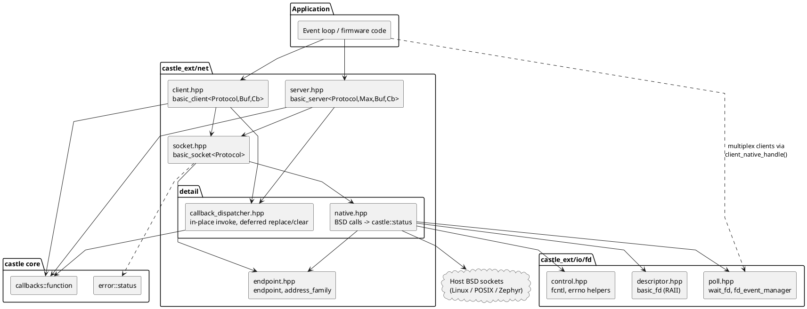
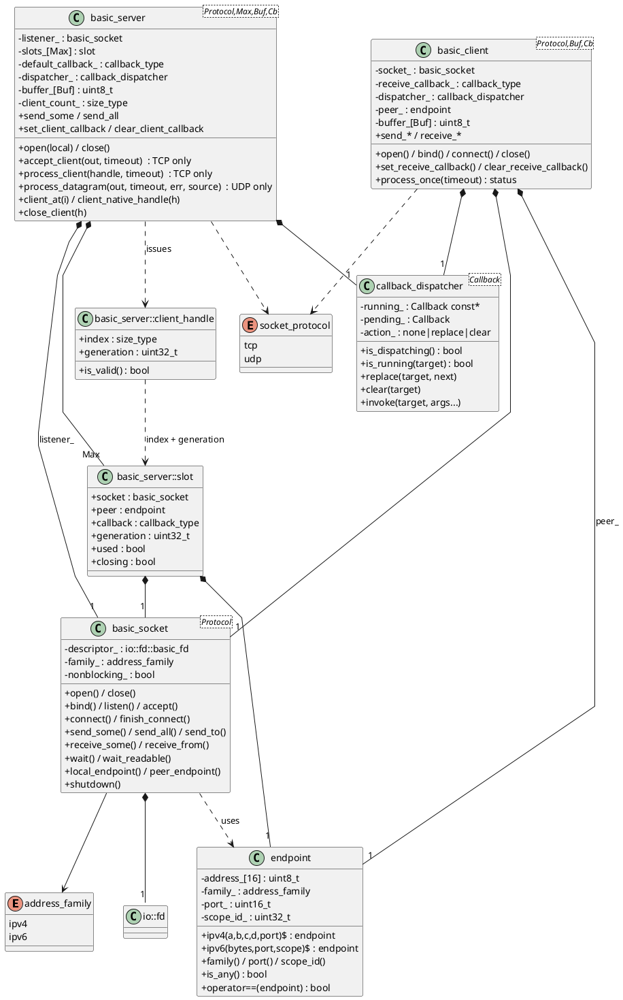
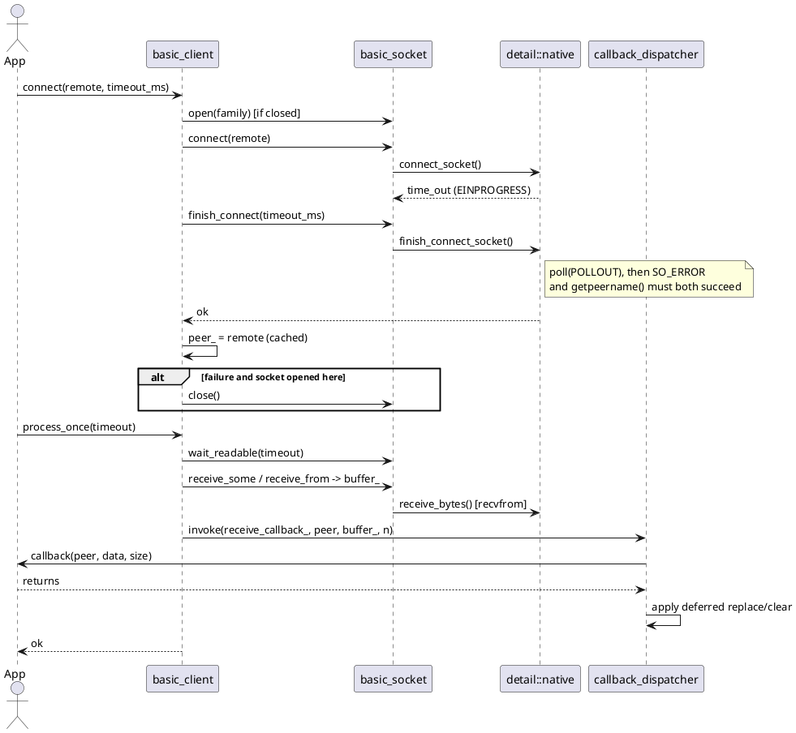
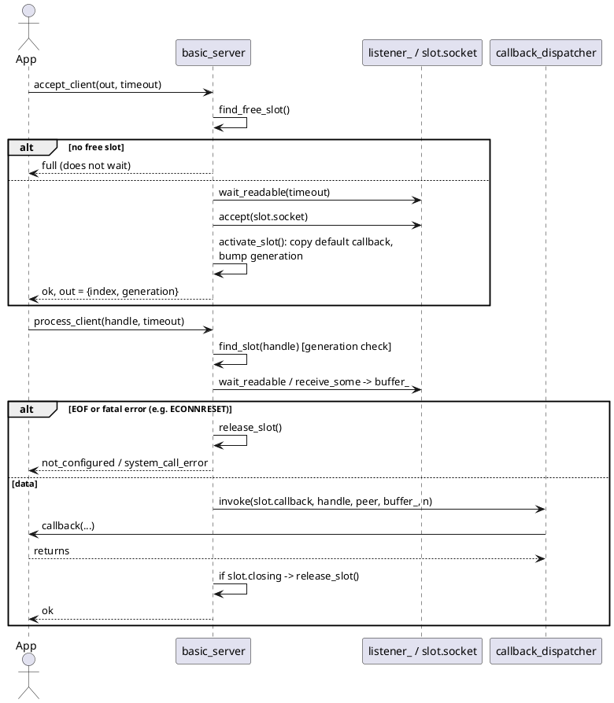
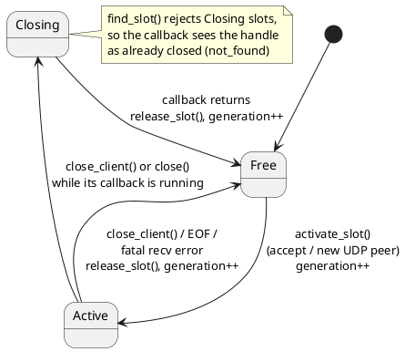
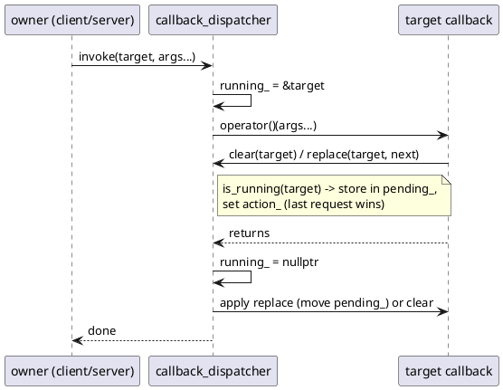
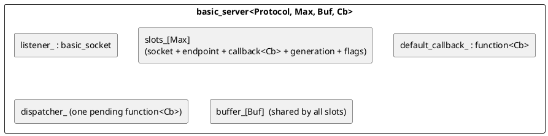
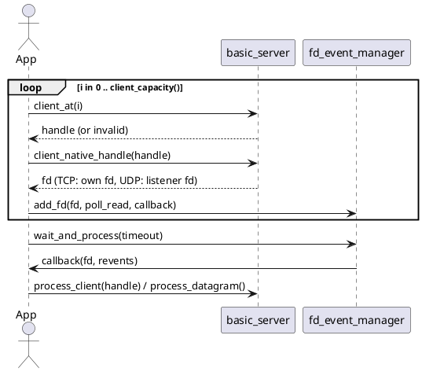

# castle_ext/net — Architecture

Heap-free TCP/UDP networking over the BSD socket API for CASTLE. It provides numeric IPv4/IPv6 endpoints, typed move-only sockets, callback-driven clients, and fixed-capacity servers. It follows CASTLE's constraints: no heap, no exceptions, no RTTI, no virtual functions, no STL, and bounded, deterministic memory.

Per-header API reference lives in [`docs/castle_ext/net/`](../../../docs/castle_ext/net/net.md). This document explains how the pieces fit together and why.

## 1. Goals and constraints

| Goal | How it is met |
|---|---|
| No allocation | Peer table, receive buffer and callbacks are plain members sized by template parameters; `sizeof(server)` is its whole memory cost. |
| No virtual / RTTI | Composition and templates only. Callbacks are `castle::callbacks::function` (function-pointer type erasure). |
| Errors without exceptions | Every operation returns `castle::status`; the native `errno` is reported through an optional `int* system_error`. |
| Reuse | Descriptor ownership, `poll()` and `fcntl` helpers come from `castle_ext/io/fd`; callbacks from `castle/callbacks`. |
| Portable build | All host-ABI code sits in one header. Without `CASTLE_USING_POSIX_APIS` the API still compiles and returns `not_configured`. |
| Deterministic | One datagram or one stream chunk per `process_*()` call; no worker threads, no hidden loops. The application owns the event loop. |

## 2. Layering

Dependencies point downward only. Upper layers never call the host socket API directly.



| Layer | Responsibility |
|---|---|
| `endpoint` | Value type: family, 4 or 16 address bytes, host-order port, IPv6 scope. Trivially copyable, fully `constexpr`, no socket ABI dependency. |
| `detail/native` | The only code that includes `<sys/socket.h>`. One function per operation, each returning `status`; converts `endpoint` to and from `sockaddr`; handles close-on-exec, `accept4`, `MSG_NOSIGNAL`/`SO_NOSIGPIPE`, `MSG_TRUNC` truncation. One body serves Linux and Zephyr; provides non-POSIX stubs. |
| `basic_socket` | Move-only owner of one descriptor (`basic_fd`). Validates state and arguments (closed, family mismatch, protocol misuse) and maps results: would-block read is `empty`, would-block write is `full`, a short datagram is `data_loss`. No `#if`. |
| `basic_client` | One socket, one receive buffer, one callback. `process_once()` = wait, receive, dispatch. |
| `basic_server` | A listener (TCP) or bound socket (UDP), a fixed slot table with generation-checked handles, a shared receive buffer, a default callback copied into each new slot. |
| `callback_dispatcher` | Runs a stored callback in place and defers a replace or clear that the callback requests for itself. |

## 3. Class model



`Protocol` is a compile-time template parameter, so TCP-only and UDP-only operations on the wrong type fail at runtime with `invalid_config` (and `server::accept_client` is compiled out for UDP via `if constexpr`). There is no inheritance anywhere.

## 4. Key behaviours

### 4.1 Client: connect and receive



The TCP peer endpoint is cached at connect time, so bytes already read are always delivered even if the connection has just been reset.

### 4.2 Server: accept, process, dispatch



UDP servers use `process_datagram()` instead. It receives one datagram from the shared socket, looks up the source in the slot table, activates a slot for a new source, and dispatches. When the table is full the datagram is dropped, `full` is returned, and the optional `source` output reports the sender.

### 4.3 Slot lifecycle and handle validity

A handle is `{index, generation}`. Every release bumps the slot's generation, so a stale handle can never address a reused slot.



### 4.4 Safe self-modification inside callbacks

A callback runs in place, so a `mutable` lambda keeps its state across calls. Destroying or overwriting the running callable would free its captures mid-call, so the dispatcher records which callback is running and defers changes aimed at it.



Rules enforced for every callback:

- It may replace or clear its own callback, close its own peer (or the whole server), send, and manage other peers. These changes take effect when it returns.
- `process_once()` / `process_client()` / `process_datagram()` called from a callback return `invalid_config`, because the shared receive buffer is still in use.
- It must not move or destroy the client or server that is running it.

## 5. Memory model



- Everything is sized at compile time; nothing is placed on the stack per call.
- A callable larger than `CallbackStorageSize` is a compile-time `static_assert`, not a runtime error.
- The dispatcher adds one extra callback's storage per owner (one per client, one per server), not one per slot.

## 6. Status mapping

| Situation | Status |
|---|---|
| Success | `ok` |
| Non-blocking read with no data | `empty` |
| Non-blocking write that cannot proceed | `full` |
| Wait expired / connect still pending | `time_out` |
| Server out of client slots (accept, or new UDP peer) | `full` |
| Datagram larger than the receive buffer (dropped) | `data_loss` |
| Closed socket, or no POSIX sockets on this target | `not_configured` |
| Wrong protocol for the operation, re-entrant `process_*` | `invalid_config` |
| Family mismatch, null buffer with non-zero size, bad mode | `invalid_argument` |
| Stale or unknown `client_handle` | `not_found` |
| Null function pointer passed as a callback | `invalid_callback` |
| Failed system call (errno in `system_error`) | `system_call_error` |
| TCP peer EOF (`process_once` / `process_client`) | `not_configured`, and the connection is closed |

## 7. Waiting on many clients

The server does not run a loop. To wait on many clients with one `poll()`, register the descriptors with `castle::io::fd::fd_event_manager`:



## 8. Design decisions

- **One host-ABI header.** Concentrating `sockaddr`, `recvfrom` and friends in `detail/native.hpp` keeps the public classes free of preprocessor branches and gives every platform difference one home.
- **Atomic descriptor flags.** Sockets are created with `SOCK_CLOEXEC | SOCK_NONBLOCK` and accepted with `accept4()` where available, with an `fcntl` fallback that reports errors, so no fork or exec race can leak a descriptor.
- **No `SIGPIPE`.** `MSG_NOSIGNAL` where defined, otherwise `SO_NOSIGPIPE` on each new socket.
- **Truncation is visible.** `recvfrom` plus `MSG_TRUNC` (datagram sockets only) makes an oversize UDP datagram `data_loss` for both `receive_some` and `receive_from`. A target without `MSG_TRUNC`/`ZSOCK_MSG_TRUNC` cannot report it.
- **`SO_REUSEADDR` on TCP listeners only**, so a second UDP server cannot silently share a port.
- **Generation-checked handles** instead of pointers: a stale handle fails with `not_found` after the slot is reused.
- **Server pending-connection policy.** `accept_client` checks capacity first. At capacity it returns `full` immediately and leaves the connection in the OS accept queue.
- **No eviction policy for UDP peers.** The library reports `full` and the rejected source, and exposes `client_at()` / `close_client()`. The application decides whom to evict.
- **No threads in the library.** Tests and samples may use threads; the library itself never does.

## 9. Thread-safety and portability

- Clients, servers and sockets have no internal synchronization. Serialize access to one instance externally. The `castle/sync` primitives can be used for that.
- Linux (`CASTLE_USING_LINUX_BSD_SOCKET`) and Zephyr (`CASTLE_USING_ZEPHYR_BSD_SOCKET`) run the same code in `detail/native.hpp`; only its headers differ. On Zephyr, enable `CONFIG_POSIX_API`, BSD sockets (`CONFIG_NET_SOCKETS`) and the transport you use (`CONFIG_NET_TCP` / `CONFIG_NET_UDP`). Zephyr-specific limits: IPv6 scope is an 8-bit interface index, and `shutdown()` and `TCP_NODELAY` may be no-ops on older releases.
- Without `CASTLE_USING_POSIX_APIS`, every call returns `not_configured`; code using the API still compiles.

## 10. File map

| Path | Content |
|---|---|
| `endpoint.hpp` | `address_family`, `endpoint` |
| `socket.hpp` | `socket_protocol`, `shutdown_mode`, `basic_socket`, `tcp_socket`, `udp_socket` |
| `client.hpp` | `basic_client`, `tcp_client`, `udp_client` |
| `server.hpp` | `basic_server`, `tcp_server`, `udp_server`, `client_handle` |
| `net.hpp` | Umbrella include |
| `detail/native.hpp` | BSD calls as `castle::status` (internal) |
| `detail/callback_dispatcher.hpp` | In-place callback invocation with deferred self-modification (internal) |

Samples are in `samples/castle_ext/net/`, tests in `test/castle_ext/net/`.

## 11. Rendering the diagrams

The diagrams are plain PlantUML. Render them with the VS Code PlantUML extension, `plantuml README.md`, or any PlantUML server. If your Markdown viewer does not render ` ```plantuml ` fences, paste each block into <https://www.plantuml.com/plantuml>.
