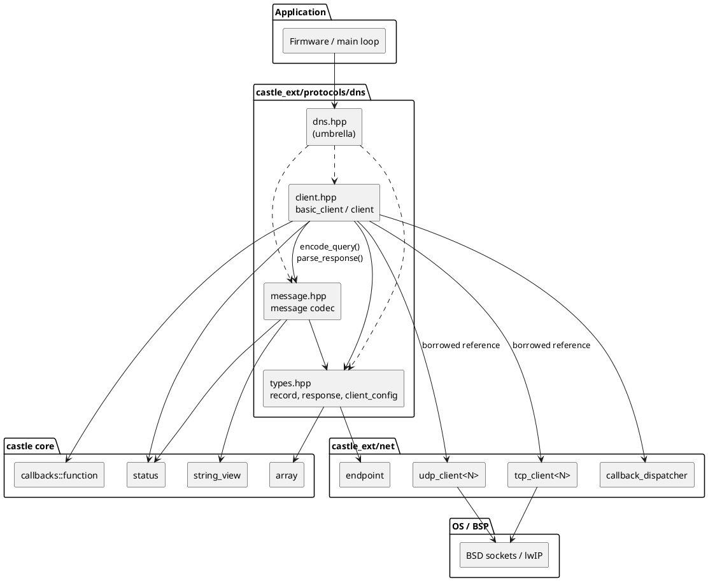
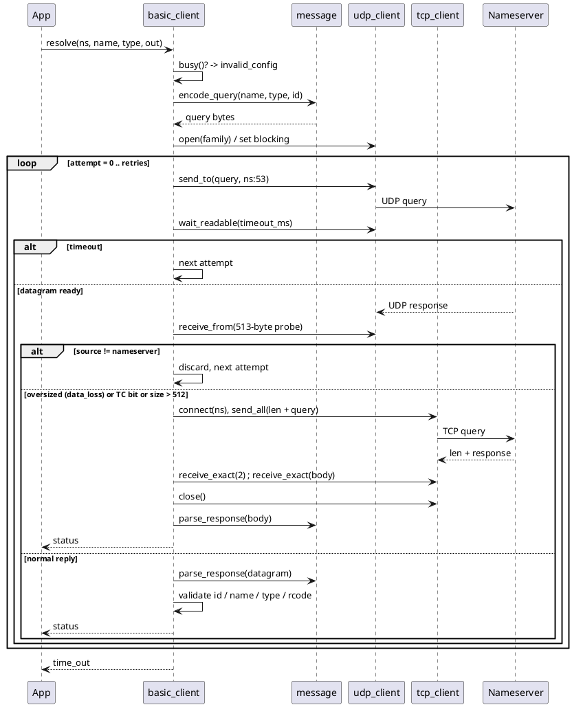
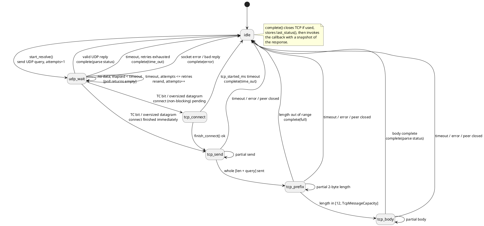

# castle_ext/protocols/dns — Architecture and Protocol Guide

Allocation-free DNS **stub resolver** for CASTLE. It sends one recursive query to a numeric nameserver address over UDP, retries on timeout, transparently falls back to TCP when the answer is truncated, and decodes the reply into a fixed-capacity structure. It targets embedded devices that need to turn a host name into an address (or read CNAME/NS/MX records) before opening a TCP/TLS/HTTP connection. It follows CASTLE's constraints: no heap, no exceptions, no RTTI, no virtual functions, no STL, and compile-time-bounded memory.

Per-header API reference is in this directory ([types](types.md), [message](message.md), [client](client.md), [umbrella](dns.md)). This document explains the design, how the implementation maps onto RFC 1035, and how the pieces fit together.

## 1. Goals and constraints

| Goal | How it is met |
|---|---|
| No allocation | Query buffer, UDP receive buffer, TCP frame buffers, async name copy and the decoded `response` are plain members sized by template parameters. `sizeof(client)` is the whole memory cost. |
| No virtual / RTTI | Transports are template parameters, not interfaces. The completion callback is a `castle::callbacks::function` with in-place storage. |
| Errors without exceptions | Every operation returns `castle::status`; the native `errno` is optionally reported through an `int*` out-parameter. |
| Two usage styles | A blocking `resolve()` and a caller-driven, non-blocking `start_resolve()` + `poll()` state machine that never waits. |
| Transport independence | `basic_client` is a template over a UDP and a TCP transport (normally `castle::net::udp_client` / `tcp_client`). DNS code never includes OS socket headers, so unit tests substitute fake transports. |
| Bounded input handling | Every length (name, label, record count, UDP datagram, TCP body, compression hops) has a hard limit and a defined failure. Packets are parsed in one pass and never indexed outside `[0, size)`. |
| Deterministic | One outstanding request per resolver; no threads, no hidden loops other than the documented retry count, and time is supplied by the application (`now_ms`) in async mode. |

## 2. Module layout

| Header | Responsibility | Reference |
|---|---|---|
| `types.hpp` | `record_type`, `record_class`, `section`, `response_code`, `resource_record`, `response<MaxRecords>`, `client_config` | [types.md](types.md) |
| `message.hpp` | `message` — stateless RFC 1035 query encoder and bounded response decoder (name compression included) | [message.md](message.md) |
| `client.hpp` | `basic_client<…>` / `client` — retry, UDP→TCP fallback, blocking and async orchestration | [client.md](client.md) |
| `dns.hpp` | Umbrella include of the three headers above | [dns.md](dns.md) |

The codec (`message`) is deliberately separate from the I/O policy (`basic_client`): the codec is pure, static and testable with byte arrays; the client owns sockets, timing and state.

## 3. Architecture

### 3.1 Layering and dependencies



The resolver **borrows** both transports by reference; it does not create or own them, and no socket is opened until the first query. The caller guarantees the transports outlive the resolver.

### 3.2 Class model

```plantuml
@startuml
skinparam shadowing false
skinparam classAttributeIconSize 0

enum record_type {
  a = 1
  ns = 2
  cname = 5
  mx = 15
  aaaa = 28
}
enum record_class { internet = 1 }
enum section { answer\nauthority\nadditional }
enum response_code {
  no_error
  format_error
  server_failure
  name_error
  not_implemented
  refused
}

class resource_record {
  +type : record_type
  +klass : record_class
  +source_section : section
  +ttl : uint32_t
  +address : net::endpoint
  +owner : char[256]
  +target : char[256]
  +preference : uint16_t
}

class "response<MaxRecords>" as response {
  +transaction_id, flags
  +question_count … additional_count
  +question_type / question_class / question_name
  +rcode : response_code
  +authoritative, truncated
  +recursion_desired, recursion_available
  +records : array<resource_record, MaxRecords>
  +record_count : size_type
  +clear()
}

class client_config {
  +timeout_ms = 1000
  +retries = 2
  +transaction_id_seed = 0xCA57
}

class message <<static codec>> {
  +header_size = 12
  +classic_udp_limit = 512
  +max_message_size = 65535
  +{static} encode_query(name, type, id, out, cap, written) : status
  +{static} is_truncated_packet(data, size) : bool
  +{static} parse_response(data, size, id, response&) : status
  +{static} decode_name(data, size, offset, out, cap, consumed) : status
}

class "basic_client<Udp, Tcp, MaxRecords,\nTcpMessageCapacity, CallbackStorage>" as basic_client {
  +basic_client(udp&, tcp&, client_config)
  +configure(client_config)
  +resolve(ns, name, type, response&, errno*) : status
  +start_resolve(ns, name, type, now_ms, errno*) : status
  +poll(now_ms, errno*) : status
  +set_callback(cb) / clear_callback()
  +busy() : bool
  +last_response() / last_status()
  -state_ : async_state
  -query_[512], udp_packet_[513]
  -tcp_message_[TcpMessageCapacity]
}

class udp_client <<castle::net>>
class tcp_client <<castle::net>>

resource_record --> record_type
resource_record --> record_class
resource_record --> section
response *-- "MaxRecords" resource_record
response --> response_code
basic_client o-- "1" udp_client : borrows
basic_client o-- "1" tcp_client : borrows
basic_client *-- client_config
basic_client *-- response : last response
basic_client ..> message : uses
message ..> response : fills
@enduml
```

`client` is the alias `basic_client<>` = `udp_client<512>`, `tcp_client<2048>`, 8 records, 2048-byte TCP body.

## 4. DNS protocol subset

DNS (RFC 1035) carries a query and its response in the same message layout. Over UDP the message is sent as-is (classic limit 512 bytes). Over TCP each message is prefixed with a 2-byte big-endian length.

```text
 0                   1                   2                   3
 0 1 2 3 4 5 6 7 8 9 0 1 2 3 4 5 6 7 8 9 0 1 2 3 4 5 6 7 8 9 0 1
+-------------------------------+-------------------------------+
|  ID (transaction id)          |QR|Opcode|AA|TC|RD|RA| Z |RCODE|   header (12 bytes)
+-------------------------------+-------------------------------+
|  QDCOUNT                      |  ANCOUNT                      |
|  NSCOUNT                      |  ARCOUNT                      |
+-------------------------------+-------------------------------+
|  QNAME (labels: len,bytes ... 0)  QTYPE (2)   QCLASS (2)      |   question
+---------------------------------------------------------------+
|  NAME  TYPE(2)  CLASS(2)  TTL(4)  RDLENGTH(2)  RDATA          |   answer / authority / additional
+---------------------------------------------------------------+
```

### 4.1 What the client sends

`message::encode_query()` builds exactly one recursive, Internet-class question:

| Field | Value |
|---|---|
| ID | Next value of the resolver's counter (seeded by `client_config::transaction_id_seed`) |
| Flags | `0x0100` — QR=0 (query), opcode 0, **RD=1** |
| QDCOUNT | 1; all other counts 0 (no EDNS0/OPT record) |
| QNAME | Labels of the ASCII name; optional trailing dot accepted; `"."` encodes the root |
| QTYPE | `a`, `aaaa`, `cname`, `ns` or `mx` |
| QCLASS | IN (1) |

Name validation: non-empty, ASCII 1–127 (no NUL), every label 1–63 octets, encoded name ≤ 255 octets, no empty labels. The caller's letter case is preserved on the wire.

### 4.2 What the client accepts

| Record type | Decoded into `resource_record` |
|---|---|
| `A` (RDLENGTH = 4) | `address` = IPv4 endpoint, port 0 |
| `AAAA` (RDLENGTH = 16) | `address` = IPv6 endpoint, port 0 |
| `CNAME`, `NS` | `target` = decompressed domain name |
| `MX` | `preference` + `target` = exchange name |
| Any other type, or class ≠ IN | **Skipped** using `RDLENGTH`; not stored, not counted against capacity |

Records from the answer, authority and additional sections are all kept, in wire order, tagged with `source_section`. `response::record_count` is the number retained, which can be lower than the header counts because unsupported records are skipped.

### 4.3 Response validation

`message::parse_response()` rejects (as `invalid_argument` unless noted):

- message shorter than 12 bytes or longer than 65535;
- transaction ID different from the request;
- QR = 0, non-zero opcode, or non-zero Z/AD/CD bits;
- `QDCOUNT != 1`;
- malformed names: label > 63, reserved label types, forward or self-referencing compression pointers, more than 128 pointer/label steps, expanded name > 255 octets, non-ASCII or NUL characters;
- an RR whose `RDLENGTH` runs past the packet, a wrong-length A/AAAA, or name-bearing RDATA whose decoded length does not equal `RDLENGTH`;
- **trailing bytes** after the last record;
- more retained records than `MaxRecords` → `full`; a name that does not fit its 256-byte field → `full`/`out_of_range`.

`basic_client` then adds the checks that need request context: the echoed question name (case-insensitive, trailing dot ignored), type and class must match, and the TC flag and RCODE are mapped to a status (§6).

## 5. Resolution flow

### 5.1 Blocking: `resolve()`



Key points:

- Total UDP transmissions = `retries + 1`. The timeout applies to each UDP attempt and to each TCP readiness wait (connect, each receive).
- A datagram from an address other than the configured nameserver is ignored and consumes the attempt.
- The UDP receive buffer is 513 bytes. The extra byte lets the resolver recognize an oversized datagram even on targets whose socket layer does not report the original datagram length; `received > 512`, the TC bit, or a `data_loss` report from the transport (for a datagram from the nameserver) triggers the TCP fallback.
- The TCP fallback is a one-shot connection: connect, send the length-prefixed query, read the 2-byte length, read the body, close. A body smaller than 12 bytes or larger than `TcpMessageCapacity` returns `full`; a peer closing early returns `data_loss`.
- A reply that fails parsing or validation (wrong ID, wrong question, malformed) ends the call with the error rather than waiting for a better reply.

### 5.2 Non-blocking: `start_resolve()` + `poll()`

`start_resolve()` validates and encodes the query, **copies the name** into an internal 256-byte buffer (the caller's `string_view` need not outlive the call), opens/switches the UDP socket to non-blocking, sends the first datagram and enters `udp_wait`. Each `poll(now_ms)` performs at most one step and never blocks. `now_ms` is a monotonic millisecond counter; elapsed time is computed with unsigned subtraction, so it is wrap-safe.



Return values of `poll()`:

| Return | Meaning |
|---|---|
| `empty` | Still waiting; nothing to do yet |
| `ok` | Progress was made (resend, state advance) **or** the lookup just completed successfully |
| other | The lookup completed with that status |
| `not_configured` | Called while idle (no request in flight) |
| `invalid_config` | Called from inside the completion callback |

Because `ok` is returned both for progress and success, drive the loop with `busy()` and read the result from the callback or `last_status()` / `last_response()`.

Timing differences from blocking mode: the TCP phase has a **single** deadline of `timeout_ms` measured from the moment the fallback begins (connect + send + receive combined), whereas blocking mode applies `timeout_ms` per wait.

## 6. Status mapping

| Situation | `castle::status` |
|---|---|
| Success (including NOERROR with zero matching records, "NODATA") | `ok` |
| RCODE 3 NXDOMAIN | `not_found` |
| RCODE 1 FORMERR | `invalid_argument` |
| RCODE 2, 4, 5 (SERVFAIL, NOTIMP, REFUSED) or reserved | `unknown_error` |
| TC set on the final (TCP) response | `data_loss` |
| Reply ID / question / header malformed or mismatched | `invalid_argument` |
| Name or type rejected by the encoder (empty, bad label, non-ASCII, too long) | `invalid_argument`; an over-long name detected while scanning interior labels reports `out_of_range` |
| Query buffer or record capacity too small | `full` |
| Name too long for async copy or record field | `out_of_range` |
| All UDP attempts or the TCP deadline expired | `time_out` |
| Short send / peer closed during TCP | `data_loss` |
| New request while one is active | `invalid_config` |
| Empty callback passed to `set_callback()` | `invalid_callback` |
| Socket-layer failure | Status from `udp_client` / `tcp_client`; native errno via `system_error` |

## 7. Memory and cost

Measured on x86-64 (64-bit `size_type`) with the default configuration:

| Item | Size |
|---|---|
| `resource_record` | 552 bytes (two 256-byte name buffers dominate) |
| `response<8>` | 4,704 bytes |
| `client` (`basic_client<>`) | ≈ 8.9 KB |

Contributions to `basic_client`: `query_[512]`, `udp_packet_[513]`, `tcp_query_[514]`, `tcp_message_[TcpMessageCapacity]`, `async_name_storage_[256]`, one `response` plus the callback storage. Tuning knobs:

- `MaxRecords` — dominant cost: each retained record adds 552 bytes in the resolver **and** in every caller-owned output `response`. Pick the smallest value your answers need.
- `TcpMessageCapacity` — range 12…65535; larger values admit big TCP answers at the cost of that many bytes of RAM. Larger replies return `full`.
- `CallbackStorageSize` — inline callback storage.

Stack: the completion callback receives a `response` **snapshot** (so the callback may safely start the next request), which is a stack copy of `sizeof(response_type)` at completion time. Account for it on small task stacks. `resolve()` additionally uses a 514-byte stack frame for the TCP fallback.

CPU cost is linear in the packet size; name decoding is bounded by 128 steps per name.

## 8. Usage

### 8.1 Blocking lookup

```cpp
#include "castle_ext/protocols/dns/dns.hpp"

using namespace castle;
using namespace castle::net;
namespace dns = castle::protocols::dns;

udp_client<512U>  udp;
tcp_client<2048U> tcp;
dns::client resolver(udp, tcp);

dns::response<8U> answer;
status s = resolver.resolve(endpoint::ipv4(1U, 1U, 1U, 1U, 53U),   // port 0 also selects 53
                            "example.com", dns::record_type::a, answer);
if (s == status::ok)
{
    for (size_type i = 0U; i < answer.record_count; ++i)
    {
        dns::resource_record const& rr = answer.records[i];
        if (rr.type == dns::record_type::a)
        {
            // rr.address is an endpoint with port 0; set the port before connecting
        }
    }
}
```

### 8.2 Non-blocking lookup with callback

```cpp
dns::client_config config;
config.timeout_ms = 800U;
config.retries = 3U;
config.transaction_id_seed = 0x1234U;   // ideally from an entropy source
dns::client resolver(udp, tcp, config);

resolver.set_callback([](status result, dns::response<8U> const& r)
{
    if (result == status::ok) { /* use r.records[0 .. r.record_count) */ }
});

resolver.start_resolve(endpoint::ipv4(8U, 8U, 8U, 8U, 53U), "example.com", dns::record_type::aaaa, now_ms());

while (resolver.busy())
{
    resolver.poll(now_ms());     // never blocks; call from the main loop / timer tick
    // ... other work ...
}
```

### 8.3 Other record types

```cpp
dns::response<8U> mx;
resolver.resolve(ns, "example.com", dns::record_type::mx, mx);   // ns: an endpoint as in 8.1
// Each MX record: rr.preference and rr.target; matching A/AAAA glue appears in section::additional.
```

When a recursive server answers an `A` query through a CNAME, the reply normally contains the `cname` record followed by the final `a` record(s); both are retained. The resolver never re-queries to follow a chain itself.

### 8.4 Testing with fake transports

`basic_client` only needs the member functions of the UDP/TCP client types it calls (`open`, `close`, `is_open`, `set_nonblocking`, `send_to`, `receive_from`, `send_all`, `send_some`, `receive_some`, `connect`, `socket()`…). [`test/castle_ext/protocols/dns/client.cpp`](../../../../test/castle_ext/protocols/dns/client.cpp) supplies in-memory fakes so truncation, retry, timeout and fallback paths are exercised with no network. Pass the fake types as the first two template arguments.

A complete online sample (DNS lookup followed by an HTTP request to the resolved address) is in [`samples/castle_ext/protocols/dns/client.cpp`](../../../../samples/castle_ext/protocols/dns/client.cpp).

## 9. Threading and lifetime rules

- One resolver = one outstanding operation. A second `resolve()`/`start_resolve()` while `busy()` returns `invalid_config`.
- No internal synchronization. Use one resolver per thread or guard it externally.
- The callback may call `clear_callback()` or `set_callback()` on its own resolver; the replacement is deferred until the callback returns (via `callback_dispatcher`). It must not call `poll()`.
- `udp`/`tcp` transports are borrowed: the resolver owns neither. The TCP transport is closed after each fallback and on every async completion; the UDP socket stays open for reuse and is re-opened automatically if the nameserver's address family changes.
- `configure()` resets the transaction-ID counter to the seed; avoid calling it while `busy()`.

## 10. Limitations and security notes

This is a minimal **stub** resolver, not a full recursive resolver.

- Only IN-class `A`, `AAAA`, `CNAME`, `NS`, `MX` queries; other types are rejected by the encoder, and other record types in replies are skipped (no `TXT`, `SOA`, `SRV`, `PTR`).
- The nameserver is given as a **numeric** endpoint; there is no `resolv.conf` handling, no server list/failover, and no search-domain logic.
- No cache, no CNAME chasing, no EDNS0 (so UDP replies are limited to 512 bytes before TCP fallback), and no DNSSEC validation or DNS-over-TLS/HTTPS.
- Any response that does not fit `MaxRecords` (including additional-section glue) fails the whole lookup with `full`; size `MaxRecords` for the largest expected answer.
- Transaction IDs are a sequential counter from a caller-selected seed and the UDP source port is chosen by the OS. They are **not** a defense against off-path spoofing; seed the counter from a hardware entropy source where it matters (`client_config::transaction_id_seed`), and use a trusted resolver on a trusted network. Responses are still accepted only from the configured nameserver address with a matching ID and question.
- Names in the response are restricted to ASCII octets 1–127; IDN names must be supplied in punycode.

## 11. Build and test

The module is header-only and lives under `include/castle_ext/protocols/dns/`. Unit tests are in [`test/castle_ext/protocols/dns/`](../../../../test/castle_ext/protocols/dns) (codec, types, client with fakes, umbrella). Run them with the repository scripts:

```bash
./build_test.sh      # builds castle_tests and runs ctest
./build_samples.sh   # builds the samples (the DNS sample needs outbound UDP/TCP 53 and TCP 80)
```
