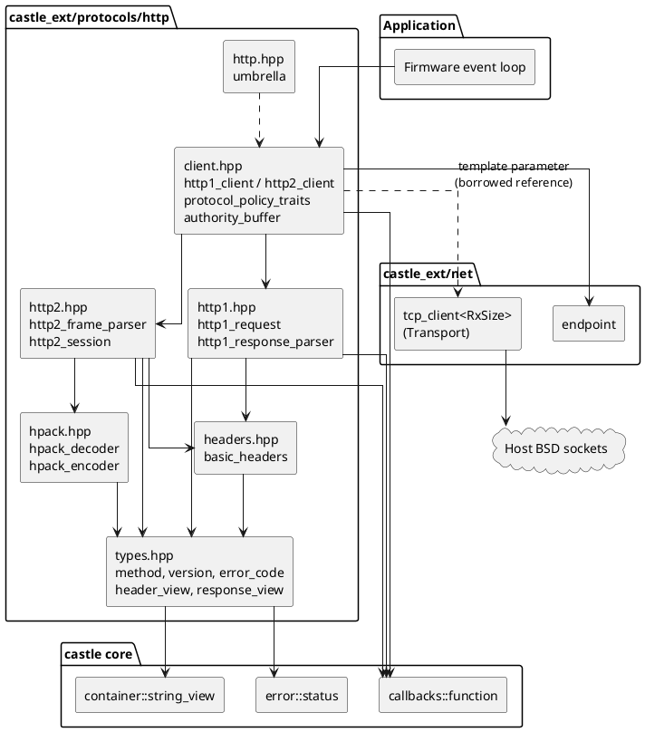
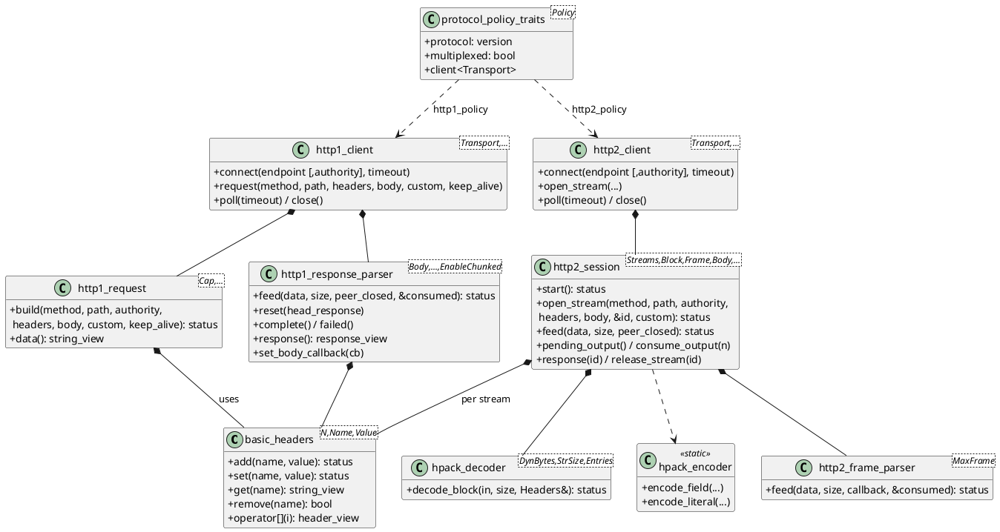
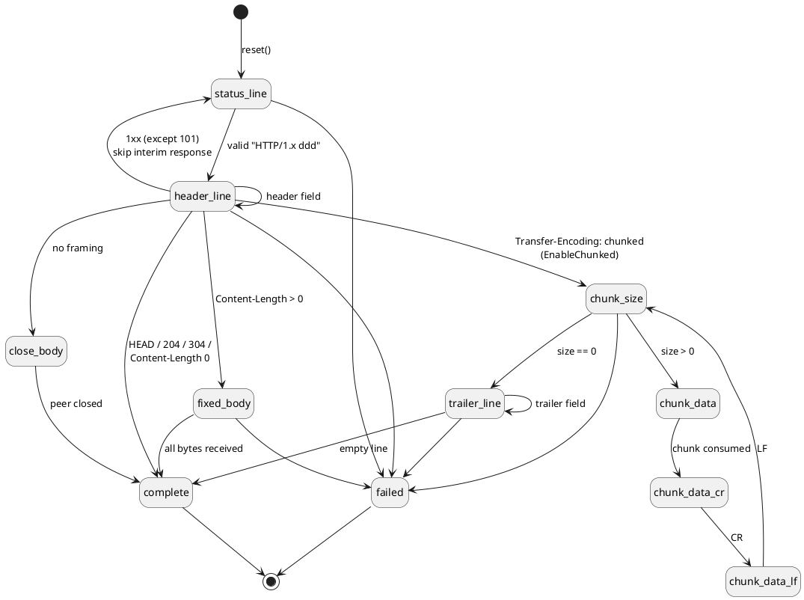
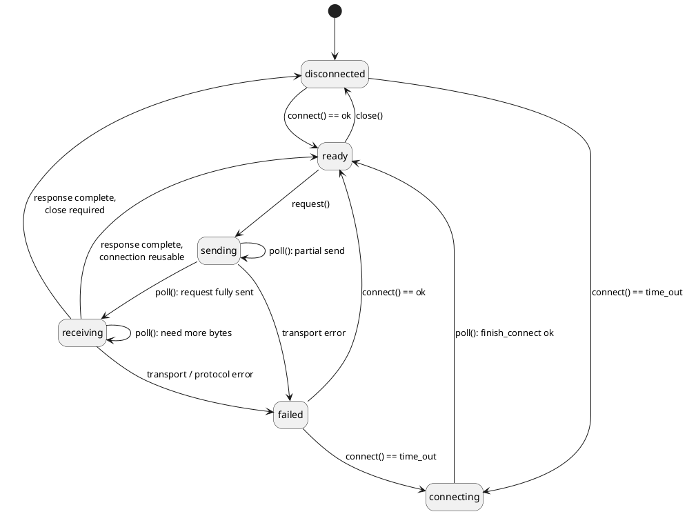
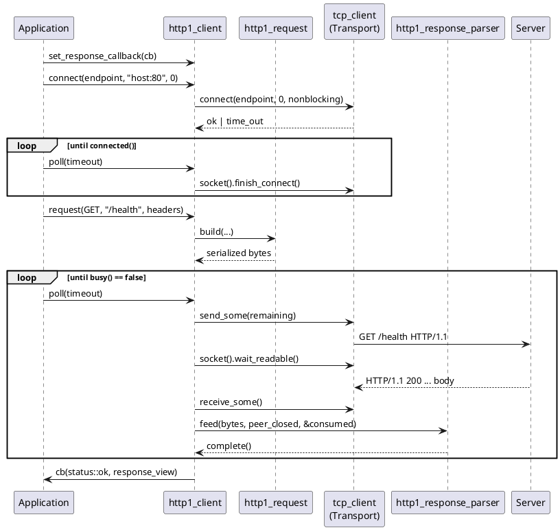
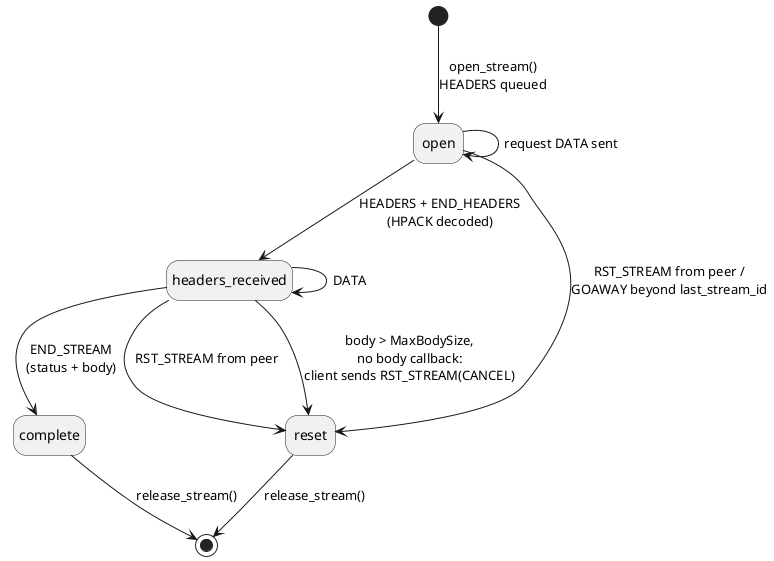
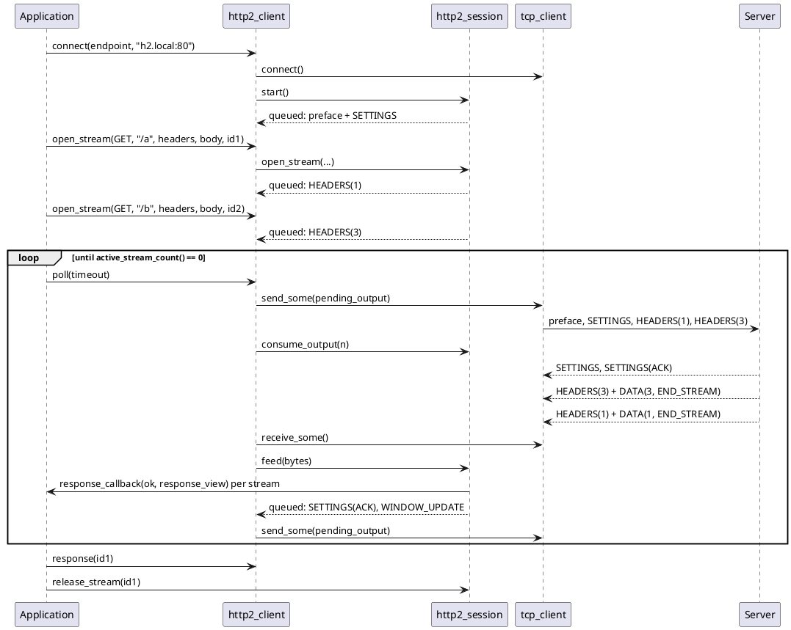

# castle_ext/protocols/http — Architecture and Protocol Guide

Allocation-free HTTP/1.1 and HTTP/2 **client** stack for CASTLE. It targets embedded devices that talk to a local gateway, a cloud REST endpoint behind a plain-TCP proxy, or a test server, using a caller-driven `poll()` loop. It follows CASTLE's constraints: no heap, no exceptions, no RTTI, no virtual functions, no STL, and compile-time-bounded memory.

Per-header API reference is in this directory ([types](types.md), [headers](headers.md), [hpack](hpack.md), [http1](http1.md), [http2](http2.md), [client](client.md), [umbrella](http.md)). This document explains the protocols, how the implementation maps onto them, and how the pieces fit together.

## 1. Goals and constraints

| Goal | How it is met |
|---|---|
| No allocation | Header collections, request buffer, parser line/body buffers, HPACK tables, stream records and the HTTP/2 output queue are plain members sized by template parameters. `sizeof(client)` is its whole memory cost. |
| No virtual / RTTI | Protocol selection is compile-time (`protocol_policy_traits<Policy>::client<Transport>`). Callbacks are `castle::callbacks::function` with in-place storage. |
| Errors without exceptions | Every operation returns `castle::status`; the protocol-level cause is available as `http::error_code` through `last_error()`. |
| Deterministic | One connect, send or receive step per `poll()`. No worker threads, no hidden loops, no hidden retries. The application owns the event loop and the timeouts. |
| Transport independence | Clients are templates over a `Transport` reference (normally `castle::net::tcp_client`). Protocol code never includes OS socket headers, so it can be unit-tested with a mock transport. |
| Bounded input handling | Every length (line, header, body, header block, frame, dynamic table) has a hard limit and a defined failure; no unbounded buffering of peer data. |
| Single pass | The HTTP/1.1 parser examines each byte once and never backtracks; the HTTP/2 frame parser assembles frames incrementally from arbitrary read boundaries. |

## 2. Protocols at a glance

| Aspect | HTTP/1.1 (RFC 9110 semantics, RFC 9112 syntax) | HTTP/2 (RFC 9113, HPACK RFC 7541) |
|---|---|---|
| Wire format | Text: request line, `name: value` fields, CRLF, optional body | Binary: 9-byte frame header + payload |
| Concurrency | One in-flight request per connection (no pipelining in this client) | Many concurrent streams multiplexed on one connection |
| Header compression | None | HPACK (static table, Huffman, optional dynamic table) |
| Message framing | `Content-Length`, `chunked`, or close-delimited | `END_STREAM` flag on `HEADERS`/`DATA` |
| Flow control | TCP only | Per-stream and per-connection windows (default 65,535 bytes) |
| Connection reuse | `Connection: keep-alive` / `close` | Connection is long-lived; ended by `GOAWAY` or close |
| Host identification | `Host` header | `:authority` pseudo-header |
| This client | `http1_client` | `http2_client` (h2c, prior knowledge) |

### 2.1 HTTP/1.1 message format

```text
GET /health HTTP/1.1\r\n            <- request line: method SP target SP version
Host: device.local:80\r\n           <- header fields (name ":" OWS value OWS)
Connection: keep-alive\r\n
\r\n                                 <- empty line ends the header section
[body]                               <- framed by Content-Length / chunked / connection close

HTTP/1.1 200 OK\r\n                  <- status line: version SP 3-digit code [SP reason]
Content-Length: 5\r\n
\r\n
hello
```

Body length of a response is determined in this order (RFC 9112 section 6.3), as implemented by `http1_response_parser::headers_done()`:

1. Response to `HEAD`, status `204` or `304`: no body.
2. `Transfer-Encoding: chunked`: chunked decoding (only when `EnableChunked`).
3. `Content-Length`: exactly that many bytes.
4. Otherwise: body runs until the peer closes the connection (connection cannot be reused).

Chunked body (`EnableChunked = true`):

```text
5\r\n hello \r\n      <- chunk-size (hex) [;extension] CRLF, data, CRLF
0\r\n                 <- last-chunk
Trailer: value\r\n    <- optional trailer fields (validated, kept in response headers)
\r\n
```

### 2.2 HTTP/2 frame format

```text
+-----------------------------------------------+
| Length (24) | Type (8) | Flags (8)            |
+-+---------------------------------------------+
|R| Stream Identifier (31)                      |
+=+=============================================+
| Frame Payload (Length bytes, <= MaxFrameSize) |
+-----------------------------------------------+
```

| Frame | Type | Handling in this client |
|---|---|---|
| `DATA` | 0 | Delivered to the body buffer and/or body callback; flow-control accounted; `END_STREAM` completes the response. |
| `HEADERS` | 1 | Response headers or trailers; padding and priority fields are skipped; `END_HEADERS` triggers HPACK decoding. |
| `PRIORITY` | 2 | Length-checked, otherwise ignored. |
| `RST_STREAM` | 3 | Marks the stream reset and reports `data_loss` to the response callback. |
| `SETTINGS` | 4 | Applied and acknowledged; ACKs are consumed. |
| `PUSH_PROMISE` | 5 | Rejected as a connection `protocol_error` (push is disabled in our SETTINGS). |
| `PING` | 6 | Echoed with the ACK flag. |
| `GOAWAY` | 7 | Sets `goaway_received`; streams above `last_stream_id` fail. |
| `WINDOW_UPDATE` | 8 | Adds send credit to the connection or stream. |
| `CONTINUATION` | 9 | Extends the header block; no other frame may interleave. |
| unknown | other | Ignored (extension frames). |

Connection start (prior knowledge, RFC 9113 section 3.3): the client sends the 24-byte preface `PRI * HTTP/2.0\r\n\r\nSM\r\n\r\n` followed by a `SETTINGS` frame advertising:

| Setting | Value |
|---|---|
| `SETTINGS_HEADER_TABLE_SIZE` | `MaxDynamicTableBytes` (0 disables the dynamic table) |
| `SETTINGS_ENABLE_PUSH` | 0 |
| `SETTINGS_MAX_FRAME_SIZE` | `MaxFrameSize` |

Client streams use odd identifiers (1, 3, 5, ...), incremented by 2 per request.

## 3. Layering

Dependencies point downward only. The protocol layers never touch a socket; only the `Transport` does.



| Layer | Responsibility |
|---|---|
| `types` | Shared vocabulary: `version`, `method`, `error_code`, `header_view`, `response_view`; ASCII helpers; token/visible-text/decimal validators in `detail`; `to_status()`. |
| `headers` | `basic_headers<MaxHeaders, MaxNameSize, MaxValueSize>`: owning, validated, case-insensitive field storage. Accepts `:`-prefixed pseudo-header names. |
| `hpack` | Bounded RFC 7541 decoder (static table, Huffman, optional dynamic table) and a stateless encoder (static indexes + plain literals). |
| `http1` | Request serializer into a fixed buffer; byte-driven response parser with optional chunked decoding and body streaming. |
| `http2` | Incremental frame parser and a protocol-only session: streams, HPACK, flow control, circular output queue. No transport access. |
| `client` | Glue: binds a protocol layer to a `Transport`, tracks connection state, drives `poll()`, selects the protocol at compile time. |

## 4. Static structure



## 5. Choosing a protocol at compile time

```cpp
#include "castle_ext/protocols/http/http.hpp"
#include "castle_ext/net/client.hpp"

using namespace castle::protocols::http;

using tcp_type = castle::net::tcp_client<512U>;

// Equivalent spellings:
using client1 = basic_http_client<tcp_type, http1_policy>;   // == http1_client<tcp_type>
using client2 = basic_http_client<tcp_type, http2_policy>;   // == http2_client<tcp_type>

static_assert(!protocol_policy_traits<http1_policy>::multiplexed, "one request at a time");
static_assert(protocol_policy_traits<http2_policy>::multiplexed, "concurrent streams");
```

Use the explicit `http1_client<...>` / `http2_client<...>` templates when buffer sizes must be tuned; the policy alias uses default capacities.

| Choose | When |
|---|---|
| HTTP/1.1 | Simple request/response devices, smallest RAM, widest server support, easy `curl`/`tcpdump` debugging. |
| HTTP/2 | Several concurrent requests over one TCP connection, many repetitive headers (HPACK), servers that speak h2c with prior knowledge. |

## 6. HTTP/1.1 client

### 6.1 Request serialization

`http1_request::build()` writes into a fixed buffer and returns `ok`, `invalid_argument`, or `full`.

| Rule | Behavior |
|---|---|
| Method | Standard token or `custom_method`; must be an RFC 9110 token. |
| Target / authority | Must be non-empty visible text (no whitespace, controls). |
| `Host` | Added from the authority unless the caller supplied one. |
| `Content-Length` | Added when a body is present or the method is `POST`/`PUT`/`PATCH`; a caller-supplied value must equal the body size. |
| `Connection` | Added as `keep-alive` or `close` (from `keep_alive`) unless supplied. |
| `Transfer-Encoding` | Rejected: only `Content-Length` framing is emitted. |
| Pseudo-headers (`:name`) | Rejected. |

### 6.2 Response parser state machine



Validation performed while parsing:

| Condition | Result (`error_code`) |
|---|---|
| Bare `LF` without `CR` | `malformed_message` |
| Line longer than `MaxLineSize` | `header_line_limit` |
| Version other than `HTTP/1.0`/`HTTP/1.1`, non 3-digit or out-of-range code | `malformed_status_line` |
| Invalid field syntax | `invalid_header` |
| More than `MaxHeaders`, or name/value too large | `header_limit` |
| Conflicting `Content-Length` values, or `Content-Length` together with `Transfer-Encoding` | `malformed_message` |
| `Transfer-Encoding: chunked` while `EnableChunked == false` | `chunked_not_supported` |
| Any other transfer coding, `101 Switching Protocols` | `unsupported_feature` |
| Body larger than `MaxBodySize` without a body callback | `body_limit` |
| Bad chunk size, chunk terminator or forbidden trailer (`Content-Length`, `Transfer-Encoding`, `Host`, `Connection`, `Trailer`) | `invalid_chunk` |
| Peer closes before the response is complete (and not close-delimited) | `connection_closed` |

`feed()` reports how many bytes it consumed. Bytes after the end of a complete response are left to the caller; the client treats them as a reason not to reuse the connection.

### 6.3 Client connection state machine



A connection is reused only when **all** hold: the peer did not close, no bytes followed the response, the response allows keep-alive (HTTP/1.1 without `Connection: close`, or HTTP/1.0 with `Connection: keep-alive`), and the request itself did not ask for `close`. Otherwise the transport is closed before the response callback runs, and `connect()` must be called again.

### 6.4 Request/response sequence



`poll()` status codes such as `time_out`, `empty` and `full` are forwarded unchanged: they mean "try again", not failure. Real failures (`data_loss`, protocol errors) also invoke the response callback with the failure status and the partial response, and move the client to `failed`.

## 7. HTTP/2 client

### 7.1 Session internals

```plantuml
@startuml
skinparam componentStyle rectangle
skinparam shadowing false

package "http2_client" {
  [poll()\nflush_output + read + feed + flush_output] as Poll
  [receive_buffer_\n(ReceiveBufferSize)] as Rx
}

package "http2_session" {
  [http2_frame_parser\npayload_[MaxFrameSize]] as FP
  [handle_frame()\ndispatcher] as Disp
  [hpack_decoder\n(shared per connection)] as Dec
  [stream_record[MaxConcurrentStreams]\nheaders, header_block, body,\nsend/receive windows] as Streams
  [circular output queue\noutput_[MaxOutputSize]] as Out
  [hpack_encoder\n(static)] as Enc
  [flow control\nconnection + stream windows] as FC
}

[tcp_client] as Tcp

Poll --> Tcp : send_some / receive_some
Tcp --> Rx
Rx --> FP : feed(bytes)
FP --> Disp : complete frame
Disp --> Dec : END_HEADERS
Dec --> Streams
Disp --> Streams : DATA, RST_STREAM
Disp --> FC
FC --> Out : WINDOW_UPDATE
Disp --> Out : SETTINGS ACK, PING ACK
Enc --> Out : HEADERS / CONTINUATION
Streams --> Out : request DATA (window permitting)
Out --> Poll : pending_output()\nconsume_output(n)
@enduml
```

### 7.2 Request encoding (`open_stream`)

The session builds an HPACK block containing, in order, `:method`, `:scheme` (`http`), `:authority`, `:path`, then the caller's fields, and queues it as `HEADERS` (+ `CONTINUATION` frames when it exceeds the peer's `MAX_FRAME_SIZE`). `END_STREAM` is set on the final header frame when there is no body. The request body is referenced, not copied, and sent as `DATA` frames as flow-control windows and queue space allow.

| Rule | Behavior |
|---|---|
| Field names | Must be lowercase (`ascii_lowercase`); pseudo-headers cannot be supplied by the caller. |
| Connection-specific fields | `host`, `connection`, `proxy-connection`, `keep-alive`, `transfer-encoding`, `upgrade` rejected (`invalid_argument`); use `:authority` instead of `host`. |
| `te` | Only `trailers` accepted. |
| Capacity | `full` when the header block or output queue cannot hold the request; `out_of_range` at the stream limit (the smaller of `MaxConcurrentStreams` and the peer's `MAX_CONCURRENT_STREAMS`). |
| After `GOAWAY` | `data_loss`; no new streams. |

The encoder emits static-table indexes for exact matches and non-Huffman, non-indexed literals otherwise, so it needs no mutable compression state and produces deterministic output.

### 7.3 Stream lifecycle



A stream slot stays allocated after completion until `release_stream()`. The response view stays valid until then. Header-limit and HPACK errors are **connection** errors, since the shared compression context can no longer be trusted: all unfinished streams are notified and the connection fails.

### 7.4 Flow control

HTTP/2 uses credit windows (initially 65,535 bytes) for the connection and for each stream; only `DATA` frames consume credit.

| Direction | Mechanism in this implementation |
|---|---|
| Sending request DATA | Limited by `min(connection window, stream window, peer max frame size, free output space)`. Peer `WINDOW_UPDATE` and `SETTINGS_INITIAL_WINDOW_SIZE` changes re-enable sending via `pump_request_bodies()`. |
| Receiving response DATA | Consumed synchronously (stored up to `MaxBodySize` and/or passed to the body callback), so credit is returned automatically: a `WINDOW_UPDATE` is queued once half the default window (32,768 bytes) has been consumed, for the connection and each unfinished stream. A full output queue only delays the update. |
| In-flight frames of reset/released streams | Discarded after flow-control accounting so the connection window stays correct. |

### 7.5 Polling model

`http2_client::poll()` performs, per call:

1. Finish a pending connect and call `session.start()` (preface + SETTINGS).
2. Flush queued output with `send_some`; a blocked write does **not** stop reads, because the peer may need to deliver `WINDOW_UPDATE`/`SETTINGS` before the write can proceed.
3. Wait for readability (`timeout_ms`), `receive_some`, and `session.feed()`.
4. Flush output again (ACKs, window updates, newly allowed request DATA).



Responses can complete in a different order than the requests; use `response_view::stream_id` (or the `stream_id` returned by `open_stream`) to correlate them.

## 8. HPACK

`hpack_decoder` implements RFC 7541 sections 5-6:

| Representation | Support |
|---|---|
| Indexed field (`1xxxxxxx`) | Static and dynamic table |
| Literal with incremental indexing (`01xxxxxx`) | Added to the dynamic table when enabled |
| Literal without indexing / never indexed (`0000` / `0001`) | Decoded, not stored |
| Dynamic table size update (`001xxxxx`) | Only at the start of a block, bounded by `MaxDynamicTableBytes` |
| Huffman strings | Complete alphabet; EOS in data and invalid padding are rejected |
| Integers | Prefix integers with overflow detection |

`MaxDynamicTableBytes = 0` removes dynamic-table storage; the session then advertises `SETTINGS_HEADER_TABLE_SIZE = 0` and the server must not use indexed dynamic entries. `MaxStringSize` bounds each decoded name/value, and `MaxDynamicEntries` bounds the entry count (default `MaxDynamicTableBytes / 32 + 1`, since each entry costs at least 32 bytes). An oversized incremental entry empties the table but keeps the negotiated size.

## 9. Error handling

Protocol errors use `http::error_code`; `to_status()` folds them into `castle::status`:

| `error_code` | `castle::status` |
|---|---|
| `ok` | `ok` |
| `header_limit`, `header_line_limit`, `body_limit`, `frame_size_limit`, `dynamic_table_limit`, `stream_limit`, `output_full` | `out_of_range` |
| `connection_closed`, `goaway_received`, `stream_reset`, `stream_closed` | `data_loss` |
| `request_in_progress`, `unsupported_feature`, `chunked_not_supported` | `invalid_config` |
| everything else (malformed message/status/header, invalid chunk/frame, compression, flow control, protocol error) | `invalid_argument` |

`poll()` return values worth distinguishing:

| Status | Meaning |
|---|---|
| `ok` | Progress was made. |
| `time_out` | Connect or readability wait not finished; poll again. |
| `empty` / `full` | Transport would block on read / write; poll again. |
| `not_configured` | Not connected, or (HTTP/1.1) a request is already in flight. |
| `invalid_config` | `connect()` called while a connection is open or pending (HTTP/1.1). |
| other | Failure; the response callback has been invoked with the status. |

## 10. Memory budget

All storage is inline. Approximate cost, with `H = MaxHeaders`, `N = MaxHeaderNameSize`, `V = MaxHeaderValueSize`:

| Object | Dominant terms |
|---|---|
| `basic_headers` | `H * (N + V + 2)` + per-field bookkeeping |
| `http1_request` | `MaxRequestSize` (headers are borrowed during `build()`, not stored) |
| `http1_response_parser` | `MaxBodySize + MaxLineSize` + one `basic_headers` + `H` `header_view`s |
| `http1_client` | request buffer + parser + `ReceiveBufferSize` + 64-byte authority buffer |
| `http2_frame_parser` | `MaxFrameSize` payload buffer (minimum 16,384) |
| `http2_session` | frame parser + `MaxOutputSize` queue + `MaxHeaderBlockSize` + `MaxConcurrentStreams * (basic_headers + H views + MaxHeaderBlockSize + MaxBodySize)` + HPACK dynamic table |
| `http2_client` | session + `ReceiveBufferSize` + 64-byte authority buffer |

Tuning hints:

- The 16 KiB frame buffer dominates a default `http2_client`; it cannot go below 16,384 bytes because RFC 9113 requires clients to accept frames of that size.
- Lower `MaxConcurrentStreams`, `MaxBodySize`, `MaxHeaderValueSize` first on small targets; per-stream cost is multiplied by the stream count.
- Register a body callback to stream large payloads instead of enlarging `MaxBodySize`.
- Keep the owner of a client (and its transport) on static storage or a large task stack; these objects are not small.

## 11. Authority (Host / `:authority`)

`connect(endpoint, timeout)` formats the numeric `a.b.c.d:port` (or `[x:x:...:x]:port` for IPv6) as the authority. `connect(endpoint, "name:port", timeout)` stores a caller-supplied text (up to 63 characters, visible characters only; `out_of_range` / `invalid_argument` otherwise). For HTTP/2 an explicit authority passed to `open_stream()` overrides the default; an empty one selects it.

## 12. Standards coverage

| Feature | Status |
|---|---|
| HTTP/1.0 and HTTP/1.1 responses, keep-alive reuse | Supported (one request at a time) |
| HTTP/1.1 request pipelining | Not supported by design |
| Chunked transfer coding and trailers | Optional (`EnableChunked`), bounded |
| `Expect: 100-continue`, interim `1xx` responses | `1xx` skipped (except `101`); `Expect` is just a header |
| `gzip` / `deflate` / other content or transfer codings | Not supported (`unsupported_feature` for transfer codings) |
| Redirect following, cookies, caching, authentication helpers | Out of scope; the application inspects `response_view` |
| HTTP/2 prior knowledge over cleartext TCP (h2c) | Supported |
| HTTP/2 via `Upgrade: h2c` or ALPN | Not supported |
| HTTP/2 server push | Disabled; `PUSH_PROMISE` is a protocol error |
| HTTP/2 stream priorities | Ignored |
| HTTP/2 `HEADERS` padding and priority fields, `CONTINUATION` | Supported on receive |
| HTTP/2 client flow control | Supported (automatic receive credit; send windows honoured) |
| HPACK | Full decoder; encoder uses static indexes and literals only |
| TLS / HTTPS / HTTP/3 | Not supported (put a TLS-terminating proxy in front or add a TLS transport later) |
| Server role | Not provided |

Because there is no TLS, do not send credentials or personal data over untrusted networks with this client.

## 13. Quick start

HTTP/1.1:

```cpp
#include "castle_ext/protocols/http/http.hpp"
#include "castle_ext/net/client.hpp"

using namespace castle;
using namespace castle::protocols;

int fetch_health()
{
    net::tcp_client<512U> tcp;
    http::http1_client<decltype(tcp)> client(tcp);
    bool done = false;
    if (client.set_response_callback([&done](status result, http::response_view const& response)
        { done = result == status::ok && response.status_code == 200U; }) != status::ok)
    {
        return 1;
    }
    const net::endpoint remote = net::endpoint::ipv4(192U, 0U, 2U, 10U, 80U);
    status result = client.connect(remote, "example.test:80", 0);
    for (size_type i = 0U; !client.connected() && i < 1000U; ++i)
    {
        result = client.poll(50);
    }
    if (!client.connected())
    {
        return 2;
    }
    http::http1_client<decltype(tcp)>::headers_type headers;
    if (client.request(http::method::get, "/health", headers) != status::ok)
    {
        return 3;
    }
    for (size_type i = 0U; i < 1000U && client.busy(); ++i)
    {
        result = client.poll(50);
    }
    (void)result;
    return done ? 0 : 4;
}
```

HTTP/2 (two concurrent requests):

```cpp
net::tcp_client<512U> tcp;
http::http2_client<decltype(tcp)> client(tcp);
client.set_response_callback([](status result, http::response_view const& response)
{
    // response.stream_id identifies the request; headers/body are valid only inside this call
    // (and until release_stream() through client.session()).
});

client.connect(net::endpoint::ipv4(192U, 0U, 2U, 10U, 80U), "h2.test:80", 0);
// poll(...) until client.connected(), then:
http::http2_client<decltype(tcp)>::headers_type headers;     // names must be lowercase
uint32_t first = 0U;
uint32_t second = 0U;
client.open_stream(http::method::get, "/a", headers, string_view(), first);
client.open_stream(http::method::get, "/b", headers, string_view(), second);
while (client.session().active_stream_count() != 0U)
{
    client.poll(50);
}
client.session().release_stream(first);
client.session().release_stream(second);
```

## 14. Design rules for contributors

- Keep protocol layers free of OS headers; reach the network only through the `Transport` template parameter (needs `connect`, `send_some`, `receive_some`, `close`, `socket().finish_connect`, `socket().wait_readable`).
- Every new buffer or limit must be a template parameter with a documented failure status; never grow dynamically.
- Treat all peer bytes as hostile: validate, bound, and fail with an `error_code` rather than truncating silently.
- Do not hide `time_out`/`empty`/`full`; they are the caller's scheduling signal.
- Keep the shared validators in `types.hpp` `detail` so HTTP/1.1 and HTTP/2 paths accept exactly the same token and text rules.

## 15. Document index

| Document | Content |
|---|---|
| [types.md](types.md) | Methods, versions, error codes, views, helpers |
| [headers.md](headers.md) | Fixed-capacity header collection |
| [hpack.md](hpack.md) | HPACK decoder and encoder |
| [http1.md](http1.md) | HTTP/1.1 request builder and response parser |
| [http2.md](http2.md) | HTTP/2 frame parser and session |
| [client.md](client.md) | Polled client adapters and policy selection |
| [http.md](http.md) | Umbrella header |
| [../../net/README.md](../../net/README.md) | TCP transport architecture |
