# castle_ext/protocols/mqtt — Architecture and Protocol Guide

Allocation-free, header-only **MQTT client and broker** for CASTLE. Both are built on the TCP sockets of [`castle_ext/net`](../../net/README.md): the client sits on `castle::net::tcp_client`, the broker on `castle::net::tcp_server`. They share one packet codec, one set of protocol types and one topic matcher, so an embedded node can publish/subscribe to a remote broker *or* host its own small broker in the same firmware.

The implementation follows CASTLE's constraints: no heap, no exceptions, no RTTI, no virtual functions, no hidden clock, no threads. Every buffer, table and queue has a compile-time capacity chosen through template parameters. Progress is made only when the application calls `poll()`.

Per-header API reference lives in this directory ([types](types.md), [topic](topic.md), [codec](codec.md), [client](client.md), [broker](broker.md), [umbrella](mqtt.md)). This document explains the design, how the code maps onto the MQTT specification, and how the pieces fit together.

## 1. Goals and constraints

| Goal | How it is met |
|---|---|
| Run on MCUs and small Linux targets | Header-only; all storage is inline in the `basic_client` / `basic_broker` objects |
| Deterministic memory | Template capacities (`MaxPacketSize`, `MaxOutstanding`, `MaxSubscriptions`, …); exhaustion returns a `castle::status`, never allocates |
| No threads required | Single-threaded, poll-driven; the caller supplies a monotonic `now_ms` |
| Robust against TCP framing | Byte-stream reassembly buffer; packets may arrive split or coalesced |
| Defensive parsing | Fixed-header flag validation, Remaining Length canonical-form check, UTF-8 validation, bounds-checked reader/writer |
| MQTT 3.1 / 3.1.1 / 5.0 interoperability | One codec, version-dependent body layout (properties and reason codes for v5) |
| Testable in isolation | Codec and topic matcher are pure functions over byte arrays |

## 2. Module layout

| Header | Role |
|---|---|
| [`types.hpp`](../../../../include/castle_ext/protocols/mqtt/types.hpp) | `version`, `qos`, `packet_type`, `reason_code`, `property_id`, fixed-capacity `property` / `property_list`, `message_view`, `will_options`, `connect_options`, `to_status(reason_code)` |
| [`topic.hpp`](../../../../include/castle_ext/protocols/mqtt/topic.hpp) | `validate_topic_name`, `validate_topic_filter`, `topic_matches`, UTF-8 validation |
| [`codec.hpp`](../../../../include/castle_ext/protocols/mqtt/codec.hpp) | Remaining Length varint, `inspect_packet` (stream framing), `packet_writer`, `packet_reader`, `encode_properties` / `decode_properties`, `encode_packet` |
| [`client.hpp`](../../../../include/castle_ext/protocols/mqtt/client.hpp) | `basic_client<…>` and the `client` alias |
| [`broker.hpp`](../../../../include/castle_ext/protocols/mqtt/broker.hpp) | `basic_broker<…>` and the `broker` alias |
| [`mqtt.hpp`](../../../../include/castle_ext/protocols/mqtt/mqtt.hpp) | Umbrella include for all of the above |

Related material: unit tests in [`test/castle_ext/protocols/mqtt/`](../../../../test/castle_ext/protocols/mqtt), samples in [`samples/castle_ext/protocols/mqtt/`](../../../../samples/castle_ext/protocols/mqtt).

## 3. Architecture

### 3.1 Layering and dependencies

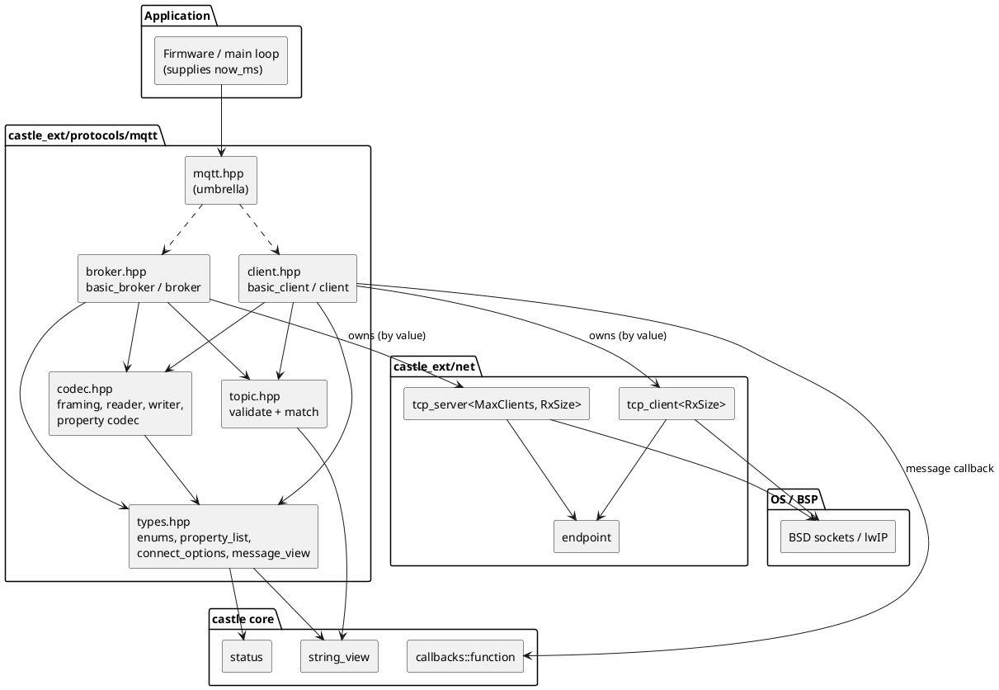

Both the client and the broker **own** their transport by value (`transport_type transport_`, `server_type server_`) and expose it via `transport()` for advanced integration. The transport is the only place that touches the OS; everything above it works on byte buffers.

### 3.2 Class model

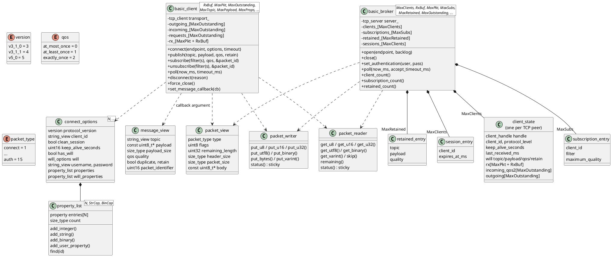

`property_list`, `connect_options`, `message_view` and `will_options` carry **no heap**: properties copy strings and binary blobs into inline arrays, and `message_view` is a non-owning view valid only inside the application callback.

### 3.3 The poll-driven execution model

Nothing happens on a background thread. The application owns the loop; each `poll()` call advances the protocol by a bounded amount of work.

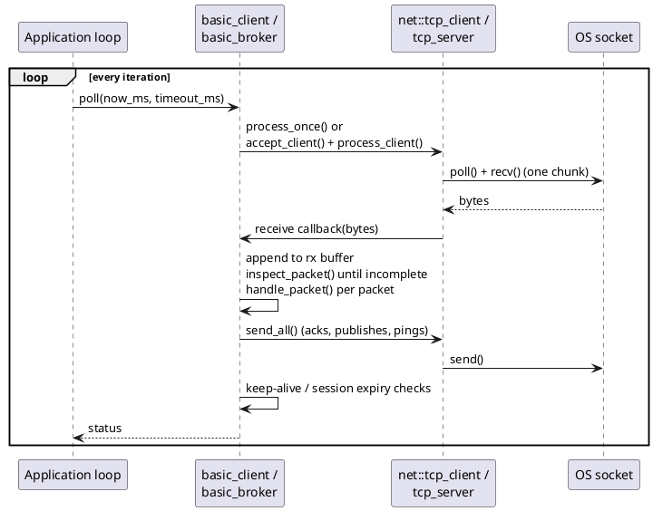

Consequences of this model:

- Receive callbacks run **inline** inside `poll()`. The user message callback must not re-enter `poll()`.
- Time is injected (`now_ms`, a wrapping `uint32_t`); deadlines use unsigned subtraction so they survive wrap-around.
- A call to `poll()` processes **one** receive chunk per connection, so call it often (or in a tight loop) when throughput matters.

## 4. Wire format and framing

### 4.1 Control packet layout

```
 byte 0            bytes 1..4               remaining bytes
+--------+------+---------------------+----------------------------+
| type   | flag | Remaining Length    | Variable header + Payload  |
| (4bit) |(4bit)| 1–4 byte base-128   | (Remaining Length bytes)   |
+--------+------+---------------------+----------------------------+
```

`inspect_packet()` ([`codec.hpp`](../../../../include/castle_ext/protocols/mqtt/codec.hpp)) examines the head of a byte buffer and returns:

| Result | Meaning |
|---|---|
| `ok` + `packet_view` | One complete packet is available; `body` points inside the caller's buffer |
| `empty` | More bytes needed (header or body incomplete) — wait for the next receive chunk |
| `invalid_argument` | Reserved type 0, illegal fixed-header flags, non-canonical or over-long Remaining Length |
| `out_of_range` | Frame larger than the configured `MaxPacketSize` |

Fixed-header flag rules enforced by `valid_fixed_header()`:

- `PUBLISH`: QoS ≠ 3, and DUP must be 0 when QoS = 0.
- `PUBREL`, `SUBSCRIBE`, `UNSUBSCRIBE`: flags must be `0b0010` (or `0b1010` for a retransmission with DUP).
- Every other packet type: flags must be `0`.

### 4.2 Stream reassembly

TCP is a byte stream, so both endpoints use the same pattern:

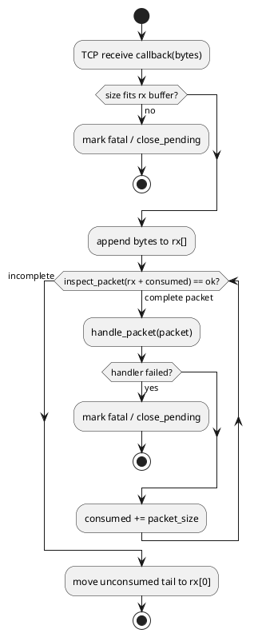

The reassembly buffer is `MaxPacketSize + ReceiveBufferSize` bytes: one maximum packet plus one TCP receive chunk, so a partially received packet can always be completed.

### 4.3 Reader / writer

`packet_writer` and `packet_reader` are bounds-checked cursors with a **sticky status**: after the first overflow or short read every further call is a no-op and `status()` reports the first error. Encoders can therefore perform a straight-line sequence of `put_*` calls and check `status()` once at the end. Strings use the 2-byte-length UTF-8 form; binary data (password, will payload) the 2-byte-length binary form; Property Length and subscription identifiers use the varint form.

### 4.4 MQTT 5.0 properties

`encode_properties` / `decode_properties` support all 27 property identifiers of the standard, grouped by wire type (byte, 2-byte, 4-byte, varint, binary, UTF-8 string, UTF-8 pair). Values land in a fixed-capacity `property_list`; the list capacity, string capacity and binary capacity are template parameters. Decoding enforces value ranges (e.g. `Receive Maximum` ≠ 0, boolean-like bytes ∈ {0,1}) and returns `full` if more properties arrive than the list can hold. When decoding with `ignore_unknown = true` (what the client and broker use), an unknown identifier causes the remaining property section to be skipped instead of failing the packet.

## 5. Topic names and filters

[`topic.hpp`](../../../../include/castle_ext/protocols/mqtt/topic.hpp) implements the MQTT topic rules without allocation:

| Function | Rule |
|---|---|
| `validate_topic_name` | Non-empty, valid UTF-8, **no** `+` or `#` |
| `validate_topic_filter` | Non-empty, valid UTF-8; `+` must occupy a whole level; `#` must be the whole, **last** level |
| `topic_matches(filter, topic)` | Level-by-level match; `+` matches exactly one level; `#` matches the parent and any depth below; wildcard filters never match `$`-prefixed topics |

Examples:

| Filter | Topic | Match |
|---|---|---|
| `sensors/+/temperature` | `sensors/kitchen/temperature` | yes |
| `sensors/+/temperature` | `sensors/kitchen/oven/temperature` | no |
| `sensors/#` | `sensors` | yes (parent level) |
| `sensors/#` | `sensors/a/b/c` | yes |
| `#` | `$SYS/uptime` | no (`$` topics excluded) |
| `$SYS/#` | `$SYS/uptime` | yes |

## 6. Client

### 6.1 Template parameters

| Parameter | Default | Meaning |
|---|---|---|
| `ReceiveBufferSize` | 512 | Size of one TCP receive chunk (`tcp_client<N>`) |
| `MaxPacketSize` | 1024 | Maximum encoded control packet, fixed header included |
| `MaxOutstanding` | 8 | Simultaneous in-flight QoS 1/2 publishes, QoS 2 receives, and SUBSCRIBE/UNSUBSCRIBE requests (each has its own table of this size) |
| `MaxTopicLength` | 128 | Max topic / filter / client-ID / username / password length + terminator |
| `MaxPayloadSize` | 512 | Max payload copied for QoS 1/2 retransmission and QoS 2 inbound hold |
| `MaxProperties` | 8 | MQTT 5 properties per list |
| `PropertyStringCapacity` / `PropertyBinaryCapacity` | 64 / 32 | Inline capacity per property value |

The default `client` object is about **18 KiB** (measured with `sizeof` on a 64-bit host).

### 6.2 Connection state machine

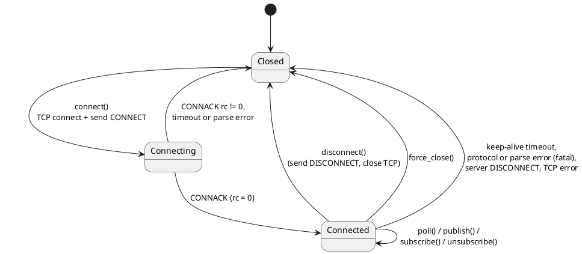

### 6.3 Connect sequence

`connect()` is the only **blocking** call: it opens TCP (blocking mode, for predictable `send_all` semantics), sends CONNECT, and runs `process_once(timeout_ms)` until a CONNACK arrives (a CONNACK may span several receive chunks).

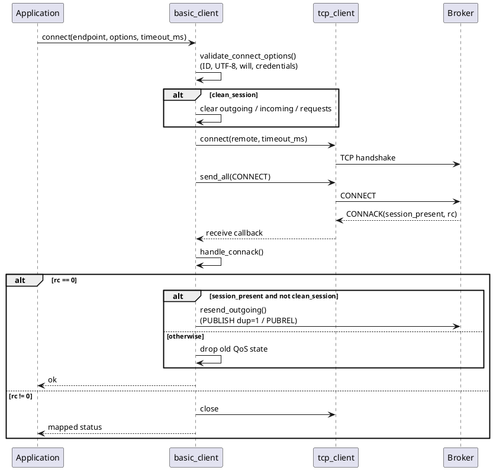

CONNACK return codes are mapped to `castle::status`:

| MQTT 3.x CONNACK code | `castle::status` | MQTT 5 reason | `castle::status` (via `to_status`) |
|---|---|---|---|
| 1 unacceptable protocol version | `invalid_config` | `unsupported_protocol_version` | `invalid_config` |
| 2 identifier rejected | `invalid_argument` | `client_identifier_not_valid`, `malformed_packet`, `protocol_error`, `topic_name_invalid` | `invalid_argument` |
| 3 server unavailable | `time_out` | `server_unavailable`, `server_busy` | `time_out` |
| 4 bad user/password, 5 not authorized | `not_configured` | `packet_too_large` | `out_of_range` |
| — | — | `packet_identifier_in_use`, `receive_maximum_exceeded` | `full` |
| — | — | `packet_identifier_not_found` | `not_found` |
| — | — | any other failure code (≥ 0x80) | `unknown_error` |

### 6.4 Publishing and the QoS flows

The client keeps a table of `MaxOutstanding` entries per direction. Each entry holds a **copy** of the topic and payload so the packet can be retransmitted after a reconnect, which is why the application's buffers need not outlive `publish()`.

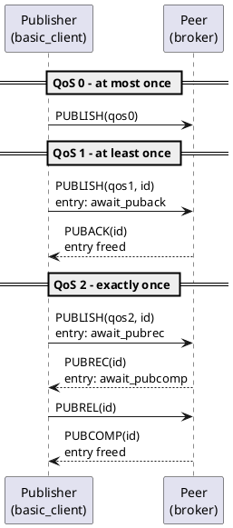

Inbound direction (client as receiver):

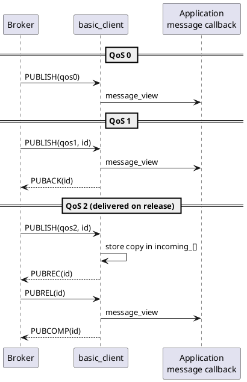

For inbound QoS 2 the application sees the message exactly once, **when PUBREL arrives**; a duplicated PUBLISH whose identifier is already stored does not create a second entry.

### 6.5 Subscribe / unsubscribe

`subscribe()` and `unsubscribe()` allocate a non-zero Packet Identifier (skipping any identifier still in use), reserve a `pending_request` slot, and send the packet. The identifier is returned through the out-parameter. When SUBACK/UNSUBACK arrives the slot is released and `last_acknowledged_packet_id()` is updated, so a typical wait looks like:

```cpp
uint16_t id = 0U;
mqtt.subscribe("sensors/#", qos::at_least_once, id);
while (mqtt.last_acknowledged_packet_id() != id) { mqtt.poll(now_ms(), 10); }
```

Multiple filters can be sent in one packet via the array overloads.

### 6.6 Keep-alive

With `keep_alive_seconds != 0`, `poll()` sends `PINGREQ` once no packet has been **sent** for a full keep-alive interval and no ping is outstanding. If the matching `PINGRESP` does not arrive within another interval, the client closes the connection and `poll()` returns `time_out`. Any send (publish, ack, subscribe…) resets the idle timer.

### 6.7 Error handling

`poll()` returns `ok`/`empty` when healthy. A malformed packet, an oversized packet, an unexpected acknowledgement, a server DISCONNECT or a keep-alive timeout is **fatal**: the client closes the socket, `is_connected()` becomes false, and `last_error()` holds the cause. Re-`connect()` to resume (with `clean_session = false`, outstanding QoS 1/2 exchanges are retransmitted when the broker reports `session_present`).

## 7. Broker

### 7.1 Template parameters

| Parameter | Default | Meaning |
|---|---|---|
| `MaxClients` | 4 | Concurrent TCP peers; also the size of the session table |
| `ReceiveBufferSize` | 512 | TCP receive chunk per `process_client()` |
| `MaxPacketSize` | 1024 | Max control packet; each client also owns a `MaxPacketSize + ReceiveBufferSize` reassembly buffer |
| `MaxSubscriptions` | 32 | Total subscription entries across all clients; also the per-SUBSCRIBE filter limit |
| `MaxRetained` | 16 | Retained-message slots |
| `MaxOutstanding` | 8 | Per client: outbound QoS 1/2 entries and inbound QoS 2 entries |
| `MaxTopicLength`, `MaxPayloadSize`, `MaxProperties`, … | 128, 512, 8 | As for the client |

The default `broker` object is about **73 KiB**; the footprint scales mostly with `MaxClients × (2 × MaxOutstanding × (MaxTopicLength + MaxPayloadSize) + MaxPacketSize + ReceiveBufferSize)`. Tune the template arguments for your target.

### 7.2 Data model

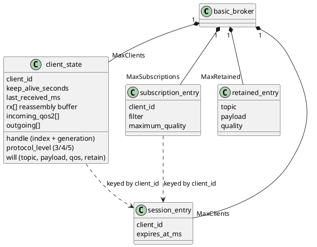

Subscriptions and sessions are keyed by **client identifier** (not by socket), which is what allows a non-clean session to keep its subscriptions across a reconnect. TCP peers are identified by the server's generation-checked `client_handle`, so a stale handle can never address a recycled slot.

### 7.3 `poll()` behaviour

Each `poll(now_ms, accept_timeout_ms)`:

1. Expires sessions whose `expires_at_ms` has passed (clearing their subscriptions).
2. Accepts at most one new TCP connection and installs the receive trampoline for it.
3. For each connected peer: enforces keep-alive (closes if silent for **1.5 ×** the negotiated keep-alive, and arms the will), then processes one receive chunk.
4. For peers marked `close_pending`: publishes the Last Will if still armed, applies session retention rules, and closes the socket.

### 7.4 Client connection lifecycle

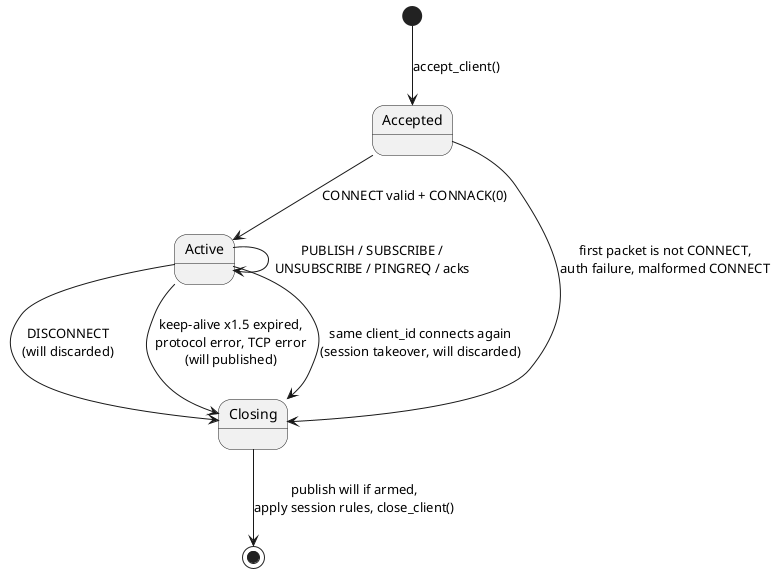

### 7.5 CONNECT processing

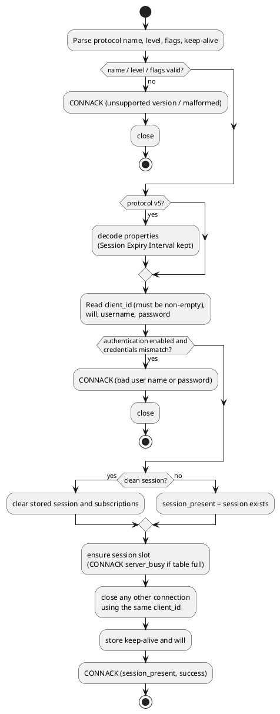

### 7.6 Publish routing

For every PUBLISH that completes (QoS 0/1 on arrival, QoS 2 on `PUBREL`), the broker runs `publish_message()`:

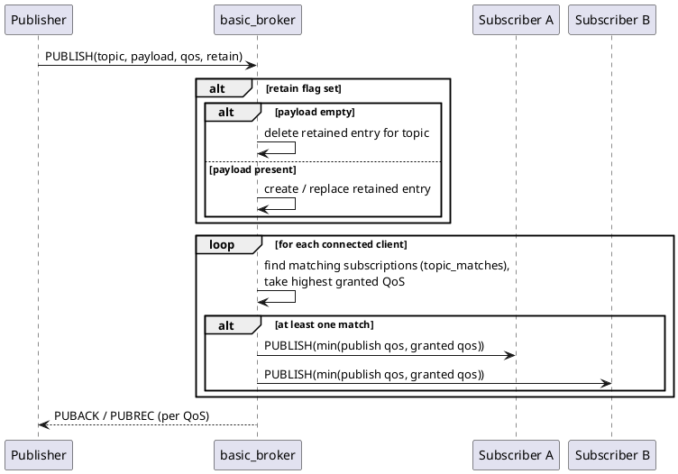

Rules visible in the code:

- A client with several overlapping subscriptions receives **one** copy, at the highest matching granted QoS (capped by the publish QoS).
- Live forwards carry `retain = 0`; only retained replays on SUBSCRIBE carry `retain = 1`.
- A retained message with an empty payload clears the retained entry; if the retained table is full a new retained message is silently not stored.
- Outbound QoS 1/2 deliveries consume one `outgoing[]` entry per recipient until the subscriber acknowledges; if the table is full that delivery is dropped for that recipient.

### 7.7 Subscribe handling and retained replay

SUBSCRIBE validates every filter (`validate_topic_filter`) and the options byte, adds/updates `subscription_entry` records, and answers with a SUBACK carrying one return code per filter (granted QoS, or `0x80` / `0x97` for v3 / v5 when the table is full). After the SUBACK is sent, every retained message matching each successfully granted filter is replayed with `retain = 1`, at `min(retained qos, granted qos)`.

### 7.8 Sessions, Last Will and authentication

| Feature | Behaviour |
|---|---|
| Clean Session / Clean Start | Clears stored subscriptions for that client ID |
| Non-clean session (v3) | Subscriptions stay in RAM after disconnect; `session_present = 1` on reconnect |
| Session Expiry Interval (v5) | `0` ⇒ session removed at disconnect; non-zero ⇒ kept until `now + expiry`, pruned by `poll()` |
| Session takeover | A second CONNECT with the same client ID closes the older connection without publishing its will |
| Last Will | Armed at CONNECT; published on any termination other than a client DISCONNECT (keep-alive timeout, protocol error, TCP failure) |
| Authentication | `set_authentication(user, pass)`; empty user disables it. CONNECT must supply both fields and they must match, otherwise CONNACK `bad user name or password` and the socket is closed |

## 8. Protocol support matrix

| Area | MQTT 3.1 / 3.1.1 | MQTT 5.0 |
|---|---|---|
| CONNECT / CONNACK | Yes (client + broker); `MQIsdp` and `MQTT` protocol names | Yes; properties decoded, Session Expiry honoured by the broker |
| PUBLISH QoS 0 / 1 / 2 | Yes | Yes (empty properties on send; inbound properties parsed and discarded) |
| SUBSCRIBE / UNSUBSCRIBE | Yes (multi-filter) | Yes; reason codes returned (`0x11` for unknown filter on UNSUBACK) |
| Retained messages | Yes (broker) | Yes |
| Will message | Yes | Yes (will properties parsed, will delay not applied) |
| Username / password | Yes | Yes |
| PINGREQ / PINGRESP, keep-alive | Yes | Yes |
| DISCONNECT with reason code | n/a | Client can send a reason; both ends parse it |
| AUTH (enhanced authentication) | n/a | Not supported (rejected) |
| Shared subscriptions, topic aliases, flow control, no-local / retain-as-published / retain-handling, subscription identifiers, request/response | n/a | Not implemented (properties are parsed but not acted upon) |
| TLS, WebSocket, persistence to disk, clustering, bridging | Out of scope | Out of scope |

## 9. Status mapping

All APIs return `castle::status` (see [`status.hpp`](../../../../include/castle/error/status.hpp)). The most relevant values:

| Status | Typical cause |
|---|---|
| `ok` | Operation succeeded |
| `empty` | `poll()` found nothing to process; or more stream bytes are needed (codec) |
| `not_configured` | Operation requires an open/connected client or server (`publish()` before CONNACK, `poll()` on a closed transport); CONNACK 4/5 |
| `invalid_argument` | Bad topic/filter, UTF-8, null payload with non-zero size, malformed or unexpected packet |
| `out_of_range` | Topic or payload larger than the configured capacity; packet above `MaxPacketSize` |
| `full` | No free outstanding-QoS slot, subscription slot, packet-ID, retained slot, or property slot |
| `time_out` | CONNACK wait expired, keep-alive PINGRESP missing, `server_busy` / `server_unavailable` |
| `invalid_config` | Unsupported protocol version, connect attempted while already open, AUTH packet |
| `data_loss` | `send_all` reported a short write |

## 10. Memory and cost

- **No dynamic allocation.** `sizeof(basic_client<…>)` / `sizeof(basic_broker<…>)` is the whole footprint; place the object in static storage or a long-lived scope (do not put a default broker on a small task stack).
- **Copy cost.** QoS 1/2 payloads are copied once into the outstanding table; incoming payloads are copied only for QoS 2 (held until PUBREL). QoS 0/1 inbound delivery passes a view directly into the receive buffer.
- **Lookup cost.** All tables are linear scans over small, compile-time-bounded arrays; routing a message is `O(MaxClients × MaxSubscriptions)` filter matches.
- **Stack use.** Packet handlers keep bounded local buffers (topic, payload, a `MaxPacketSize` scratch for property encoding in the client, and `MaxSubscriptions × MaxTopicLength` of filter storage while the broker handles SUBSCRIBE). Size task stacks accordingly when raising capacities.

## 11. Usage

### 11.1 Client

```cpp
#include "castle_ext/protocols/mqtt/mqtt.hpp"

using namespace castle::protocols::mqtt;

static client mqtt; // ~18 KiB, keep it out of small stacks

int run(uint32_t (*now_ms)())
{
    (void)mqtt.set_message_callback([](message_view const& m)
    {
        // m.topic / m.payload are valid only inside this callback; copy what you need.
        (void)m;
    });

    connect_options<> options;
    options.protocol_version = version::v3_1_1;   // or version::v5_0
    options.client_id = "embedded-node-01";
    options.keep_alive_seconds = 30U;
    options.clean_session = true;

    if (mqtt.connect(castle::net::endpoint::loopback_ipv4(1883U), options, 3000) != castle::status::ok)
    {
        return 1;
    }

    uint16_t sub_id = 0U;
    (void)mqtt.subscribe("sensors/+/temperature", qos::at_least_once, sub_id);
    (void)mqtt.publish("status/online", "1", qos::at_least_once, /*retain=*/true);

    for (;;)
    {
        castle::status s = mqtt.poll(now_ms(), 10);
        if (s != castle::status::ok && s != castle::status::empty)
        {
            break; // connection lost: reconnect with a back-off policy
        }
    }
    return 0;
}
```

Last Will and credentials:

```cpp
connect_options<> options;
options.client_id = "node-7";
options.has_will = true;
options.will.topic = "status/node-7";
options.will.payload = reinterpret_cast<const uint8_t*>("offline");
options.will.payload_size = 7U;
options.will.quality = qos::at_least_once;
options.will.retain = true;
options.has_username = true; options.username = "user";
options.has_password = true; options.password = "secret";
```

### 11.2 Broker

```cpp
#include "castle_ext/protocols/mqtt/mqtt.hpp"

using namespace castle::protocols::mqtt;

// 4 clients, 512 B chunks, 1 KiB packets, 16 subscriptions, 8 retained,
// 8 outstanding QoS entries, 128 B topics, 512 B payloads.
static basic_broker<4U, 512U, 1024U, 16U, 8U, 8U, 128U, 512U> server;

int main()
{
    if (server.open(castle::net::endpoint::any_ipv4(1883U)) != castle::status::ok) { return 1; }
    (void)server.set_authentication("user", "secret"); // optional

    for (;;)
    {
        (void)server.poll(monotonic_ms(), 0); // monotonic_ms(): your millisecond clock
        // sleep / yield / service other work
    }
}
```

### 11.3 Broker and client in one process

See [`mqtt_broker_online.cpp`](../../../../samples/castle_ext/protocols/mqtt/mqtt_broker_online.cpp): a single-threaded broker listening on `127.0.0.1:1883` that runs until SIGINT (Ctrl+C) or SIGTERM. Point the mosquitto clients at it, for example `mosquitto_pub -h localhost -p 1883 -t test/castle/broker -m "hello"`. [`mqtt_client_online.cpp`](../../../../samples/castle_ext/protocols/mqtt/mqtt_client_online.cpp) talks to an external broker.

## 12. Threading and lifetime rules

- Neither `basic_client` nor `basic_broker` is internally synchronized; serialize **all** calls (including `poll()`) on one thread or behind your own lock.
- Both are non-copyable; their receive trampolines capture `this`, so do not move them after construction.
- Message callbacks run inside `poll()`; they must not call `poll()` and should return quickly. `message_view::topic` and `payload` are valid only for the duration of the callback.
- Borrowed inputs (`connect_options::client_id`, `will.payload`, credentials) must stay valid until `connect()` returns; they are copied into the client's bounded storage.
- The broker uses shared scratch buffers (`tx_`, `frame_`) for building packets, so it is not re-entrant.

## 13. Limitations and security notes

This is a deliberately small implementation intended for embedded/edge use, not a general-purpose broker.

- **Transport security:** plain TCP only. There is no TLS; credentials are sent in clear text and compared with a non-constant-time comparison. Use a trusted network or terminate TLS elsewhere.
- **Single credential:** the broker supports one username/password pair, no ACLs, and no per-topic authorization.
- **Persistence:** sessions, subscriptions and retained messages live in RAM only and are lost on restart. There is no offline queue: QoS 1/2 messages for a disconnected subscriber are not stored. The session table is bounded by `MaxClients`.
- **Retransmission:** outbound QoS 1/2 state is tracked, but there is no per-message retry timer within a live connection. The client retransmits unacknowledged exchanges only after reconnecting to a persistent session; the broker does not retransmit.
- **SUBACK results:** the client clears the pending request on SUBACK and updates `last_acknowledged_packet_id()`, but it does not surface the per-filter granted QoS / failure code to the application.
- **MQTT 5:** only the core is implemented (see §8). Received properties are decoded for validation and then discarded; `Maximum Packet Size`, `Receive Maximum`, topic aliases and subscription options are not negotiated or enforced.
- **Capacity limits are hard limits:** a PUBLISH whose topic or payload exceeds `MaxTopicLength` / `MaxPayloadSize`, or a packet above `MaxPacketSize`, is treated as a protocol failure — the client closes the connection, and the broker drops the offending peer.
- **Scale:** designed for a handful of peers; subscription matching is a linear scan.
- **Blocking connect:** `client::connect()` blocks up to `timeout_ms` for TCP connect and again for CONNACK; all other client calls are non-blocking apart from `poll(timeout_ms)`.

## 14. Build and test

The module is header-only under `include/castle_ext/protocols/mqtt/`. Unit tests (types, topic, codec, client, broker, umbrella) are in [`test/castle_ext/protocols/mqtt/`](../../../../test/castle_ext/protocols/mqtt). From the repository root:

```bash
./build_test.sh      # builds castle_tests and runs ctest (with coverage)
./build_samples.sh   # builds the samples, including the MQTT loopback and online samples
```

## 15. Document index

| Document | Content |
|---|---|
| [mqtt.md](mqtt.md) | Umbrella header |
| [types.md](types.md) | Enums, properties, `connect_options`, `message_view` |
| [topic.md](topic.md) | Topic validation and matching |
| [codec.md](codec.md) | Framing, reader/writer, property codec |
| [client.md](client.md) | `basic_client` API |
| [broker.md](broker.md) | `basic_broker` API |
| [../../net/README.md](../../net/README.md) | TCP client/server transport used by this module |
