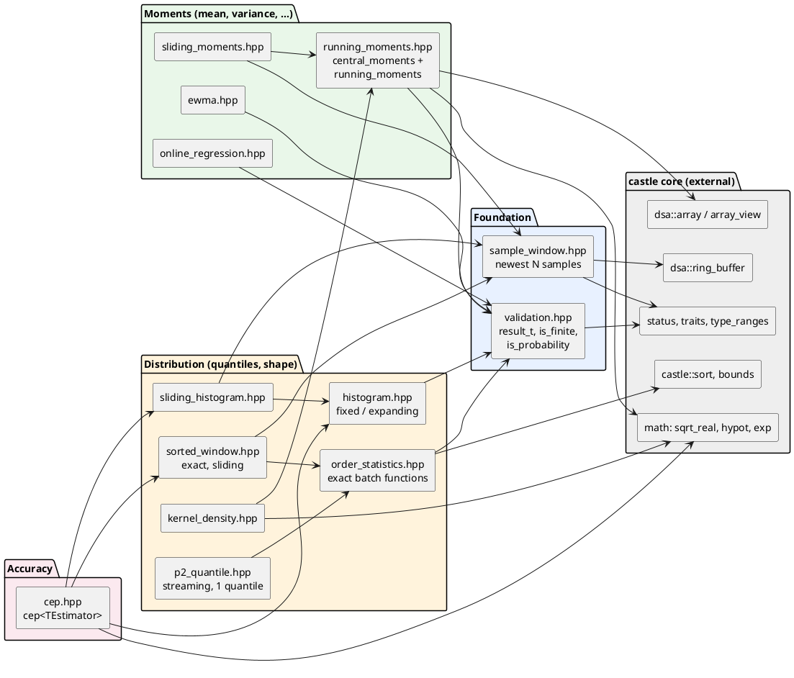
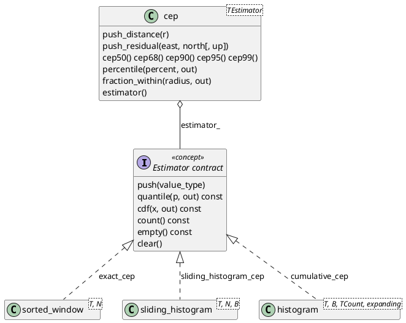
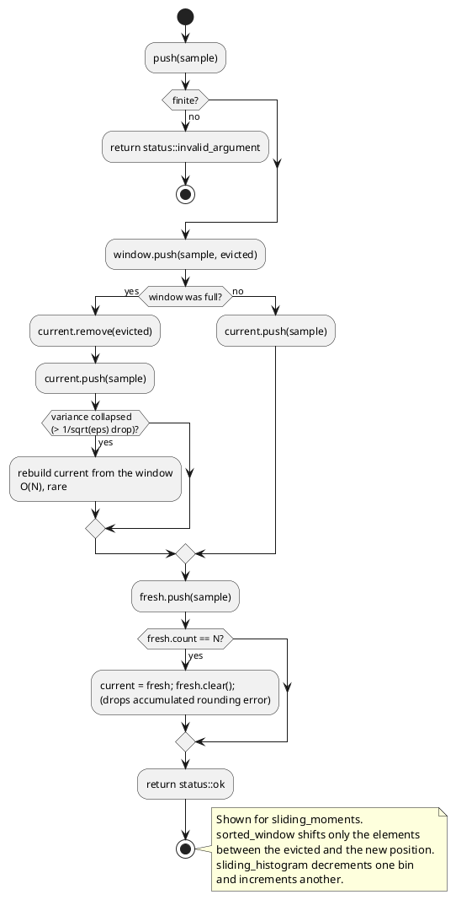
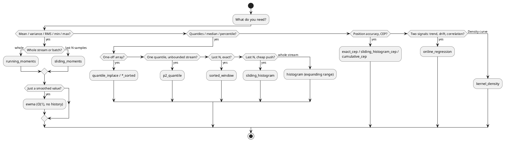
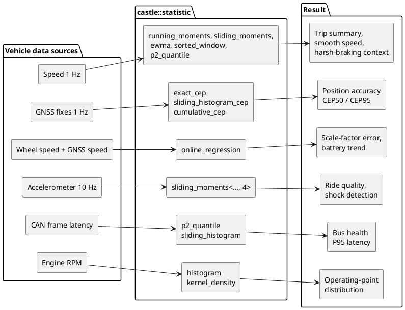
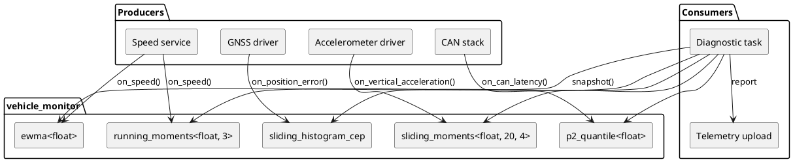
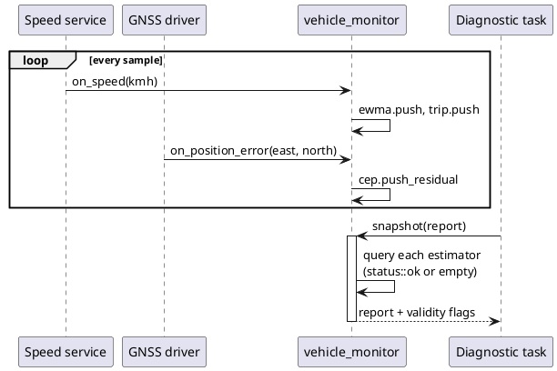

# Statistic (`castle_ext/statistic`)

## Contents
1. [What this module is](#1-what-this-module-is)
2. [Architecture](#2-architecture)
3. [Choosing a component](#3-choosing-a-component)
4. [Common conventions](#4-common-conventions)
5. [Basic statistics demonstration](#5-basic-statistics-demonstration)
6. [What the numbers mean](#6-what-the-numbers-mean)
7. [Vehicle data scenarios](#7-vehicle-data-scenarios)
8. [Putting it together: a vehicle monitor](#8-putting-it-together-a-vehicle-monitor)
9. [Design notes](#9-design-notes)
10. [Pitfalls](#10-pitfalls)
11. [Per-header reference](#11-per-header-reference)

## 1. What this module is

`castle::statistic` is a header-only statistics toolkit written for embedded targets. Everything is a template with compile-time capacities, so the module needs no heap, no exceptions, no RTTI and no STL. Every result is reported through `castle::status` instead of a thrown error or a sentinel value.

It covers three kinds of work:

| Kind of work | Typical question | Components |
|---|---|---|
| **Describe a signal** | What is the average speed, how noisy is it, what was the peak? | `running_moments`, `sliding_moments`, `ewma` |
| **Describe a distribution** | What is the median, the 95th percentile, how are the values spread? | `sorted_window`, `histogram`, `sliding_histogram`, `p2_quantile`, order-statistics functions, `kernel_density` |
| **Relate two signals / judge accuracy** | Is the wheel speed biased against GNSS? What radius contains 95 % of the position fixes? | `online_regression`, `cep` |

The module is a good fit when samples arrive one at a time (a 1 Hz GNSS fix, a CAN frame, an ADC read) and the device cannot afford to keep the whole history or to run a second pass.

```cpp
#include "castle_ext/statistic/statistic.hpp"          // everything
#include "castle_ext/statistic/running_moments.hpp"    // or one component at a time
```

> Include single headers when compile time matters. Only `kernel_density.hpp` depends on `<math.h>` (the Gaussian kernel and the bandwidth rule).

## 2. Architecture

The headers form three layers: shared foundation, estimators built on it, and the `cep` front end that composes quantile estimators. Arrows read "uses".



### 2.1 `cep` is a front end, not an estimator

`cep<TEstimator>` stores nothing itself. It validates radii, converts east/north residuals to a radius, and forwards `quantile()` / `cdf()` to whichever estimator it wraps. Any type that offers the contract below can be plugged in.



### 2.2 Sliding statistics share one window

`sliding_moments`, `sorted_window` and `sliding_histogram` each own a `sample_window<T, N>` (a drop-oldest ring buffer). The window reports the sample that falls out, so the estimator can retract it in O(1).



## 3. Choosing a component



| Need | Component | Scope | Exact? | Memory | Cost per sample / query |
|---|---|---|---|---|---|
| Mean, variance, min/max of everything seen | `running_moments` | stream | exact | O(1) | O(1) / O(1) |
| Mean, variance of the last N | `sliding_moments` | window | exact | N samples + 2 accumulators | O(1) / O(1); min/max O(N) |
| One-off median or percentile of an array | `quantile_inplace`, `*_sorted` | batch | exact | none (in place) | O(N log N) sort, then O(1) |
| Exact percentiles of the last N | `sorted_window`, `exact_cep` | window | exact | 2N samples | O(N) / O(1) |
| Percentiles of the last N, cheap push | `sliding_histogram`, `sliding_histogram_cep` | window | bin width | N samples + B counters | O(1) / O(B) |
| Distribution of the whole stream | `histogram`, `cumulative_cep` | stream | bin width | B counters | O(1) / O(B) |
| One quantile of the whole stream | `p2_quantile` | stream | approximate | 5 markers | O(1) / O(1) |
| Smoothed value and noise level | `ewma` | stream | exact recursion | O(1) | O(1) / O(1) |
| Trend, drift, correlation | `online_regression` | stream | exact | O(1) | O(1) / O(1) |
| Smooth density curve | `kernel_density` | any range | exact sum | none | - / O(N) |

## 4. Common conventions

| Rule | Detail |
|---|---|
| Result type | `result_t<T>` is `T` for floating point (a `float` pipeline stays in single precision) and `double` for integer samples. |
| Status instead of exceptions | Queries return `castle::status` and write the value to an out-parameter. The out-parameter is **unchanged on failure**. |
| Invalid samples | NaN and infinity are rejected with `status::invalid_argument` and leave the statistics untouched. |
| Order of arguments | `push(sample)` to feed, `clear()` to reset, `count()` / `empty()` to inspect. |
| Configurable estimators | `histogram`, `sliding_histogram`, `p2_quantile`, `ewma` must be configured (constructor or `configure()`); until then `push()` returns `status::not_configured`. |
| Thread safety | None. Protect shared instances with a mutex or feed from a single task. |

Status codes you meet most often:

| Status | Meaning here |
|---|---|
| `ok` | The out-parameter was written. |
| `empty` | Not enough samples (`sample_variance` and `correlation` need at least 2; `mean` needs 1). |
| `invalid_argument` | NaN/infinity sample, probability outside [0, 1], zero variance for `skewness` / `excess_kurtosis` / `correlation`, identical x for `fit`. |
| `not_configured` | Range, probability or `alpha` not set yet. |
| `full` | An integral counter would overflow. |

## 5. Basic statistics demonstration

Eight 1 Hz readings of vehicle speed in km/h. Seven values hover around 51 km/h and one reading (90) is a spike, for example a wheel-speed glitch.

```cpp
#include <stdio.h>
#include "castle_ext/statistic/statistic.hpp"

namespace stat = castle::statistic;

int main()
{
    const double speed[] = {50, 52, 51, 50, 53, 50, 52, 90};
    const unsigned n = sizeof(speed) / sizeof(speed[0]);

    // ---- streaming moments: one pass, O(1) memory --------------------------------
    stat::running_moments<double, 4U> m;          // Order 4: also skewness and kurtosis
    m.push_range(speed, speed + n);

    double v = 0.0;
    printf("count=%u\n", static_cast<unsigned>(m.count()));
    m.mean(v);                printf("mean=%.4f\n", v);
    m.rms(v);                 printf("rms=%.4f\n", v);
    m.population_variance(v); printf("population variance=%.4f\n", v);
    m.sample_variance(v);     printf("sample variance=%.4f\n", v);
    m.population_stddev(v);   printf("population std dev=%.4f\n", v);
    m.sample_stddev(v);       printf("sample std dev=%.4f\n", v);
    m.minimum(v);             printf("min=%.4f\n", v);
    m.maximum(v);             printf("max=%.4f\n", v);
    m.range(v);               printf("range=%.4f\n", v);
    m.skewness(v);            printf("skewness=%.4f\n", v);
    m.excess_kurtosis(v);     printf("excess kurtosis=%.4f\n", v);

    // ---- exact order statistics on a caller-owned array ---------------------------
    double a[8];
    for (unsigned i = 0; i < n; ++i) { a[i] = speed[i]; }
    stat::sort_samples(a, a + n);                        // validates, then sorts in place
    stat::median_sorted(a, a + n, v);                    printf("median=%.4f\n", v);
    stat::quantile_sorted(a, a + n, 0.25, v);            printf("Q1=%.4f\n", v);
    stat::quantile_sorted(a, a + n, 0.75, v);            printf("Q3=%.4f\n", v);
    stat::interquartile_range_sorted(a, a + n, v);       printf("IQR=%.4f\n", v);
    stat::mode_sorted(a, a + n, v);                      printf("mode=%.4f\n", v);
    stat::quantile_sorted(a, a + n, 0.9, v);             printf("P90 (linear)=%.4f\n", v);
    stat::quantile_sorted(a, a + n, 0.9, v, stat::quantile_method::nearest_rank);
    printf("P90 (nearest rank)=%.4f\n", v);

    // ---- the same data without the spike -----------------------------------------
    stat::running_moments<double> clean;
    clean.push_range(speed, speed + n - 1U);
    clean.mean(v);              printf("mean without spike=%.4f\n", v);
    clean.population_stddev(v); printf("std dev without spike=%.4f\n", v);

    // ---- every query reports failure through status ------------------------------
    stat::running_moments<double> e;
    printf("mean of nothing -> status %d (empty)\n", static_cast<int>(e.mean(v)));
    return 0;
}
```

Output:

```text
count=8
mean=56.0000
rms=57.4652
population variance=166.2500
sample variance=190.0000
population std dev=12.8938
sample std dev=13.7840
min=50.0000
max=90.0000
range=40.0000
skewness=2.2378
excess kurtosis=3.0668
median=51.5000
Q1=50.0000
Q3=52.2500
IQR=2.2500
mode=50.0000
P90 (linear)=64.1000
P90 (nearest rank)=90.0000
mean without spike=51.1429
std dev without spike=1.1249
mean of nothing -> status 2 (empty)
```

Hand check: the mean is 448 / 8 = 56. Deviations from the mean are -6, -4, -5, -6, -3, -6, -4, +34; their squares sum to 1330, so the population variance is 1330 / 8 = 166.25 and the sample variance is 1330 / 7 = 190.

### 5.1 Histogram and CDF of the same data

```cpp
stat::histogram<double, 6U> h(40.0, 100.0);   // six 10 km/h bins over [40, 100)
h.push_range(speed, speed + n);

unsigned count = 0U;
h.bin(1U, count);                // bin [50, 60): 7 readings
double v = 0.0;
h.mode(v);                       // 55.0     centre of the heaviest bin
h.quantile(0.5, v);              // 55.7143  interpolated inside the bin
h.cdf(55.0, v);                  // 0.4375   fraction of readings <= 55
```

Bin counts are `0 7 0 0 0 1`. The histogram answers in bin-width resolution; the exact functions above answer to the last digit but need the samples to be kept.

## 6. What the numbers mean

For the eight-reading example (mean 56, median 51.5, sample std dev 13.78):

| Value | Formula | Result | Meaning |
|---|---|---|---|
| **Mean** | `sum / n` | 56.00 | Centre of mass of the data. Pulled up by the 90 km/h spike: the clean mean is 51.14. |
| **Median** | middle value (50 % quantile) | 51.50 | Half of the readings are below. Robust: barely notices the spike. |
| **Mode** | most frequent value | 50 | Most common reading. Meaningful for discrete or quantized data; use the histogram mode for continuous data. |
| **RMS** | `sqrt(sum(x^2) / n)` | 57.47 | "Power" average. Equals the mean only for a constant signal; the gap grows with spread. Used for vibration and ripple. |
| **Population variance** | `M2 / n` | 166.25 | Mean squared distance from the mean, when the data is the **whole** population (a complete trip). |
| **Sample variance** | `M2 / (n - 1)` | 190.00 | Unbiased estimate of the underlying variance when the data is a **sample** of a larger process (a few seconds of a longer drive). Needs `n >= 2`. |
| **Std dev** | `sqrt(variance)` | 12.89 / 13.78 | Typical distance from the mean, in the unit of the signal (km/h). |
| **Min / max / range** | extremes, `max - min` | 50 / 90 / 40 | Envelope. Extremely sensitive to single glitches. |
| **Skewness** | `sqrt(n) * M3 / M2^1.5` | 2.24 | Asymmetry. `0` symmetric, `> 0` long tail to the high side (here the spike), `< 0` long tail to the low side. |
| **Excess kurtosis** | `n * M4 / M2^2 - 3` | 3.07 | Tail weight versus a normal distribution (`0`). Large positive: rare, large excursions (spikes, shocks). Negative: flat, bounded signals. |
| **Q1 / Q3 / IQR** | 25 % / 75 % quantiles, `Q3 - Q1` | 50 / 52.25 / 2.25 | Spread of the central half of the data. Robust counterpart of the standard deviation. |
| **Percentile Pp** | value with p % of the data at or below it | P90 = 64.1 (linear) or 90 (nearest rank) | Tail behaviour. Linear interpolates between samples; nearest rank always returns a measured sample. |
| **CDF(x)** | fraction of data `<= x` | CDF(55) = 0.4375 (histogram) | Inverse of the quantile: "what share of the time was speed below x". |

Where `M2`, `M3`, `M4` are the sums of the 2nd, 3rd and 4th powers of the deviations from the mean.

Practical reading of the demo: a mean of 56 with a standard deviation of 12.9 suggests an erratic drive, while a median of 51.5 with an IQR of 2.25 shows steady cruising with one outlier. Comparing mean to median, or standard deviation to IQR, is a quick spike detector.

**Population or sample?** Use population variance and standard deviation when the samples are everything you care about, such as a closed trip summary. Use the sample versions when you generalize from a window to the process behind it, such as "how noisy is this sensor".

**Quantile definitions.** `quantile_method::linear` (the default, the same as R type 7 and NumPy) interpolates at position `p * (n - 1)`. `quantile_method::nearest_rank` returns the smallest sample whose empirical CDF reaches `p`. Test reports often quote "p % of fixes within r metres", which is the nearest-rank convention.

## 7. Vehicle data scenarios

Each scenario shows the data, the code, the actual output and the interpretation.



### 7.1 Trip speed: summary, last seconds, smoothing

**Data.** One speed value per second (km/h): acceleration, cruise, a hard brake to standstill, restart.

**Goal.**
- Whole-trip summary (`running_moments`).
- "How is it going right now" over the last 5 s (`sliding_moments`).
- A smoothed speed for display (`ewma`).
- Robust recent median and percentile (`sorted_window`).
- A cheap whole-trip 95th percentile that needs no sample storage (`p2_quantile`).

```cpp
#include <stdio.h>
#include "castle_ext/statistic/statistic.hpp"

namespace stat = castle::statistic;

int main()
{
    const float speed[] = {0, 8, 17, 26, 35, 42, 47, 50, 51, 50, 52, 51,
                           50, 51, 52, 49, 20, 6, 0, 0, 7, 16, 25, 33};
    const unsigned n = sizeof(speed) / sizeof(speed[0]);

    stat::running_moments<float, 3U> trip;     // whole trip, with skewness
    stat::sliding_moments<float, 5U> last5;    // newest 5 s
    stat::ewma<float> smooth(0.3f);            // alpha 0.3, about a 3 s time constant (1 / alpha)
    stat::sorted_window<float, 10U> last10;    // exact order statistics of newest 10 s
    stat::p2_quantile<float> p95(0.95f);       // streaming P95, 5 markers

    for (unsigned t = 0; t < n; ++t)
    {
        trip.push(speed[t]);
        last5.push(speed[t]);
        smooth.push(speed[t]);
        last10.push(speed[t]);
        p95.push(speed[t]);

        float mean = 0.0f, sd = 0.0f, ew = 0.0f, med = 0.0f;
        last5.mean(mean);
        last5.population_stddev(sd);
        smooth.mean(ew);
        last10.median(med);
        printf("t=%2u v=%4.0f | last5 mean=%6.2f sd=%6.2f | ewma=%6.2f | median10=%5.1f\n",
               t, speed[t], mean, sd, ew, med);
    }

    float v = 0.0f;
    trip.mean(v);               printf("trip mean=%.3f\n", v);
    trip.population_stddev(v);  printf("trip std dev=%.3f\n", v);
    trip.maximum(v);            printf("trip max=%.1f\n", v);
    trip.skewness(v);           printf("trip skewness=%.3f\n", v);
    p95.quantile(v);            printf("P95 streaming (P2)=%.3f\n", v);

    float all[24];
    for (unsigned i = 0; i < n; ++i) { all[i] = speed[i]; }
    stat::quantile_inplace(all, all + n, 0.95f, v);
    printf("P95 exact=%.3f\n", v);

    last10.quantile(0.95f, v);  printf("P95 of last 10 s=%.3f\n", v);
    last10.cdf(30.0f, v);       printf("share of last 10 s at or below 30 km/h=%.3f\n", v);
    return 0;
}
```

Output (rows for t = 7, 12, 15, 16, 18, 23 and the summary; the program prints every second):

```text
t= 7 v=  50 | last5 mean= 40.00 sd=  8.65 | ewma= 37.66 | median10= 30.5
t=12 v=  50 | last5 mean= 50.80 sd=  0.75 | ewma= 48.50 | median10= 50.0
t=15 v=  49 | last5 mean= 50.60 sd=  1.02 | ewma= 49.75 | median10= 50.5
t=16 v=  20 | last5 mean= 44.40 sd= 12.24 | ewma= 40.83 | median10= 50.5
t=18 v=   0 | last5 mean= 25.40 sd= 21.52 | ewma= 21.27 | median10= 50.0
t=23 v=  33 | last5 mean= 16.20 sd= 11.89 | ewma= 21.80 | median10= 18.0
trip mean=30.750
trip std dev=19.473
trip max=52.0
trip skewness=-0.325
P95 streaming (P2)=51.375
P95 exact=51.850
P95 of last 10 s=50.650
share of last 10 s at or below 30 km/h=0.700
```

**Reading the output.**

| Observation | Interpretation |
|---|---|
| `last5 sd` is 8.65 at t=7 and 0.75 at t=12 | The windowed standard deviation separates acceleration (large) from steady cruising (small). Thresholding it is a cheap "is the vehicle in steady state?" test. |
| `last5 sd` jumps from 1.02 to 12.24 at t=16 | A harsh brake entered the window. The 5-sample window reacts within one sample. |
| `ewma` lags the raw value (40.83 vs 20 at t=16) | EWMA has memory of past values; larger `alpha` reacts faster, smaller `alpha` smooths more. `alpha = 2 / (N + 1)` matches an N-sample moving average. |
| `median10` stays at 50.5 at t=16, then falls to 18.0 at t=21 | The median ignores a few brief excursions and only follows the speed once most of the window has changed. It is the robust estimator of "typical speed". |
| Trip skewness -0.33 | The long tail is on the low side: many cruise samples with a few stops. |
| P2 P95 51.375 vs exact 51.850 | P2 is an estimate with five markers and no stored samples; it tightens as the stream grows. Use `sorted_window` or `quantile_inplace` where exact values are required. |

**Health checks built on the same classes.**

```cpp
stat::sliding_moments<float, 5U> stuck;
for (int i = 0; i < 5; ++i) { stuck.push(48.0f); }
float sd = 0.0f;
stuck.population_stddev(sd);                // 0.000: a live sensor always jitters, so a
                                            // frozen value is suspicious (stuck signal)

stat::sliding_moments<float, 8U> baseline;
const float calm[] = {50.0f, 51.0f, 50.0f, 52.0f, 51.0f, 50.0f, 52.0f, 51.0f};
for (const float x : calm) { baseline.push(x); }
float mu = 0.0f;
baseline.mean(mu);                          // 50.875
baseline.population_stddev(sd);             // 0.781
const float z = (70.0f - mu) / sd;          // 24.5: 70 km/h is 24.5 sigma away, so it is not
                                            // a plausible next reading, reject it as a glitch
```

### 7.2 GNSS accuracy: CEP

**Concept.** *Circular error probable* CEPp is the radius of a circle, centred on the true position, that contains p percent of the fixes. CEP50 is the typical error, CEP95 the error you should plan around. The module turns east/north residuals into radii and answers percentile queries.

**Data.** Twenty fixes from a receiver at a surveyed point; east/north error in metres. The last fix (2.4 m, 1.8 m) is a multipath outlier whose radius is exactly 3.0 m.

```cpp
#include <stdio.h>
#include "castle_ext/statistic/statistic.hpp"

namespace stat = castle::statistic;

int main()
{
    const float east[]  = { 0.3f,-0.4f, 0.1f, 0.6f,-0.2f, 0.5f,-0.7f, 0.2f, 0.0f, 0.4f,
                           -0.3f, 0.8f,-0.5f, 0.1f, 0.3f,-0.6f, 0.2f, 0.9f,-0.1f, 2.4f};
    const float north[] = { 0.4f, 0.3f,-0.2f, 0.8f, 0.5f,-0.4f, 0.3f, 0.6f,-0.1f,-0.5f,
                            0.7f,-0.3f, 0.2f, 0.9f,-0.4f, 0.1f,-0.8f, 0.4f, 0.6f, 1.8f};

    stat::exact_cep<float, 20U> exact;                              // newest 20 fixes, exact
    stat::sliding_histogram_cep<float, 20U, 30U> binned(0.0f, 3.0f);// newest 20 fixes, 0.1 m bins
    stat::cumulative_cep<float, 16U> lifetime(0.0f, 1.0f);          // whole stream, range grows

    for (unsigned i = 0; i < 20U; ++i)
    {
        exact.push_residual(east[i], north[i]);      // radius = hypot(east, north)
        binned.push_residual(east[i], north[i]);
        lifetime.push_residual(east[i], north[i]);
    }

    float v = 0.0f;
    exact.cep50(v);                 printf("exact    CEP50=%.4f m\n", v);
    exact.cep68(v);                 printf("exact    CEP68=%.4f m\n", v);
    exact.cep90(v);                 printf("exact    CEP90=%.4f m\n", v);
    exact.cep95(v);                 printf("exact    CEP95=%.4f m\n", v);
    exact.cep99(v);                 printf("exact    CEP99=%.4f m\n", v);
    exact.fraction_within(1.0f, v); printf("exact    fixes within 1 m=%.2f\n", v);
    exact.fraction_within(0.5f, v); printf("exact    fixes within 0.5 m=%.2f\n", v);
    exact.estimator().interquartile_range(v);
    printf("exact    IQR of radii=%.4f m\n", v);
    exact.estimator().quantile(0.95f, v, stat::quantile_method::nearest_rank);
    printf("exact    CEP95 (nearest rank)=%.4f m\n", v);

    binned.cep50(v);                printf("binned   CEP50=%.4f m\n", v);
    binned.cep95(v);                printf("binned   CEP95=%.4f m\n", v);
    lifetime.cep50(v);              printf("lifetime CEP50=%.4f m\n", v);
    lifetime.cep95(v);              printf("lifetime CEP95=%.4f m\n", v);
    printf("lifetime range grew to [0, %.1f), bin width %.2f m\n",
           lifetime.estimator().upper(), lifetime.estimator().bin_width());
    return 0;
}
```

Output:

```text
exact    CEP50=0.6364 m
exact    CEP68=0.7616 m
exact    CEP90=0.9864 m
exact    CEP95=1.1000 m
exact    CEP99=2.6200 m
exact    fixes within 1 m=0.95
exact    fixes within 0.5 m=0.25
exact    IQR of radii=0.3032 m
exact    CEP95 (nearest rank)=1.0000 m
binned   CEP50=0.6600 m
binned   CEP95=1.1000 m
lifetime CEP50=0.7000 m
lifetime CEP95=1.2500 m
lifetime range grew to [0, 4.0), bin width 0.25 m
```

**Reading the output.**

| Value | Interpretation |
|---|---|
| CEP50 = 0.64 m | Half of the fixes are within 0.64 m of the true point. Quote this as the typical accuracy. |
| CEP95 = 1.10 m | 95 % of fixes are within 1.1 m. Use it for lane-level feasibility and safety margins. |
| CEP99 = 2.62 m | Dominated by the single multipath outlier. A big gap between CEP95 and CEP99 means a heavy tail, so look for reflections or a poor sky view. |
| Within 1 m = 0.95 | Same information as CEP95 asked the other way round: `fraction_within(r)` is the empirical CDF. |
| IQR = 0.30 m | Central half of the radii falls in a 0.30 m band; the spread is modest and the error budget is dominated by the tail. |
| Nearest-rank CEP95 = 1.00 m | The 19th of 20 sorted radii. The linear value (1.10 m) interpolates between the 19th and the 20th (3.0 m). Quote which convention you use. |
| Binned vs exact | Binned CEP95 equals exact here; CEP50 differs by 0.024 m, below its 0.1 m bin width. Resolution is one bin width. |
| `lifetime` range grew to 4.0 | The `expanding` histogram doubled its range (1 -> 2 -> 4 m) as larger radii arrived, merging bins pairwise. No range had to be guessed up front, at the price of coarser bins (0.25 m). |

**Choosing the CEP variant.**

| Variant | Use when |
|---|---|
| `exact_cep<T, N>` | Window of at most a few hundred fixes; exact answers matter; push cost O(N) is acceptable at 1-10 Hz. |
| `sliding_histogram_cep<T, N, B>` | Long windows (an hour of 1 Hz data is 3600 samples) or high rates; resolution of one bin is enough and the maximum error radius is known. |
| `cumulative_cep<T, B>` | The whole mission, no sample storage, unknown maximum error. |

> `cep` measures the **true** error against a known reference. A receiver's reported accuracy estimate (hAcc) is a prediction; percentiles of hAcc describe that prediction, not the real error.

Radii equal to or above the histogram's `upper` bound go to the overflow counter (the single 3.0 m fix above sits at the 3.0 m bound of `binned`). They still count in the total and push CEP at that percentile to `upper`.

### 7.3 Calibration and trend: wheel speed vs GNSS, battery drift

`online_regression` fits `y = intercept + slope * x` in one pass and also reports covariance and Pearson correlation. A drifting offset or scale factor shows as a slope different from 1 (or a non-zero slope of a quantity against time).

**Wheel-speed scale factor.** Tyre wear or pressure changes the rolling radius, so wheel-speed readings scale off from GNSS (assumed correct).

```cpp
stat::online_regression<double> cal;
const double gnss[]  = {10, 20, 30, 40, 50, 60, 70, 80};
const double wheel[] = {10.4, 20.6, 30.9, 41.1, 51.6, 61.7, 71.9, 82.2};
for (int i = 0; i < 8; ++i) { cal.push(gnss[i], wheel[i]); }

double slope = 0.0, intercept = 0.0, r = 0.0;
cal.fit(slope, intercept);                 // slope 1.02619, intercept 0.12143
cal.correlation(r);                        // 0.999996
const double correction = 1.0 / slope;     // 0.97448
```

| Value | Interpretation |
|---|---|
| slope = 1.026 | The wheel sensor reads 2.6 % high; multiply by `1 / slope = 0.9745` to correct it. |
| intercept = 0.12 km/h | A tiny constant offset, negligible at driving speeds. |
| r = 0.999996 | The relation is almost perfectly linear, so a single scale factor explains the error. A low `r` would say the error is not a scale factor (noise, slip, latency). |

**Battery drift.** Voltage logged every 10 minutes while parked; x is minutes since the start, not an absolute timestamp.

```cpp
stat::online_regression<double> bat;
const double volts[] = {12.60, 12.58, 12.57, 12.55, 12.54, 12.52, 12.51, 12.49};
for (int i = 0; i < 8; ++i) { bat.push(i * 10.0, volts[i]); }

double slope = 0.0, intercept = 0.0;
bat.fit(slope, intercept);                           // slope -0.001524 V/min, intercept 12.5983 V
const double minutes_to_11v8 = (11.8 - intercept) / slope;   // 523.9 min, about 8.7 h
```

The slope is the discharge rate (about 0.09 V per hour). Extrapolating to a cut-off voltage gives a rough time until the cold-start threshold; real discharge is not linear, so use it as an early warning, not a guarantee.

> Use time **relative to a start point** for `x`. Large absolute values (epoch seconds) in a `float` pipeline lose the precision that the slope needs.

### 7.4 Ride quality and shock detection

**Concept.** RMS of vertical acceleration is the standard ride-vibration measure. Skewness and excess kurtosis reveal *shape*: a smooth road gives a flat, symmetric distribution; a pothole produces rare, large excursions that raise kurtosis sharply even when the RMS barely changes.

**Data.** A 2 s window (20 samples at 10 Hz) of vertical acceleration in m/s^2, first on a smooth road, then with a pothole hit (two samples of +6.5 and -5.0).

```cpp
stat::sliding_moments<float, 20U, 4U> az;          // Order 4: skewness and kurtosis

// ... push 20 smooth-road samples ...
float v = 0.0f;
az.mean(v);              // 0.0050
az.rms(v);               // 0.1423
az.skewness(v);          // -0.0881
az.excess_kurtosis(v);   // -1.4870

az.clear();
// ... push the same 20 samples with samples 12 and 13 replaced by 6.5 and -5.0 ...
az.mean(v);              // 0.0825
az.rms(v);               // 1.8384
az.skewness(v);          // 1.0730
az.excess_kurtosis(v);   // 7.3880
az.maximum(v);           // 6.5
az.range(v);             // 11.5
```

| Quantity | Smooth road | Pothole | Interpretation |
|---|---|---|---|
| Mean | 0.005 | 0.083 | Near zero either way (gravity removed beforehand); not informative alone. |
| RMS | 0.14 | 1.84 | Vibration amplitude rises about 13 times; the comfort index worsens. |
| Skewness | -0.09 | 1.07 | The distribution becomes asymmetric because of the one-sided spike. |
| Excess kurtosis | -1.49 | 7.39 | Strongly positive: rare, large excursions. Kurtosis detects shocks and separates them from steady rough-road vibration, which has a high RMS but a kurtosis near or below 0. |
| Range | - | 11.5 | Peak-to-peak amplitude; costs O(N) in `sliding_moments` (use `sorted_window` when it is needed on every sample). |

An alert rule such as "excess kurtosis above 3 and RMS above 1" flags a shock event while ignoring steady rough road.

### 7.5 CAN bus latency: tail percentiles

**Concept.** Average latency hides the problems that matter. A bus that is usually 4 ms but spikes to 22 ms every 100th frame violates a real-time deadline although the mean looks healthy. Percentiles show the tail.

**Data.** 1000 latency samples: 2-6 ms of jitter, with a 22 ms spike every 100th frame.

```cpp
stat::p2_quantile<float> p95(0.95f);                    // whole run, 5 markers, no history
stat::sliding_histogram<float, 200U, 50U> window(0.0f, 25.0f);   // newest 200 frames, 0.5 ms bins

for (/* every received frame */;;)
{
    const float latency_ms = /* measured */ 0.0f;
    p95.push(latency_ms);
    window.push(latency_ms);
}

float v = 0.0f;
p95.quantile(v);              // 5.814   P95 over the whole run
window.quantile(0.95f, v);    // 5.862   P95 over the last 200 frames
window.median(v);             // 4.083   typical latency
window.mode(v);               // 5.750   centre of the busiest bin
window.cdf(6.0f, v);          // 0.990   share of frames within the 6 ms budget
```

| Value | Interpretation |
|---|---|
| P95 ~ 5.8 ms | 95 % of frames arrive within 5.8 ms: the normal jitter band. |
| CDF(6 ms) = 0.990 | 99 % of the last 200 frames meet a 6 ms budget; the missing 1 % is the periodic 22 ms spike. |
| Median 4.1 ms | Typical latency, undisturbed by the spikes (the mean would be pulled up). |

`p2_quantile` needs no history and is the right tool for a lifetime counter. `sliding_histogram` forgets old data, so it reports the **current** bus health and recovers after a load burst ends. Choose `sliding_histogram` bins to match the resolution you need: width = (upper - lower) / bins.

### 7.6 Engine operating points: histogram and kernel density

**Concept.** A histogram turns a stream into a distribution. Engine RPM is usually *multi-modal*: idle plus one or more cruise ranges. Mean and standard deviation (1465 and 659 rpm) describe neither; the distribution does.

**Data.** Twelve RPM readings: idle near 800, cruise near 2100.

```cpp
const double rpm[] = {800, 820, 790, 810, 2100, 2150, 2080, 2120, 2200, 2090, 805, 815};

stat::histogram<double, 8U> bins(0.0, 4000.0);     // 500 rpm bins
bins.push_range(rpm, rpm + 12);
double v = 0.0;
bins.mode(v);                                      // 750: centre of the heaviest bin [500, 1000)

// Smooth density curve, evaluated at chosen points.
double h = 0.0, d = 0.0;
stat::normal_reference_bandwidth(rpm, rpm + 12, h);                  // 443.9 rpm (rule of thumb)
stat::kernel_density<stat::gaussian_kernel>(rpm, rpm + 12, 1500.0, h, d);       // 3.0e-04
stat::kernel_density<stat::gaussian_kernel>(rpm, rpm + 12, 1500.0, 60.0, d);    // 3.5e-24
stat::kernel_density<stat::gaussian_kernel>(rpm, rpm + 12, 800.0, 60.0, d);     // 3.3e-03
stat::kernel_density<stat::gaussian_kernel>(rpm, rpm + 12, 2100.0, 60.0, d);    // 2.7e-03
```

| Observation | Interpretation |
|---|---|
| Histogram mode = 750 rpm | The engine spends most of its time at idle. |
| Density at 800 and 2100 is high, at 1500 almost zero (bandwidth 60) | Two operating points with a gap. The vehicle moves quickly through 1500 rpm and never rests there. |
| Bandwidth 443.9 smooths the gap away (3.0e-04 at 1500) | `normal_reference_bandwidth` assumes a unimodal, roughly normal sample. For multi-modal data, choose a smaller `h` by hand. This is the bandwidth trade-off: small `h` shows detail and noise, large `h` shows the trend and hides structure. |

Available kernels: `gaussian_kernel` (smoothest, uses `exp`), `epanechnikov_kernel`, `triangular_kernel`, `uniform_kernel` (compact support, arithmetic only; prefer on targets without a math library). The density integrates to 1, so its unit is "per rpm".

### 7.7 Merging statistics from several ECUs or trips

`running_moments` and `central_moments` merge exactly: combining the summaries of two partitions is the same as feeding all samples into one accumulator. Each ECU keeps a small summary, and the gateway merges them without raw data.

```cpp
stat::running_moments<double> ecu_a;        // front axle
stat::running_moments<double> ecu_b;        // rear axle
const double front[] = {42.1, 38.5, 55.0, 61.2};
const double rear[]  = {47.3, 52.8, 30.4};
for (const double x : front) { ecu_a.push(x); }
for (const double x : rear)  { ecu_b.push(x); }

ecu_a.merge(ecu_b);                         // ecu_a now describes all seven samples
double mean = 0.0, sd = 0.0;
ecu_a.mean(mean);                           // 46.757143, identical to one accumulator over all samples
ecu_a.sample_stddev(sd);                    // 10.573372, identical as well
```

The summary is only `count`, mean, the moment sums, minimum and maximum, so it also suits transmitting per-trip summaries over a constrained link. `central_moments::remove()` retracts a sample; `sliding_moments` is built on it.

## 8. Putting it together: a vehicle monitor

One class aggregates the estimators of the scenarios above. The data sources call `on_*()`; a 1 Hz diagnostic task calls `snapshot()`.





```cpp
#include "castle_ext/statistic/statistic.hpp"

namespace stat = castle::statistic;

struct vehicle_report
{
    float speed_smooth;     // km/h
    float speed_mean;       // km/h, whole trip
    float speed_stddev;     // km/h, whole trip
    float speed_max;        // km/h
    float hacc_cep95;       // m, newest 100 fixes
    float ride_rms;         // m/s^2, newest 2 s
    float ride_kurtosis;    // excess kurtosis, shock indicator
    float latency_p95;      // ms, whole run
};

class vehicle_monitor
{
public:
    vehicle_monitor() : speed_smooth_(0.3f), position_(0.0f, 5.0f), latency_p95_(0.95f) {}

    // Producers: O(1) per call (sliding_moments rebuilds in O(N) only after a large outlier leaves its window).
    void on_speed(float kmh)
    {
        (void)speed_smooth_.push(kmh);
        (void)trip_.push(kmh);
    }
    void on_position_error(float east_m, float north_m) { (void)position_.push_residual(east_m, north_m); }
    void on_vertical_acceleration(float ms2)            { (void)ride_.push(ms2); }
    void on_can_latency(float ms)                       { (void)latency_p95_.push(ms); }

    // Diagnostic task: returns true when every value is available.
    bool snapshot(vehicle_report& out) const
    {
        bool ok = true;
        ok = (speed_smooth_.mean(out.speed_smooth) == castle::status::ok) && ok;
        ok = (trip_.mean(out.speed_mean) == castle::status::ok) && ok;
        ok = (trip_.population_stddev(out.speed_stddev) == castle::status::ok) && ok;
        ok = (trip_.maximum(out.speed_max) == castle::status::ok) && ok;
        ok = (position_.cep95(out.hacc_cep95) == castle::status::ok) && ok;
        ok = (ride_.rms(out.ride_rms) == castle::status::ok) && ok;
        ok = (ride_.excess_kurtosis(out.ride_kurtosis) == castle::status::ok) && ok;
        ok = (latency_p95_.quantile(out.latency_p95) == castle::status::ok) && ok;
        return ok;
    }

private:
    stat::ewma<float> speed_smooth_;
    stat::running_moments<float, 3U> trip_;
    stat::sliding_histogram_cep<float, 100U, 50U> position_;   // 0.1 m bins up to 5 m
    stat::sliding_moments<float, 20U, 4U> ride_;
    stat::p2_quantile<float> latency_p95_;
};
```

Notes on the design:
- `snapshot()` does not stop at the first failure: values that are not ready yet (for example kurtosis before any sample, or after a window holding constant data) leave their field untouched and the function returns `false`, so the caller can still use the fields that are valid.
- Every estimator is sized at compile time. The monitor owns a 100-sample and a 20-sample window (the latter with two moment accumulators), 50 histogram counters, the P2 markers and a handful of floats: its footprint is known at link time.
- Feed the monitor from a single context, or wrap `on_*()` and `snapshot()` in the same lock. The module itself does no locking.

## 9. Design notes

**Numerical stability.** Moments use the pairwise update of Chan, Golub and LeVeque, extended to higher moments by Pebay (Welford's method is the single-sample case). The naive `sum(x^2) - sum(x)^2 / n` formula cancels catastrophically when the mean is large compared with the spread: a speed of 100 km/h with a standard deviation of 0.1 km/h in `float` already loses several of its seven significant digits, and larger offsets lose all of them. `online_regression` uses the same style of update for covariance.

**Sliding-window drift.** Retracting a sample cancels digits. `sliding_moments` therefore keeps a second accumulator that is rebuilt from scratch alongside the main one and swapped in after every `Capacity` pushes, bounding the drift to at most `2 * Capacity` updates. If a large outlier leaves the window and collapses the variance, the accumulator is rebuilt immediately, an O(Capacity) step that is rare in practice.

**Order of moments.** The `Order` template parameter (2, 3 or 4) selects the highest maintained moment. Unused moments cost neither memory nor arithmetic, and requesting `skewness()` from an `Order 2` object is a compile-time error.

**Exact versus binned.**

| | `sorted_window` | `sliding_histogram` |
|---|---|---|
| Quantile error | none | one bin width |
| Push | O(log N) comparisons + at most N moves | O(1) |
| Query | O(1) | O(bins) |
| Memory | 2N samples | N samples + bins |
| Range must be known | no | yes (values outside land in underflow/overflow) |

**Quantile estimation.** `p2_quantile` follows Jain and Chlamtac (1985). Up to the fifth sample it reports the exact quantile; after that, five markers move with a parabolic prediction. Extreme quantiles (p near 0 or 1) need many samples to settle.

**Integer samples.** `running_moments<int>`, `histogram<uint16_t, ...>` and others accept integer samples and report in `double`. `cep` limits `push_residual()` to floating-point types so that east/north residuals are never silently truncated.

**Memory and time.** No component allocates. A `sample_window` of N elements costs N elements plus two indices; `p2_quantile` stores 20 floating-point values, the probability, a counter and a flag; `ewma` stores three values and two flags; `running_moments` stores a count, the mean, `Order - 1` moment sums, a minimum and a maximum.

## 10. Pitfalls

| Pitfall | What to do |
|---|---|
| Reading a value before enough samples exist | Always check the returned `status`. `sample_variance`, `sample_stddev` and `correlation` need at least two samples; with one sample the output stays untouched and `status::empty` is returned. |
| `skewness`, `excess_kurtosis`, `correlation` on constant data | Zero variance returns `status::invalid_argument`. A constant signal has no shape; handle this as a normal case (for example a stopped vehicle). |
| `histogram`/`sliding_histogram` used without a range | `push()` returns `status::not_configured`. Pass the range to the constructor or call `configure()`. Calling `configure()` discards the collected data. |
| Radius or value at the upper bound of a histogram | The range is `[lower, upper)`; a value exactly at `upper` is counted as overflow. Leave headroom above the largest expected value. |
| Using the mean for spiky data | Compare mean with median and standard deviation with IQR; use `sorted_window` or `p2_quantile` when spikes occur. |
| Using `sliding_moments::minimum/maximum` per sample | They scan the window in O(N). Use `sorted_window` when extremes are needed on every sample. |
| Trusting `p2_quantile` with a handful of samples | It is exact up to five samples but a coarse estimate for the next few dozen. Let it see enough data before acting on it. |
| Bandwidth for multi-modal densities | `normal_reference_bandwidth` oversmooths multi-modal data; pick `h` by hand (see 7.6). |
| Large absolute `x` in `online_regression<float>` | Use time or position relative to a start point to avoid losing precision. |
| Sharing an instance between an ISR and a task | Not thread-safe. Copy samples through a queue and feed the estimator from one context. |
| Assuming percentile of reported accuracy equals true accuracy | `cep` measures residuals against a reference. A receiver's own accuracy estimate is a prediction, not an error. |

## 11. Per-header reference

| Header | Component | Page |
|---|---|---|
| `statistic.hpp` | Umbrella header | [statistic.md](statistic.md) |
| `validation.hpp` | `result_t`, `is_finite`, `is_probability` | [validation.md](validation.md) |
| `sample_window.hpp` | `sample_window<T, N>` | [sample_window.md](sample_window.md) |
| `running_moments.hpp` | `central_moments`, `running_moments` | [running_moments.md](running_moments.md) |
| `sliding_moments.hpp` | `sliding_moments` | [sliding_moments.md](sliding_moments.md) |
| `order_statistics.hpp` | `quantile_sorted`, `median_sorted`, `interquartile_range_sorted`, `mode_sorted`, `sort_samples`, `quantile_inplace` | [order_statistics.md](order_statistics.md) |
| `sorted_window.hpp` | `sorted_window` | [sorted_window.md](sorted_window.md) |
| `histogram.hpp` | `histogram` | [histogram.md](histogram.md) |
| `sliding_histogram.hpp` | `sliding_histogram` | [sliding_histogram.md](sliding_histogram.md) |
| `p2_quantile.hpp` | `p2_quantile` | [p2_quantile.md](p2_quantile.md) |
| `cep.hpp` | `cep`, `exact_cep`, `sliding_histogram_cep`, `cumulative_cep` | [cep.md](cep.md) |
| `ewma.hpp` | `ewma` | [ewma.md](ewma.md) |
| `online_regression.hpp` | `online_regression` | [online_regression.md](online_regression.md) |
| `kernel_density.hpp` | `kernel_density`, `normal_reference_bandwidth`, kernels | [kernel_density.md](kernel_density.md) |

Runnable samples live in [`samples/castle_ext/statistic/`](../../../samples/castle_ext/statistic/); [`statistic.cpp`](../../../samples/castle_ext/statistic/statistic.cpp) runs a small GNSS pipeline across every family.
