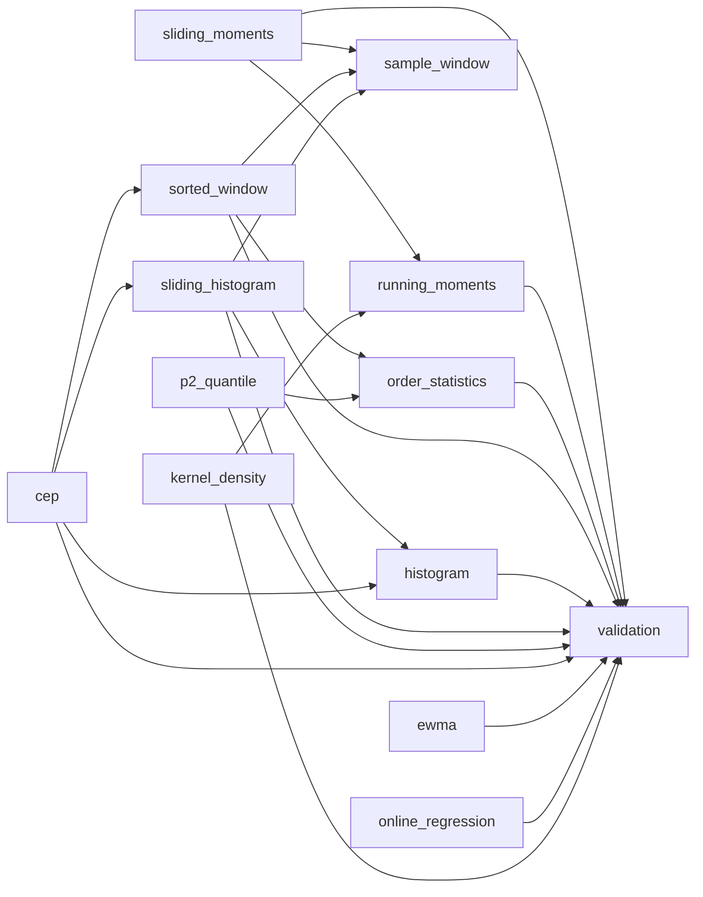

# Statistic

## Overview
`castle::statistic` is a header-only, allocation-free statistics toolkit for embedded targets: running and sliding-window moments, exact and approximate quantiles, histograms, circular error probable (CEP) for GNSS accuracy, smoothing, regression, and kernel density estimation. `statistic.hpp` is the umbrella header that includes every component. Include the individual headers instead when compile time or dependencies matter; only `kernel_density.hpp` depends on `<math.h>`.

## Header
`#include "castle_ext/statistic/statistic.hpp"`

## Dependencies
- [`castle_ext/statistic/validation.hpp`](validation.md)
- [`castle_ext/statistic/sample_window.hpp`](sample_window.md)
- [`castle_ext/statistic/running_moments.hpp`](running_moments.md)
- [`castle_ext/statistic/sliding_moments.hpp`](sliding_moments.md)
- [`castle_ext/statistic/order_statistics.hpp`](order_statistics.md)
- [`castle_ext/statistic/sorted_window.hpp`](sorted_window.md)
- [`castle_ext/statistic/histogram.hpp`](histogram.md)
- [`castle_ext/statistic/sliding_histogram.hpp`](sliding_histogram.md)
- [`castle_ext/statistic/p2_quantile.hpp`](p2_quantile.md)
- [`castle_ext/statistic/cep.hpp`](cep.md)
- [`castle_ext/statistic/ewma.hpp`](ewma.md)
- [`castle_ext/statistic/online_regression.hpp`](online_regression.md)
- [`castle_ext/statistic/kernel_density.hpp`](kernel_density.md)

Header dependencies inside the module (`A --> B` means A includes B):



## Public API
Every component reports results in `result_t<T>` (`T` for floating point, `double` for integral samples) and rejects NaN and infinity with `status::invalid_argument`.

|Component|Description|Doc|
|---|---|---|
|`is_finite`, `is_probability`, `result_t`|Shared sample validation and result-type selection.|[validation](validation.md)|
|`sample_window<T, N>`|Fixed-capacity window of the newest N samples with forward iterators and `latest()` views.|[sample_window](sample_window.md)|
|`running_moments<T, Order>`, `central_moments`|Streaming mean, variance, standard deviation, RMS, min/max, skewness, kurtosis; mergeable.|[running_moments](running_moments.md)|
|`sliding_moments<T, N, Order>`|The same moments over the newest N samples, with eviction.|[sliding_moments](sliding_moments.md)|
|`quantile_sorted`, `median_sorted`, `interquartile_range_sorted`, `mode_sorted`, `sort_samples`, `quantile_inplace`|Exact order statistics of caller-owned ranges.|[order_statistics](order_statistics.md)|
|`sorted_window<T, N>`|Exact quantiles, median, IQR, mode, CDF over the newest N samples, kept sorted.|[sorted_window](sorted_window.md)|
|`histogram<T, Bins, TCount, Range>`|Equal-width histogram with approximate quantile, CDF and mode; `fixed` or `expanding` range.|[histogram](histogram.md)|
|`sliding_histogram<T, N, Bins>`|Histogram of the newest N samples with O(1) push.|[sliding_histogram](sliding_histogram.md)|
|`p2_quantile<T>`|Single streaming quantile in constant memory (P-squared algorithm).|[p2_quantile](p2_quantile.md)|
|`cep<TEstimator>`, `exact_cep`, `sliding_histogram_cep`, `cumulative_cep`|CEP50/68/90/95/99 and percentile tracking over radial position errors.|[cep](cep.md)|
|`ewma<T>`|Exponentially weighted moving mean and variance.|[ewma](ewma.md)|
|`online_regression<T>`|One-pass covariance, Pearson correlation, least-squares line.|[online_regression](online_regression.md)|
|`kernel_density`, `normal_reference_bandwidth`, four kernels|Smooth density estimate over any sample range.|[kernel_density](kernel_density.md)|

### Choosing a component
|Need|Component|Scope|Exact?|Memory|Time per sample / query|
|---|---|---|---|---|---|
|Mean, variance, min/max of everything seen|`running_moments`|streaming|exact|O(1)|O(1) / O(1)|
|Mean, variance of the last N|`sliding_moments`|sliding window|exact (O(N) rebuild only after severe cancellation)|N samples + 2 accumulators|O(1) typical / O(1); min/max O(N)|
|One-off median or percentile of an array|`quantile_inplace`, `*_sorted`|batch|exact|none (in place)|O(N log N) sort, then O(1)|
|Exact percentiles of the last N|`sorted_window` / `exact_cep`|sliding window|exact|2N samples|O(N) / O(1)|
|Percentiles of the last N, cheap push|`sliding_histogram` / `sliding_histogram_cep`|sliding window|approximate (bin width)|N samples + B counters|O(1) / O(B)|
|Distribution of the whole stream|`histogram`, `cumulative_cep`|streaming|approximate (bin width)|B counters|O(1) / O(B)|
|One quantile of the whole stream|`p2_quantile`|streaming|approximate|5 markers|O(1) / O(1)|
|Smoothed value and noise level|`ewma`|streaming|exact recursion (recency weighted)|O(1)|O(1) / O(1)|
|Trend, drift, correlation|`online_regression`|streaming|exact|O(1)|O(1) / O(1)|
|Smooth density curve|`kernel_density`|batch over any range|exact sum|none|- / O(N)|

CEP reminder: CEPp is the radius containing p percent of the fixes. Percentiles of a receiver's reported hAcc describe its accuracy estimate, not the true error.

## Usage Example
```cpp
#include "castle_ext/statistic/statistic.hpp"

castle::statistic::exact_cep<double, 100U> horizontal; // latest 100 fixes
castle::statistic::running_moments<double> moments;
horizontal.push_residual(0.3, 0.4); // east/north error [m]
moments.push(0.5);

double cep95 = 0.0;
if (horizontal.cep95(cep95) == castle::status::ok)
{
    // 95 % of the retained fixes lie within cep95 metres
}
```

See [`samples/castle_ext/statistic/statistic.cpp`](../../../samples/castle_ext/statistic/statistic.cpp), a small GNSS pipeline that uses every family.

## Constraints & Notes
- No heap allocation, exceptions, RTTI or STL; all capacities are template parameters. Stack use is O(1) per call except where each component's page states its fixed object size.
- No component is thread-safe; protect shared instances externally.
- Failure is reported through `castle::status`; outputs are left unchanged on failure.
- Exact sliding-window quantiles cost O(N) per push; choose the histogram variants when push cost matters more than bin-width resolution.
- The umbrella header adds `<math.h>` only through `kernel_density.hpp` (Gaussian kernel, bandwidth rule).
- Designed for reuse by a later DSP component: `sample_window` (sample history and sub-window views), `central_moments` (add, retract, and merge of partitions), `sliding_moments` (moving mean, variance, RMS), `histogram` and `p2_quantile` (distribution and quantile estimation), and `ewma` (first-order IIR smoothing) are independent building blocks.
