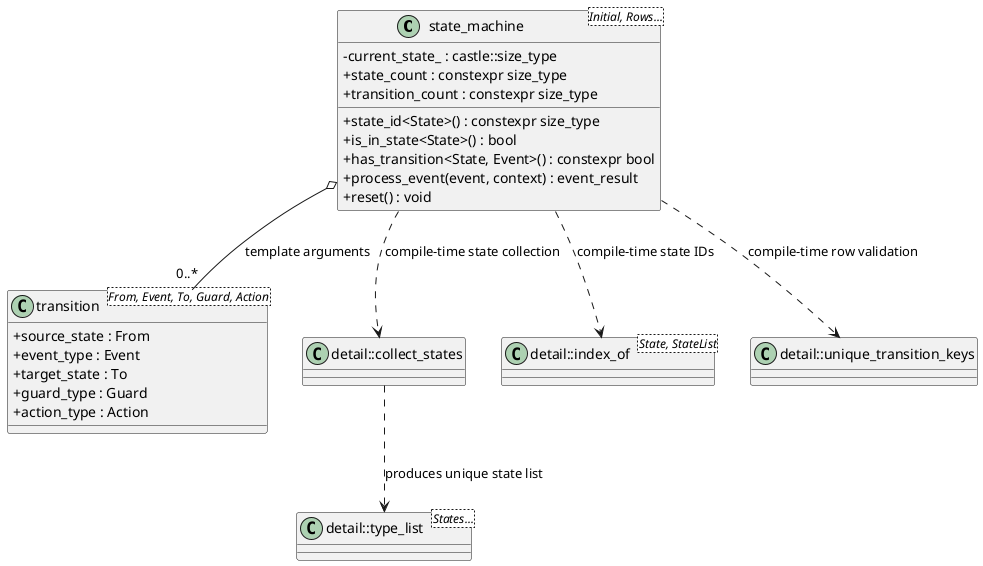
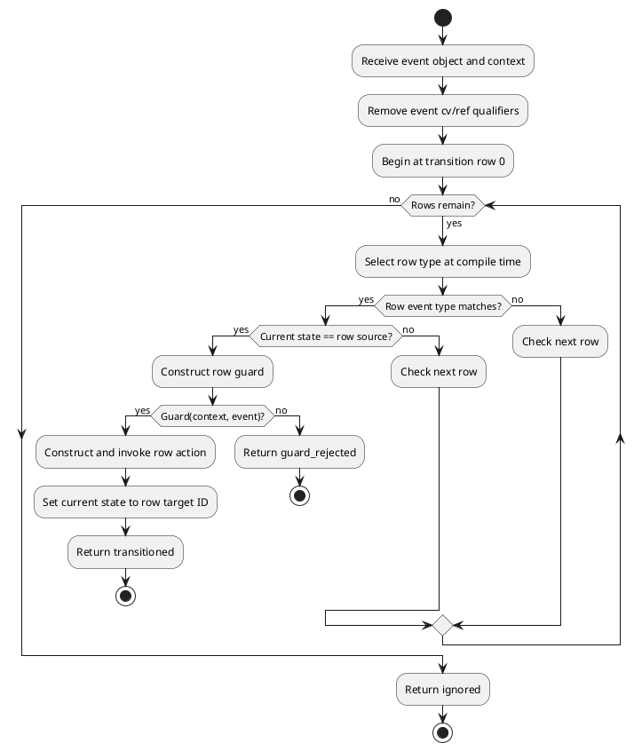

# Template Finite State Machine Design Pattern in CASTLE

## 1. Purpose and design goals

A finite state machine (FSM) models a component whose behavior depends on a finite current state and an incoming event. Given the same current state and event, the machine makes the same transition decision, subject to the guard and application context.

CASTLE's FSM is deliberately a **static, table-driven FSM**:

- States are C++ types, not heap-allocated polymorphic objects.
- Events are C++ types, not integer tags that require a runtime cast.
- The transition table is a variadic template argument pack.
- Template metaprogramming derives the machine's unique state set and checks transition-key uniqueness.
- Runtime state is represented by one integer index.
- Event dispatch uses compile-time event-type selection and a bounded linear scan of table rows.
- Guards and actions are statically dispatched functor types.

This is a good fit for small and medium embedded control logic where the transition topology is known at build time and predictable memory use matters more than runtime-modifiable transition tables.

The implementation intentionally does not use `std::variant`, `std::tuple`, `std::function`, heap allocation, RTTI, exceptions, or virtual functions. CASTLE's traits are used for type comparisons, decay, and compile-time validation.

## 2. Basic FSM model

A deterministic event-driven state machine can be viewed as:

\[
M = (S, E, T, s_0)
\]

where:

- `S` is a finite set of states.
- `E` is the set of event types accepted by the machine.
- `T` is the transition relation. A row associates `(source state, event)` with a target state, an optional guard, and an optional action.
- `s0` is the initial state.

At runtime, the machine has one current state `s`. When event `e` arrives:

1. Find a row whose source is `s` and whose event type is exactly `e`'s type.
2. If no row exists, return `event_result::ignored` and preserve `s`.
3. Evaluate the row's guard.
4. If the guard rejects, return `event_result::guard_rejected` and preserve `s`.
5. Run the action.
6. Commit the row's target state and return `event_result::transitioned`.

A row can target its own source state. That represents an internal/self transition: the guard and action still run, but the state ID remains the same.

## 3. Why state and event types?

A conventional embedded implementation often uses enums:

```cpp
enum class state { idle, running, fault };
enum class event { start, stop, failure, reset };
```

This is compact, but transition handlers need runtime `switch` statements and developers can accidentally mix unrelated event values or omit cases.

CASTLE instead uses empty tag types:

```cpp
struct idle {};
struct running {};
struct fault {};

struct start_event {};
struct stop_event {};
struct failure_event {};
struct reset_event {};
```

These types have no required data and create no per-state or per-event storage. They provide compile-time identity. A call such as `machine.process_event(start_event{})` cannot accidentally pass `stop_event` where a `start_event` object is required.

The FSM does not construct state objects. It only stores an integer state ID that corresponds to one of the state tag types. Therefore a state tag should describe identity, not hold runtime application data.

## 4. Transition rows as types

A row is declared with:

```cpp
fsm::transition<SourceState, Event, TargetState, Guard, Action>
```

`Guard` defaults to `fsm::always_guard`; `Action` defaults to `fsm::no_action`.

For example:

```cpp
using door_machine = fsm::state_machine<
    locked,
    fsm::transition<locked, key_turned, unlocked, valid_key, count_unlocks>,
    fsm::transition<unlocked, door_closed, locked>,
    fsm::transition<locked, forced_entry, alarm>,
    fsm::transition<unlocked, forced_entry, alarm>,
    fsm::transition<alarm, reset_event, locked>
>;
```

Read each row as a sentence: “When the machine is in `locked` and receives `key_turned`, check `valid_key`; if accepted, run `count_unlocks` and move to `unlocked`.”

### Why one row per state/event key?

The template rejects duplicate `(source state, event type)` keys. Multiple guarded rows with the same key would need an explicit priority/fallback policy. Implicitly using declaration order can hide logic and create accidental differences when a table is reordered. CASTLE chooses a simpler deterministic contract: one matching row, one guard decision. A rejected guard ends processing for that event.

The same event type can appear in multiple rows when the source states differ. For instance, `forced_entry` may move both `locked` and `unlocked` to `alarm`.

## 5. Compile-time architecture

The template arguments contain all transition topology. The implementation uses a small internal type-list toolkit:

1. Start the inferred state list with `InitialState`.
2. Visit every row type.
3. Append the row's source and target state only when the type is not already in the list.
4. Use the resulting ordered unique list to calculate each state's integer ID.
5. Validate that each row is a `fsm::transition` specialization.
6. Validate that transition keys are unique.

The state list exists only during template instantiation. It is not stored in the machine object.



### The inferred type list

Conceptually, given:

```cpp
state_machine<
    standby,
    transition<standby, connect_event, connected>,
    transition<connected, disconnect_event, standby>,
    transition<connected, error_event, fault>
>
```

The ordered unique state list is:

```cpp
type_list<standby, connected, fault>
```

The exact state ID order is an implementation detail derived from first encounter. It is useful for runtime storage and diagnostics, but should not be serialized as a stable protocol value.

## 6. Runtime architecture and memory footprint

Each instance stores only:

```cpp
castle::size_type current_state_;
```

No state object, event queue, transition array, function pointer table, virtual table, or dynamic allocation is required by the FSM engine.

The transition rows are template arguments. Dispatch is generated by recursively expanding the row pack with `if constexpr` and a compile-time row index. Event type comparison is performed at compile time; the current state ID comparison is performed at runtime.



The dispatch cost is O(T), where T is the number of transition rows. The bound is known at compile time, and no search structure needs to be allocated or initialized at runtime. `is_in_state`, `current_state_id`, and `reset` are O(1).

## 7. Guards and actions

Guards answer whether a transition is currently permitted. Actions perform side effects associated with an accepted event.

```cpp
struct battery_is_ready
{
    bool operator()(controller_context& context,
                    start_event const&) const noexcept
    {
        return context.battery_millivolts >= 11000U;
    }
};

struct enable_motor
{
    void operator()(controller_context& context,
                    start_event const&) const noexcept
    {
        context.motor_enabled = true;
    }
};
```

A functor is called with `(context, event)`. The context type is selected by the call to `process_event`; all guards/actions used for a given event must accept that context type.

### Why pass a context?

The state types are tags, so mutable machine/application data belongs in an ordinary context object owned by the application. This has several advantages:

- The machine does not own or copy application state.
- Multiple machines can share a deliberately designed context.
- The context can contain fixed-size buffers, peripheral references, counters, or other user-defined data.
- The action and guard policies remain simple types and do not need runtime type erasure.

The context is passed by reference and is not retained. Its lifetime and synchronization are the caller's responsibility.

### Functor constraints

Guard and action types must be default-constructible without throwing. Each is instantiated as a temporary for the selected event and invoked through a `noexcept` call operator. Persistent counters or mutable state should therefore live in the context, not in a guard/action object. This keeps per-instance machine storage minimal and behavior explicit.

The guard must return a value convertible to `bool`. The action's return value, if any, is ignored; actions should normally return `void`.

## 8. Event results

`process_event` returns one of three values:

| Result | Meaning | Current state |
| --- | --- | --- |
| `event_result::transitioned` | A row matched, the guard accepted, and the action ran. | Set to target state. |
| `event_result::ignored` | No row matched the current state and event type. | Unchanged. |
| `event_result::guard_rejected` | A row matched, but its guard returned false. | Unchanged. |

These are domain outcomes, not generic error codes. An ignored event can be normal in an event-driven application; it is not necessarily a system error.

## 9. State lifecycle and self-transitions

This minimal engine does not impose implicit entry/exit callbacks. There are no hidden side effects when a state changes. Put the output behavior into a transition's action, or extend the application context with explicit state-entry/exit operations when the application needs that policy.

A self-transition is supported:

```cpp
fsm::transition<connected, keep_alive_event, connected, link_is_alive, refresh_link_timeout>
```

The guard and action run normally. The state index is then set to the same state ID.

`reset()` is intentionally different from a normal transition. It unconditionally restores the initial state and does not execute any guard or action.

## 10. Compile-time checks

The following mistakes are diagnosed during compilation:

- An entry is not an `fsm::transition` specialization.
- The initial state is `void`.
- A transition's source, event, target, guard, or action type is `void`.
- Two rows declare the same `(source state, event type)` pair.
- `state_id<State>()` or `is_in_state<State>()` is requested for a state not present in the machine.
- A selected guard/action is not default constructible, invocable with `(context, event)`, or `noexcept`.

`has_transition<State, Event>()` is a compile-time query that returns whether the row exists. It does not evaluate a runtime guard and does not depend on the current state of a machine instance.

## 11. Usage pattern

A common architecture is:

1. Define empty state tags.
2. Define one empty event tag per input class.
3. Define an application context with persistent mutable data.
4. Implement stateless guards/actions that accept the context and their event type.
5. Declare one `state_machine<Initial, transition<...>...>` alias.
6. Create a machine instance and call `process_event()` in the event loop or from the component's event boundary.
7. Inspect `event_result` when the application needs to count, log, or reject unexpected events.

The machine itself does not own a scheduler, event queue, timer, or hardware driver. Those remain in the surrounding application architecture.

## 12. Design trade-offs and extension points

### Chosen trade-offs

- **Static topology vs. runtime reconfiguration:** rows cannot be added or changed after compilation. This allows compile-time checking and zero table storage.
- **Linear scan vs. lookup table:** O(T) dispatch keeps code and storage small. A very large machine may prefer a generated dispatch structure, at the cost of code size or extra tables.
- **One row per key vs. ordered alternatives:** no ambiguous guard priority. Applications needing alternatives should represent the choice inside one guard/action or model the alternatives as distinct events/states.
- **External context vs. owned state payload:** machine storage stays one state index and ownership remains explicit.
- **No entry/exit hook convention:** only declared transitions have effects; reset remains side-effect-free and easy to reason about.

### Possible future extensions

If a future CASTLE requirement justifies additional code, possible extensions include compile-time state-entry/exit policies, deferred-event queues with fixed capacity, hierarchical state machines, time-triggered transitions using `castle::chrono`, and a separate adapter that subscribes to CASTLE event dispatchers. These are not part of the current header and should not be assumed by callers.

## 13. Architecture references

The design is informed by established embedded FSM discussions and type-safe C++ approaches:

- [Finite State Machines in Embedded Systems — Part 1: There's a State in This Machine!](https://www.embeddedrelated.com/showarticle/1625.php)
- [Finite State Machines in Embedded Systems — Part 2: Simple C++ State Machine Engine](https://www.embeddedrelated.com/showarticle/1628.php)
- [Finite State Machines in Embedded Systems — Part 3: Unuglify C++ FSM with DSL](https://www.embeddedrelated.com/showarticle/1645.php)
- [Finite State Machines in Embedded Systems — Part 4: Let 'em talk](https://www.embeddedrelated.com/showarticle/1665.php)
- [Finite State Machines in Embedded Systems — Part 5: From One FSM to Many](https://www.embeddedrelated.com/showarticle/1784.php)
- [Simple Finite State Machine using templates — Stack Overflow](https://stackoverflow.com/questions/76477897/simple-finite-state-machine-using-templates)
- [Implementing a Finite State Machine in C++](https://www.aleksandrhovhannisyan.com/blog/implementing-a-finite-state-machine-in-cpp/)

CASTLE's implementation is intentionally a compact, no-virtual, no-heap subset tailored to its C++17 embedded constraints; it is not a full actor framework or hierarchical statechart library.
