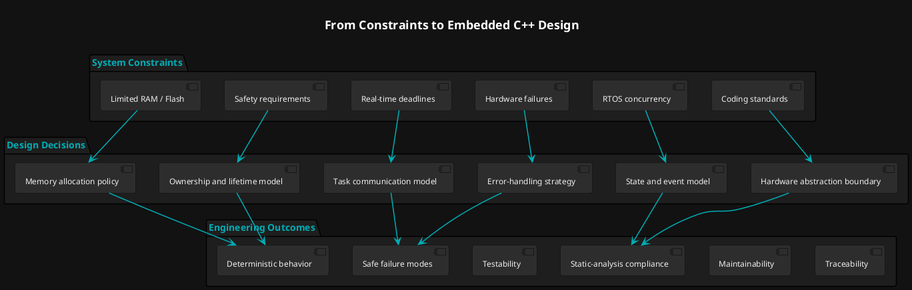

# Design principles for safety-critical embedded C++

## Overview

CASTLE stands for **Compliant Automotive Safety Template Library for Embedded**. The goal is to use modern C++ to build embedded software that is safe, predictable, testable, and efficient under strict resource limits.

This applies to automotive ECUs such as AUTOSAR controllers, ADAS, body control, battery management, clusters, and infotainment. It also applies to aerospace, railway, industrial control, robotics, and medical devices.

## Why it matters

On a PC, a failed allocation, a late task, or an unexpected exception may only crash or slow down one process. In an ECU, the same problem can be much worse:

- A control task misses its real-time deadline.
- A CAN, LIN, or Ethernet message is handled too late.
- Memory fragments, and the system fails after hours of driving.
- A driver starts before clocks or pins are ready.
- A race condition sends a wrong actuator command.
- A fault is not detected, reported, or moved to a safe state.

So the question is not only "does the code work?" The goal is code with **predictable behavior**: bounded memory, bounded time, and known failure paths.

## Questions to ask

Ask these for every module:

1. Is memory allocated only at start-up, or is it forbidden later?
2. Is execution time bounded and predictable?
3. Does the real-time path avoid exceptions?
4. Are ownership, object lifetime, and dependencies clear?
5. Can the module be tested on a PC without hardware?
6. Are communication, concurrency, and state changes safe?
7. What happens when memory, hardware, communication, or timing fails?

## Standards

Automotive projects use guidelines such as MISRA C++, AUTOSAR C++14, CERT C++, and the ISO 26262 safety process. These are not only style rules. They prevent failures that are hard to reproduce and expensive to fix on a real target.

### Examples

**MEM52-CPP: handle allocation failure.** Define a clear response when allocation fails. Often the best choice is to avoid the failure: allocate at start-up, use fixed-capacity containers, or use bounded memory pools. CASTLE containers such as [`vector`](container/containers.md) keep their data inside the object.

**MEM57-CPP: do not use default `operator new` for over-aligned types.** Alignment can fail on the target MCU or compiler even when PC tests pass. Treat memory layout and alignment as part of the design.

**OOP51-CPP: do not slice derived objects.** Copying a derived object into a base object by value drops its data and behavior. Pick the right model: value semantics, references, runtime polymorphism, or compile-time polymorphism. CASTLE uses compile-time choices by default. See [callbacks](callbacks/function.md).

## Design flow

The diagram shows how constraints lead to design decisions, and then to engineering outcomes.

## How CASTLE applies these principles

| Concern | CASTLE approach | Read more |
|---|---|---|
| Memory | Fixed-capacity containers, no mandatory heap. | [containers](container/containers.md) |
| Failure | Status values and assertions, no exceptions in normal paths. | [error handler](core/error_handler.md) |
| Dispatch | Compile-time choices, fixed-storage callbacks. | [function](callbacks/function.md) |
| Concurrency | Explicit synchronization types, no hidden locks. | [mutex](sync/mutex.md) |
| Testing | Host-side mock backends for hardware interfaces. | [GPIO backends](castle_ext/io/gpio/backends.md) |
