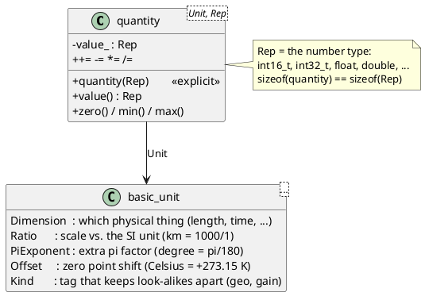
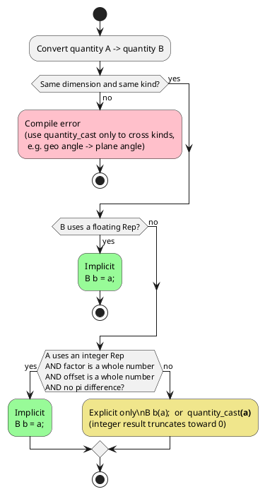
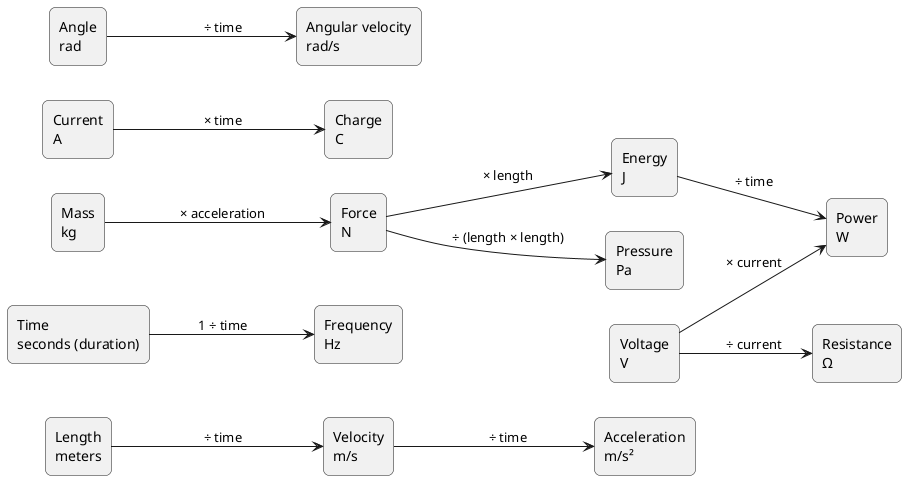
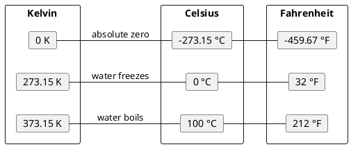

# CASTLE Units — Quick Guide

`castle::units` gives every physical value a **type**. A speed is not a plain
`double`, it is a `meters_per_second<double>`. The compiler then checks your
math for you:

- You cannot pass a temperature where a speed is expected.
- You cannot add meters to seconds.
- When you mix scales (`km` + `m`), the library converts for you.
- Converting costs no extra memory: a quantity is exactly as big as its number.

Everything is header-only, uses no heap, no exceptions, no RTTI and no virtual
functions. All conversion factors are worked out at compile time.

---

## Table of contents

1. [The 30-second idea](#1-the-30-second-idea)
2. [Common rules for every unit](#2-common-rules-for-every-unit)
3. [Overview of all units](#3-overview-of-all-units)
4. [How units connect to each other](#4-how-units-connect-to-each-other)
5. Unit by unit
   - [5.1 Time](#51-time-timehpp)
   - [5.2 Angle](#52-angle-anglehpp)
   - [5.3 Geographic angle](#53-geographic-angle-geohpp)
   - [5.4 Distance](#54-distance-distancehpp)
   - [5.5 Velocity](#55-velocity-velocityhpp)
   - [5.6 Acceleration](#56-acceleration-accelerationhpp)
   - [5.7 Angular velocity](#57-angular-velocity-angular_velocityhpp)
   - [5.8 Frequency](#58-frequency-frequencyhpp)
   - [5.9 Temperature](#59-temperature-temperaturehpp)
   - [5.10 Pressure](#510-pressure-pressurehpp)
   - [5.11 Mass](#511-mass-masshpp)
   - [5.12 Force](#512-force-forcehpp)
   - [5.13 Energy](#513-energy-energyhpp)
   - [5.14 Power](#514-power-powerhpp)
   - [5.15 Voltage](#515-voltage-voltagehpp)
   - [5.16 Current](#516-current-currenthpp)
   - [5.17 Resistance](#517-resistance-resistancehpp)
   - [5.18 Charge](#518-charge-chargehpp)
   - [5.19 Gain](#519-gain-gainhpp)
6. [Scales (SI prefixes)](#6-scales-si-prefixes-scalehpp)
7. [Making your own unit](#7-making-your-own-unit)
8. [Pitfalls to remember](#8-pitfalls-to-remember)

---

## 1. The 30-second idea

```cpp
#include "castle/units/units.hpp"   // or only the headers you need

namespace cu = castle::units;
using namespace castle::units::literals;   // enables 1.5_km, 90_deg, ...
```

> **All samples below assume these three lines.** `cu` is just a short name
> for `castle::units`.

```cpp
void set_speed(cu::meters_per_second<double> speed);

void demo()
{
    set_speed(90.0_kmph);          // OK: converted to 25 m/s
    set_speed(100.0_m / 4.0_s);    // OK: m / s is a speed, 25 m/s
    // set_speed(5.0_deg);         // compile error: an angle is not a speed
    // set_speed(25.0);            // compile error: a plain number has no unit
}
```

A quantity is a small class with two template parameters:



You rarely touch `basic_unit` yourself. Each header gives ready-made names such
as `cu::meters<Rep>`, `cu::kilometers<Rep>` and `cu::feet<Rep>`.

---

## 2. Common rules for every unit

These rules are the same for every unit in the library. Learn them once.

### 2.1 Set and get a scalar value

There is no `set()` function. You **set** by building a new value and
assigning it. You **get** with `value()` (or `count()` for time).

```cpp
cu::meters<double> d;                 // 0 m (default is zero)
cu::meters<double> d2(12.5);          // set: 12.5 m
d = cu::meters<double>(20.0);         // set again: 20 m
d = 3.0_m;                            // set with a literal
double raw = d.value();               // get: 3.0

d += 1.0_km;                          // 1003 m (km converted automatically)
d *= 2.0;                             // 2006 m (scale by a plain number)

auto zero = cu::meters<double>::zero();
auto top  = cu::meters<int32_t>::max();   // largest int32_t, in meters

// cu::meters<double> bad = 12.5;     // compile error: constructor is explicit
```

Literals:

| You write | You get |
|-----------|---------|
| `15_m` (integer) | `cu::meters<int64_t>` |
| `1.5_m` (floating) | `cu::meters<double>` |

### 2.2 Implicit or explicit conversion?

Converting between units of the **same kind of thing** (for example `km` → `m`)
is allowed. It happens **automatically** only when no precision can be lost.
Otherwise you must ask for it **explicitly**.



```cpp
cu::meters<int32_t> m = 2_km;               // implicit: 2000, exact (factor 1000)
cu::kilometers<double> km = 1500.0_m;       // implicit: 1.5, floating target
// cu::kilometers<int32_t> k = 1500_m;      // compile error: 1.5 does not fit an int
cu::kilometers<int32_t> k(1500_m);          // explicit: 1 (truncated)
auto k2 = cu::quantity_cast<cu::kilometers<int32_t>>(1500_m);   // same as above
```

> **Time is special.** Time values are `castle::chrono::duration`, which follows
> chrono rules: changing the period is **always explicit**, even when exact.
> See [5.1 Time](#51-time-timehpp).

### 2.3 Math between quantities

| Operation | Rule | Example |
|-----------|------|---------|
| `a + b`, `a - b` | Same dimension and kind. Result uses a common scale. | `1.2_km + 350.0_m` → 1550 m |
| `a * n`, `a / n` | `n` is a plain number. Unit stays the same. | `2.0_m * 3` → 6 m |
| `a * b`, `a / b` | Any two quantities. The result unit is **derived**. | `100.0_m / 4.0_s` → 25 m/s |
| `n / a`, `inverse(a)` | Gives the reciprocal unit. | `1.0 / 50.0_Hz` → 0.02 s |
| `==` `!=` `<` `<=` `>` `>=` | Same dimension and kind. Compared in a common scale. | `1_km == 1000_m` → true |
| `-a`, `abs(a)` | Same unit. | `abs(-3.0_m)` → 3 m |

What type does `a * b` or `a / b` give you?

```plantuml
@startuml
start
:a * b   or   a / b;
:Add / subtract the dimension exponents,
multiply / divide the scales;
if (Result is pure time?) then (yes)
  :castle::chrono::duration<Rep, second>
  e.g. 100 m / 25 m/s = 4 s;
elseif (Result has no dimension?) then (yes)
  :plain Rep (double, int, ...)
  e.g. 50 Hz * 2 s = 100.0;
else (other)
  :quantity<derived unit, Rep>
  assign it to the type you want,
  e.g. meters_per_second<double>;
endif
stop
@enduml
```

The derived unit keeps the combined scale. For example, `1.5_km / 1.0_min` is a
speed in "km per minute". Assign it to `cu::meters_per_second<double>` and it is
converted for you.

---

## 3. Overview of all units

Integer literals give `int64_t`, floating literals give `double`.
`—` means no literal exists. Use the constructor instead.

| Header | Thing measured | SI (coherent) unit | Other variants (alias → literal) |
|--------|---------------|-------------------|----------------------------------|
| `time.hpp` | Time | `seconds` `_s` | `nanoseconds` `_ns`, `microseconds` `_us`, `milliseconds` `_ms`, `minutes` `_min`, `hours` `_h`, `days` `_d`, `weeks` `_w` |
| `angle.hpp` | Plane angle | `radians` `_rad` | `milliradians` `_mrad`, `degrees` `_deg`, `arcminutes` `_arcmin`, `arcseconds` `_arcsec`, `revolutions` `_rev` |
| `geo.hpp` | Latitude / longitude | `geo_radians` `_geo_rad` | `geo_degrees` `_geo_deg`, `geo_degrees_e7` —, `geo_semicircles` —, `geo_arcseconds` `_geo_arcsec`, `geo_milliarcseconds` `_geo_mas` |
| `distance.hpp` | Length | `meters` `_m` | `kilometers` `_km`, `centimeters` `_cm`, `millimeters` `_mm`, `micrometers` `_um`, `nanometers` `_nm`, `inches` `_in`, `feet` `_ft`, `yards` `_yd`, `miles` `_mi`, `nautical_miles` `_nmi` |
| `velocity.hpp` | Speed | `meters_per_second` `_mps` | `kilometers_per_hour` `_kmph`, `miles_per_hour` `_mph`, `knots` `_kn`, `feet_per_second` —, `centimeters_per_second` `_cmps`, `millimeters_per_second` `_mmps` |
| `acceleration.hpp` | Acceleration | `meters_per_second_squared` `_mps2` | `standard_gravities` `_gn`, `milli_standard_gravities` `_mgn`, `feet_per_second_squared` — |
| `angular_velocity.hpp` | Turn rate | `radians_per_second` `_radps` | `milliradians_per_second` `_mradps`, `degrees_per_second` `_degps`, `revolutions_per_second` `_rps`, `revolutions_per_minute` `_rpm` |
| `frequency.hpp` | Cycles per time | `hertz` `_Hz` | `millihertz` `_mHz`, `kilohertz` `_kHz`, `megahertz` `_MHz`, `gigahertz` `_GHz` |
| `temperature.hpp` | Temperature | `kelvin` `_K` | `millikelvin` `_mK`, `celsius` `_degC`, `fahrenheit` `_degF`, `deci_celsius` — |
| `pressure.hpp` | Pressure | `pascals` `_Pa` | `hectopascals` `_hPa`, `kilopascals` `_kPa`, `megapascals` `_MPa`, `bars` `_bar`, `millibars` `_mbar`, `atmospheres` `_atm`, `pounds_per_square_inch` `_psi` |
| `mass.hpp` | Mass | `kilograms` `_kg` | `grams` `_g`, `milligrams` `_mg`, `tonnes` `_t`, `pounds` `_lb`, `ounces` `_oz` |
| `force.hpp` | Force | `newtons` `_N` | `millinewtons` `_mN`, `kilonewtons` `_kN`, `pounds_force` `_lbf` |
| `energy.hpp` | Energy | `joules` `_J` | `millijoules` `_mJ`, `kilojoules` `_kJ`, `megajoules` `_MJ`, `milliwatt_hours` `_mWh`, `watt_hours` `_Wh`, `kilowatt_hours` `_kWh` |
| `power.hpp` | Power | `watts` `_W` | `microwatts` `_uW`, `milliwatts` `_mW`, `kilowatts` `_kW`, `megawatts` `_MW`; level `decibel_milliwatts` `_dBm` |
| `voltage.hpp` | Voltage | `volts` `_V` | `kilovolts` `_kV`, `millivolts` `_mV`, `microvolts` `_uV` |
| `current.hpp` | Current | `amperes` `_A` | `kiloamperes` `_kA`, `milliamperes` `_mA`, `microamperes` `_uA` |
| `resistance.hpp` | Resistance | `ohms` `_Ohm` | `milliohms` `_mOhm`, `kiloohms` `_kOhm`, `megaohms` `_MOhm` |
| `charge.hpp` | Electric charge | `coulombs` `_C` | `millicoulombs` `_mC`, `ampere_hours` `_Ah`, `milliampere_hours` `_mAh` |
| `gain.hpp` | Log gain | `bels` `_B` | `decibels` `_dB` |

Support headers:

| Header | What it gives |
|--------|---------------|
| `quantity.hpp` | The `quantity` class, `unit`, `scaled_unit_t`, `quantity_cast`, `inverse`, `abs`, all operators |
| `scale.hpp` | Ratios: `atto` … `giga`, plus `second`, `minute`, `hour`, `day`, `week` |
| `units.hpp` | Includes every header above in one line |

Every alias also has a matching unit type named in the singular with `_unit`
(for example `meters<Rep>` = `quantity<meter_unit, Rep>`). You need these only
when building your own units ([section 7](#7-making-your-own-unit)).

---

## 4. How units connect to each other

Multiplying or dividing quantities gives a new quantity. The diagram shows the
results you get with the built-in units, all in SI scale.



Reverse directions work too. For example: `length / velocity` → time,
`energy / power` → time, `voltage / resistance` → current,
`charge / time` → current.

---

## 5. Unit by unit

Each unit section has the same three parts:

- **Set / get**: store a number and read it back.
- **Related scales**: the same unit with a different SI prefix (m ↔ km ↔ mm).
- **Convert from other units**: other units of the same thing (feet → meters),
  and results of math that produce this unit (m ÷ s → speed).

### 5.1 Time (`time.hpp`)

Time values **are** `castle::chrono::duration`. `cu::seconds<Rep>` is just
another name for `castle::chrono::duration<Rep, cu::second>`.

| Alias | Period | Integer literal type |
|-------|--------|----------------------|
| `nanoseconds<Rep>` | 10⁻⁹ s | `chrono::nanoseconds` |
| `microseconds<Rep>` | 10⁻⁶ s | `chrono::microseconds` |
| `milliseconds<Rep>` | 10⁻³ s | `chrono::milliseconds` |
| `seconds<Rep>` | 1 s | `chrono::seconds` |
| `minutes<Rep>` | 60 s | `chrono::minutes` |
| `hours<Rep>` | 3600 s | `chrono::hours` |
| `days<Rep>` | 86400 s | `chrono::days` |
| `weeks<Rep>` | 604800 s | `chrono::weeks` |

**Set / get:** use `count()`, not `value()`.

```cpp
cu::seconds<double> dt(0.02);                    // 0.02 s
castle::chrono::milliseconds timeout = 250_ms;   // int64_t ticks
auto t = 1.5_min;                                // cu::minutes<double>
double s = dt.count();                           // 0.02
```

**Related scales:** changing the period is **always explicit** (chrono rule).

```cpp
cu::milliseconds<int64_t> ms(2_s);                                 // 2000 ms
auto sec = cu::quantity_cast<cu::seconds<double>>(250_ms);         // 0.25 s
auto whole = castle::chrono::duration_cast<castle::chrono::seconds>(1500_ms);  // 1 s (truncated)
auto total = 1_s + 250_ms;                                         // 1250 ms
// cu::seconds<double> bad = 250_ms;                               // compile error: must be explicit
```

**Convert from other units:**

```cpp
cu::seconds<double> travel = 100.0_m / 25.0_mps;   // length ÷ speed = 4 s
cu::seconds<double> period = 1.0 / 50.0_Hz;        // 0.02 s
```

### 5.2 Angle (`angle.hpp`)

Angle is its own dimension, so an angle can never be mixed up with a plain
number. Degrees, arc-minutes, arc-seconds and revolutions store an exact
π factor, so whole-number conversions between them stay exact.

| Alias | Size |
|-------|------|
| `radians<Rep>` | 1 rad (SI) |
| `milliradians<Rep>` | 0.001 rad |
| `degrees<Rep>` | π/180 rad |
| `arcminutes<Rep>` | 1/60 degree |
| `arcseconds<Rep>` | 1/3600 degree |
| `revolutions<Rep>` | 2π rad (one full turn) |

**Set / get:**

```cpp
cu::degrees<double> heading(370.0);
double h = heading.value();                 // 370.0
cu::degrees<int32_t> step = 90_deg;
```

**Related scales:**

```cpp
cu::milliradians<int64_t> mr = 2_rad;      // implicit: 2000 mrad
cu::radians<double> r = 1500.0_mrad;       // implicit: 1.5 rad
```

**Convert from other units:**

```cpp
cu::radians<double> r = 180_deg;               // implicit: 3.14159... rad
cu::arcminutes<int64_t> am = 2_deg;            // implicit, exact: 120 arcmin
cu::degrees<int64_t> d = 1_rev;                // implicit, exact: 360 deg
cu::revolutions<double> quarter = 90.0_deg;    // 0.25 rev
cu::degrees<int32_t> d2(cu::radians<double>(1.0));   // explicit: 57 deg (truncated)
cu::degrees<double> turned = 30.0_degps * 2.0_s;     // rate × time = 60 deg
```

**Helpers** (work with any angle unit, including geographic angles):

| Function | Result |
|----------|--------|
| `sin(a)`, `cos(a)`, `tan(a)` | floating number (`double` for integer reps) |
| `asin(x)`, `acos(x)`, `atan2(y, x)` | `radians<T>` |
| `atan2(qy, qx)` | `radians` from two quantities of the same kind, e.g. two lengths |
| `wrap_positive(a)` | same unit, in `[0, one turn)`, e.g. `[0, 360)` |
| `wrap_signed(a)` | same unit, in `[-half turn, half turn)`, e.g. `[-180, 180)` |

```cpp
cu::degrees<double> h = cu::wrap_positive(370.0_deg);   // 10 deg
cu::degrees<int32_t> s = cu::wrap_signed(cu::degrees<int32_t>(270));  // -90 deg
double y = cu::sin(30.0_deg);                            // 0.5
cu::radians<double> slope = cu::atan2(3.0_m, 4.0_m);     // 0.6435 rad
cu::degrees<double> a = cu::asin(0.5);                   // 30 deg
```

### 5.3 Geographic angle (`geo.hpp`)

Latitude and longitude are angles, but they carry the tag `geo_kind`. This
stops you from passing a GPS latitude where a steering angle is expected.

| Alias | Size | Typical source |
|-------|------|----------------|
| `geo_radians<Rep>` | 1 rad | — |
| `geo_degrees<Rep>` | π/180 rad | human-readable |
| `geo_degrees_e7<Rep>` | 10⁻⁷ degree | u-blox UBX `int32` lat/lon |
| `geo_semicircles<Rep>` | 180° / 2³¹ | Garmin FIT `int32` positions |
| `geo_arcseconds<Rep>` | 1/3600 degree | arc-second based formats |
| `geo_milliarcseconds<Rep>` | 1/3600000 degree | milliarc-second `int32` lat/lon |

**Set / get:**

```cpp
cu::geo_degrees<double> lat(37.5665);
cu::geo_degrees<double> lon = 127.0_geo_deg;
double v = lat.value();                          // 37.5665
```

**Related scales:**

```cpp
cu::geo_degrees_e7<int32_t> raw(375665000);      // from the GPS receiver
cu::geo_degrees<double> lat = raw;               // implicit: 37.5665 deg
cu::geo_degrees_e7<int32_t> back(lat);           // explicit: double -> int
cu::geo_degrees<double> fit = cu::geo_semicircles<int32_t>(447392427);   // about 37.5 deg
cu::geo_radians<double> rad = lat;               // 0.6557 rad
```

**Convert from other units:** a plane angle needs `quantity_cast`.

```cpp
cu::geo_degrees<double> lat(37.5665);
cu::degrees<double> plane = cu::quantity_cast<cu::degrees<double>>(lat);   // 37.5665 deg
// cu::degrees<double> bad = lat;                 // compile error: different kind
bool ok = cu::is_valid_latitude(lat);              // true, -90..90
bool ok2 = cu::is_valid_longitude(200.0_geo_deg);  // false, -180..180
double c = cu::cos(lat);                           // angle helpers accept geo angles
```

### 5.4 Distance (`distance.hpp`)

| Alias | Size |
|-------|------|
| `meters<Rep>` | 1 m (SI) |
| `kilometers<Rep>` | 1000 m |
| `centimeters<Rep>` | 0.01 m |
| `millimeters<Rep>` | 0.001 m |
| `micrometers<Rep>` | 10⁻⁶ m |
| `nanometers<Rep>` | 10⁻⁹ m |
| `inches<Rep>` | 0.0254 m |
| `feet<Rep>` | 0.3048 m |
| `yards<Rep>` | 0.9144 m |
| `miles<Rep>` | 1609.344 m |
| `nautical_miles<Rep>` | 1852 m |

**Set / get:**

```cpp
cu::meters<double> d(12.5);
double v = d.value();                         // 12.5
```

**Related scales:**

```cpp
cu::millimeters<int32_t> mm = 3_m;            // implicit: 3000 mm
cu::kilometers<double> km = 1500.0_m;         // implicit: 1.5 km
cu::meters<int32_t> m(1500_mm);               // explicit: 1 m (truncated)
cu::meters<double> total = 1.2_km + 350.0_m;  // 1550 m
```

**Convert from other units:**

```cpp
cu::feet<double> alt = 100.0_m;               // 328.08 ft
cu::inches<int64_t> in = 1_ft;                // implicit, exact: 12 in
cu::feet<int64_t> ft = 1_yd;                  // implicit, exact: 3 ft
cu::nautical_miles<double> nm = 3704.0_m;     // 2 NM
cu::meters<double> walked = 2.0_mps * 3.0_s;  // speed × time = 6 m
```

### 5.5 Velocity (`velocity.hpp`)

| Alias | Size |
|-------|------|
| `meters_per_second<Rep>` | 1 m/s (SI) |
| `centimeters_per_second<Rep>` | 0.01 m/s |
| `millimeters_per_second<Rep>` | 0.001 m/s |
| `kilometers_per_hour<Rep>` | 5/18 m/s |
| `miles_per_hour<Rep>` | 0.44704 m/s |
| `knots<Rep>` | 1852/3600 m/s |
| `feet_per_second<Rep>` | 0.3048 m/s |

**Set / get:**

```cpp
cu::meters_per_second<double> v(13.9);
double raw = v.value();                                // 13.9
```

**Related scales:**

```cpp
cu::millimeters_per_second<int64_t> mmps = 2_mps;      // implicit: 2000 mm/s
cu::centimeters_per_second<double> cmps = 1.5_mps;     // 150 cm/s
```

**Convert from other units:**

```cpp
cu::meters_per_second<double> limit = 90.0_kmph;       // 25 m/s
cu::kilometers_per_hour<double> ground = 10.0_kn;      // 18.52 km/h
cu::miles_per_hour<double> us = 100.0_kmph;            // 62.14 mph
cu::feet_per_second<double> fps = 1.0_mps;             // 3.28 ft/s
cu::kilometers_per_hour<int64_t> k(cu::meters_per_second<int64_t>(10));  // explicit: 36 km/h
cu::meters_per_second<double> v1 = 100.0_m / 4.0_s;    // length ÷ time = 25 m/s
cu::meters_per_second<double> v2 = 1.5_km / 1.0_min;   // 25 m/s
```

### 5.6 Acceleration (`acceleration.hpp`)

| Alias | Size |
|-------|------|
| `meters_per_second_squared<Rep>` | 1 m/s² (SI) |
| `standard_gravities<Rep>` | 9.80665 m/s² (1 g) |
| `milli_standard_gravities<Rep>` | 0.00980665 m/s² (1 mg) |
| `feet_per_second_squared<Rep>` | 0.3048 m/s² |

**Set / get:**

```cpp
cu::meters_per_second_squared<double> a(9.81);
double raw = a.value();                                     // 9.81
```

**Related scales:** `g` and `mg` are the scaled pair here.

```cpp
cu::milli_standard_gravities<int64_t> mg = 2_gn;            // implicit: 2000 mg
cu::standard_gravities<double> g = 500.0_mgn;               // 0.5 g
cu::milli_standard_gravities<int32_t> imu(1000);            // raw accelerometer reading
```

**Convert from other units:**

```cpp
cu::meters_per_second_squared<double> a1 = 2.0_gn;          // 19.6133 m/s²
cu::feet_per_second_squared<double> f = 9.80665_mps2;       // 32.17 ft/s²
cu::meters_per_second_squared<double> a2 = 10.0_mps / 2.0_s;       // speed ÷ time = 5 m/s²
cu::meters_per_second_squared<double> a3 = 100.0_kmph / 10.0_s;    // 2.78 m/s²
```

### 5.7 Angular velocity (`angular_velocity.hpp`)

Angular velocity is "angle per time". It is **not** frequency, so `rpm` never
silently turns into `Hz`.

| Alias | Size |
|-------|------|
| `radians_per_second<Rep>` | 1 rad/s (SI) |
| `milliradians_per_second<Rep>` | 0.001 rad/s |
| `degrees_per_second<Rep>` | π/180 rad/s |
| `revolutions_per_second<Rep>` | 2π rad/s |
| `revolutions_per_minute<Rep>` | π/30 rad/s |

**Set / get:**

```cpp
cu::radians_per_second<double> w(3.14);
double raw = w.value();                                     // 3.14
```

**Related scales:**

```cpp
cu::milliradians_per_second<int64_t> mw = 2_radps;          // implicit: 2000 mrad/s
cu::radians_per_second<double> w = 250.0_mradps;            // 0.25 rad/s
```

**Convert from other units:**

```cpp
cu::degrees_per_second<int64_t> d = 60_rpm;                 // implicit, exact: 360 deg/s
cu::revolutions_per_minute<int64_t> rpm = 2_rps;            // implicit, exact: 120 rpm
cu::radians_per_second<double> w = 180.0_degps;             // 3.14159 rad/s
cu::degrees_per_second<double> rate = 90.0_deg / 0.5_s;     // angle ÷ time = 180 deg/s
// cu::hertz<double> f = 60.0_rpm;                          // compile error: not a frequency
```

### 5.8 Frequency (`frequency.hpp`)

Frequency is "cycles per time" (no angle inside).

| Alias | Size |
|-------|------|
| `hertz<Rep>` | 1 Hz (SI) |
| `millihertz<Rep>` | 0.001 Hz |
| `kilohertz<Rep>` | 10³ Hz |
| `megahertz<Rep>` | 10⁶ Hz |
| `gigahertz<Rep>` | 10⁹ Hz |

**Set / get:**

```cpp
cu::hertz<double> f(50.0);
double raw = f.value();                         // 50.0
```

**Related scales:**

```cpp
cu::hertz<int64_t> hz = 2_kHz;                  // implicit: 2000 Hz
cu::kilohertz<double> khz = 1500.0_Hz;          // 1.5 kHz
cu::megahertz<int64_t> mhz(16000000_Hz);        // explicit: 16 MHz
```

**Convert from other units:** frequency and time are each other's inverse.

```cpp
cu::hertz<double> rate = cu::inverse(20.0_ms);  // 50 Hz
cu::seconds<double> period = 1.0 / 2.0_kHz;     // 0.0005 s
double cycles = 50.0_Hz * 2.0_s;                // plain number: 100
```

### 5.9 Temperature (`temperature.hpp`)

Celsius and Fahrenheit do not start at zero kelvin. They have an **offset**
(their zero point is shifted). The library handles the shift for you, but it
adds a few rules.



| Alias | Step size | Zero point | Offset? |
|-------|-----------|------------|---------|
| `kelvin<Rep>` | 1 K (SI) | absolute zero | no |
| `millikelvin<Rep>` | 0.001 K | absolute zero | no |
| `celsius<Rep>` | 1 K | 273.15 K | **yes** |
| `deci_celsius<Rep>` | 0.1 K | 273.15 K | **yes** |
| `fahrenheit<Rep>` | 5/9 K | 255.372 K | **yes** |

Rules for offset units (Celsius, deci-Celsius, Fahrenheit):

- Compare any two temperatures freely (`==`, `<`, ...).
- `+` and `-` work only between the **same** unit, or between two units without
  offset (kelvin, millikelvin). `celsius + kelvin` does not compile.
- `*`, `/` and `inverse` between quantities do not compile. Convert to kelvin first.
- A Celsius value is a **point** on the scale. Write differences in kelvin.

**Set / get:**

```cpp
cu::celsius<double> room(21.5);
double raw = room.value();                                  // 21.5
cu::deci_celsius<int16_t> sensor(253);                      // raw int16 sensor value
```

**Related scales:**

```cpp
cu::millikelvin<int64_t> mk = 3_K;                          // implicit: 3000 mK
cu::celsius<double> c = cu::deci_celsius<int16_t>(253);     // 25.3 °C
```

**Convert from other units:**

```cpp
cu::kelvin<double> k = 25.0_degC;                           // 298.15 K
cu::fahrenheit<double> f = 100.0_degC;                      // 212 °F
cu::celsius<int32_t> c(cu::fahrenheit<int32_t>(212));       // explicit: 100 °C
bool same = (-40_degC == -40_degF);                         // true
cu::celsius<double> warmer = 20.0_degC + 5.0_degC;          // same unit: 25 °C
cu::kelvin<double> hot = 30.0_degC;
cu::kelvin<double> cold = 20.0_degC;
cu::kelvin<double> delta = hot - cold;                      // difference: 10 K
// auto bad = 20.0_degC + 5.0_K;                            // compile error: mixed offset unit
```

### 5.10 Pressure (`pressure.hpp`)

| Alias | Size |
|-------|------|
| `pascals<Rep>` | 1 Pa (SI) |
| `hectopascals<Rep>` | 100 Pa (= 1 mbar) |
| `kilopascals<Rep>` | 10³ Pa |
| `megapascals<Rep>` | 10⁶ Pa |
| `bars<Rep>` | 100000 Pa |
| `millibars<Rep>` | 100 Pa |
| `atmospheres<Rep>` | 101325 Pa |
| `pounds_per_square_inch<Rep>` | ≈ 6894.757 Pa (exact ratio) |

**Set / get:**

```cpp
cu::pascals<double> p(101325.0);
double raw = p.value();                                     // 101325.0
```

**Related scales:**

```cpp
cu::pascals<int64_t> pa = 2_kPa;                            // implicit: 2000 Pa
cu::hectopascals<double> hpa = 101325.0_Pa;                 // 1013.25 hPa
cu::pascals<int64_t> tyre = 2_bar + 150_hPa;                // 215000 Pa
```

**Convert from other units:**

```cpp
cu::hectopascals<double> qnh = 1.01325_bar;                 // 1013.25 hPa
cu::millibars<int64_t> mb = 1_bar;                          // implicit: 1000 mbar
cu::hectopascals<int64_t> same = 5_mbar;                    // implicit: 5 hPa
cu::kilopascals<double> tire = 32.0_psi;                    // 220.6 kPa
cu::atmospheres<double> atm = 101325.0_Pa;                  // 1 atm
cu::pascals<double> on_plate = 100.0_N / (2.0_m * 0.5_m);   // force ÷ area = 100 Pa
```

### 5.11 Mass (`mass.hpp`)

The **kilogram** (not the gram) is the SI unit with scale 1.

| Alias | Size |
|-------|------|
| `kilograms<Rep>` | 1 kg (SI) |
| `grams<Rep>` | 10⁻³ kg |
| `milligrams<Rep>` | 10⁻⁶ kg |
| `tonnes<Rep>` | 1000 kg |
| `pounds<Rep>` | 0.45359237 kg |
| `ounces<Rep>` | 1/16 lb |

**Set / get:**

```cpp
cu::kilograms<double> m(72.5);
double raw = m.value();                                     // 72.5
```

**Related scales:**

```cpp
cu::grams<int64_t> g = 2_kg;                                // implicit: 2000 g
cu::milligrams<int64_t> mg = 3_g;                           // implicit: 3000 mg
cu::tonnes<double> t = 2500.0_kg;                           // 2.5 t
cu::kilograms<double> payload = 1.5_kg + 250.0_g;           // 1.75 kg
```

**Convert from other units:**

```cpp
cu::kilograms<double> kg = 10.0_lb;                         // 4.536 kg
cu::ounces<int64_t> oz = 2_lb;                              // implicit, exact: 32 oz
cu::kilograms<double> m = 98.0665_N / 9.80665_mps2;         // force ÷ acceleration = 10 kg
```

### 5.12 Force (`force.hpp`)

| Alias | Size |
|-------|------|
| `newtons<Rep>` | 1 N (SI) = 1 kg·m/s² |
| `millinewtons<Rep>` | 10⁻³ N |
| `kilonewtons<Rep>` | 10³ N |
| `pounds_force<Rep>` | 4.4482216152605 N |

**Set / get:**

```cpp
cu::newtons<double> f(12.0);
double raw = f.value();                                     // 12.0
```

**Related scales:**

```cpp
cu::millinewtons<int64_t> fine = 2_N;                       // implicit: 2000 mN
cu::newtons<double> thrust = 1.2_kN + 300.0_N;              // 1500 N
```

**Convert from other units:**

```cpp
cu::newtons<double> n = 1.0_lbf;                            // 4.448 N
cu::newtons<double> f1 = 2.0_kg * 9.81_mps2;                // mass × acceleration = 19.62 N
cu::newtons<double> weight = 10.0_kg * 1.0_gn;              // 98.0665 N
```

### 5.13 Energy (`energy.hpp`)

| Alias | Size |
|-------|------|
| `joules<Rep>` | 1 J (SI) = 1 N·m |
| `millijoules<Rep>` | 10⁻³ J |
| `kilojoules<Rep>` | 10³ J |
| `megajoules<Rep>` | 10⁶ J |
| `milliwatt_hours<Rep>` | 3.6 J |
| `watt_hours<Rep>` | 3600 J |
| `kilowatt_hours<Rep>` | 3.6 MJ |

**Set / get:**

```cpp
cu::joules<double> e(250.0);
double raw = e.value();                                     // 250.0
```

**Related scales:**

```cpp
cu::millijoules<int64_t> mj = 2_J;                          // implicit: 2000 mJ
cu::joules<double> e = 1.5_kJ + 500.0_J;                    // 2000 J
cu::milliwatt_hours<int64_t> pack = 3_Wh;                   // implicit: 3000 mWh
```

**Convert from other units:**

```cpp
cu::joules<int64_t> j = 1_Wh;                               // implicit, exact: 3600 J
cu::kilowatt_hours<double> kwh = 7.2_MJ;                    // 2 kWh
cu::joules<double> work = 10.0_N * 2.0_m;                   // force × length = 20 J
cu::watt_hours<double> used = 5.0_W * 2.0_h;                // power × time = 10 Wh
```

### 5.14 Power (`power.hpp`)

| Alias | Size |
|-------|------|
| `watts<Rep>` | 1 W (SI) = 1 J/s |
| `microwatts<Rep>` | 10⁻⁶ W |
| `milliwatts<Rep>` | 10⁻³ W |
| `kilowatts<Rep>` | 10³ W |
| `megawatts<Rep>` | 10⁶ W |
| `decibel_milliwatts<Rep>` | dBm, 10·log10(P / 1 mW); logarithmic level, kind `power_level_kind` |

**Set / get:**

```cpp
cu::watts<double> p(1.65);
double raw = p.value();                                     // 1.65
```

**Related scales:**

```cpp
cu::microwatts<int64_t> sleep = 3_mW;                       // implicit: 3000 uW
cu::watts<double> budget = 1.5_W + 250.0_mW;                // 1.75 W
```

**Convert from other units:**

```cpp
cu::watts<double> p1 = 3.3_V * 0.5_A;                       // voltage × current = 1.65 W
cu::watts<double> p2 = 3600.0_J / 60.0_s;                   // energy ÷ time = 60 W
cu::watts<double> p3 = 1.0_Wh / 1.0_h;                      // 1 W
```

**dBm (absolute power level):** dBm is logarithmic, so it is not a scaled
watt. Cross between the two domains with functions:

| Function / operator | Math |
|---------------------|------|
| `milliwatts_from_dbm(l)` | 10^(dBm/10) mW |
| `dbm_from_power(p)` | 10·log10(p / 1 mW), `p > 0` |
| `level ± gain` | dBm ± dB → dBm |
| `level - level` | dBm − dBm → dB |

```cpp
cu::watts<double> tx = cu::milliwatts_from_dbm(30.0_dBm);      // 30 dBm = 1 W = 1000 mW
cu::decibel_milliwatts<double> l = cu::dbm_from_power(1_mW);   // 0 dBm
auto rx = 30.0_dBm - 3.0_dB;                                    // 27 dBm
cu::decibels<double> path = 30.0_dBm - 10.0_dBm;               // 20 dB
// auto bad = 30.0_dBm + 10.0_dBm;                              // compile error: add linear powers
```

### 5.15 Voltage (`voltage.hpp`)

| Alias | Size |
|-------|------|
| `volts<Rep>` | 1 V (SI) |
| `kilovolts<Rep>` | 10³ V |
| `millivolts<Rep>` | 10⁻³ V |
| `microvolts<Rep>` | 10⁻⁶ V |

**Set / get:**

```cpp
cu::millivolts<int32_t> adc(1650);
int32_t raw = adc.value();                                  // 1650
```

**Related scales:**

```cpp
cu::millivolts<int32_t> rail = 3_V + 300_mV;                // 3300 mV
cu::volts<double> reading = 1650.0_mV;                      // 1.65 V
cu::microvolts<int64_t> uv = 2_mV;                          // implicit: 2000 uV
```

**Convert from other units:**

```cpp
cu::volts<double> v1 = 2.0_A * 100.0_Ohm;                   // Ohm's law: 200 V
cu::volts<double> v2 = 1.65_W / 0.5_A;                      // power ÷ current = 3.3 V
```

### 5.16 Current (`current.hpp`)

| Alias | Size |
|-------|------|
| `amperes<Rep>` | 1 A (SI) |
| `kiloamperes<Rep>` | 10³ A |
| `milliamperes<Rep>` | 10⁻³ A |
| `microamperes<Rep>` | 10⁻⁶ A |

**Set / get:**

```cpp
cu::amperes<double> i(0.75);
double raw = i.value();                                     // 0.75
```

**Related scales:**

```cpp
cu::milliamperes<int32_t> load = 1_A + 250_mA;              // 1250 mA
cu::amperes<double> peak = 1500.0_mA;                       // 1.5 A
cu::microamperes<int64_t> ua = 2_mA;                        // implicit: 2000 uA
```

**Convert from other units:**

```cpp
cu::amperes<double> i1 = 5.0_V / 1000.0_Ohm;                // voltage ÷ resistance = 0.005 A
cu::amperes<double> i2 = 3.6_C / 2.0_s;                     // charge ÷ time = 1.8 A
cu::milliamperes<double> avg = 1000.0_mAh / 10.0_h;         // 100 mA
```

### 5.17 Resistance (`resistance.hpp`)

| Alias | Size |
|-------|------|
| `ohms<Rep>` | 1 Ω (SI) |
| `milliohms<Rep>` | 10⁻³ Ω |
| `kiloohms<Rep>` | 10³ Ω |
| `megaohms<Rep>` | 10⁶ Ω |

**Set / get:**

```cpp
cu::ohms<int64_t> r(4700);
int64_t raw = r.value();                                    // 4700
```

**Related scales:**

```cpp
cu::ohms<int64_t> divider = 4_kOhm + 700_Ohm;               // 4700 Ω
cu::kiloohms<double> pullup = 10000.0_Ohm;                  // 10 kΩ
cu::milliohms<int64_t> shunt = 2_Ohm;                       // implicit: 2000 mΩ
```

**Convert from other units:**

```cpp
cu::ohms<double> r1 = 5.0_V / 0.01_A;                       // voltage ÷ current = 500 Ω
cu::kiloohms<double> r2 = 5.0_V / 1.0_mA;                   // 5 kΩ
```

### 5.18 Charge (`charge.hpp`)

| Alias | Size |
|-------|------|
| `coulombs<Rep>` | 1 C (SI) = 1 A·s |
| `millicoulombs<Rep>` | 10⁻³ C |
| `ampere_hours<Rep>` | 3600 C |
| `milliampere_hours<Rep>` | 3.6 C |

**Set / get:**

```cpp
cu::milliampere_hours<int32_t> battery(2500);
int32_t raw = battery.value();                              // 2500
```

**Related scales:**

```cpp
cu::millicoulombs<int64_t> mc = 2_C;                        // implicit: 2000 mC
cu::milliampere_hours<int64_t> mah = 2_Ah;                  // implicit: 2000 mAh
cu::milliampere_hours<double> drawn = 0.5_Ah + 250.0_mAh;   // 750 mAh
```

**Convert from other units:**

```cpp
cu::coulombs<double> q = 1.0_mAh;                           // 3.6 C
cu::coulombs<double> q1 = 2.0_A * 3.0_s;                    // current × time = 6 C
cu::ampere_hours<double> q2 = 0.5_A * 2.0_h;                // 1 Ah
cu::milliampere_hours<double> q3 = 100.0_mA * 3.0_h;        // 300 mAh
```

### 5.19 Gain (`gain.hpp`)

Gain has no physical dimension, but it carries the tag `gain_kind`. So a gain
never turns into a plain number by accident. Adding two gains means "two stages
in a row".

| Alias | Size |
|-------|------|
| `bels<Rep>` | 1 B (×10 in power) |
| `decibels<Rep>` | 0.1 B |

**Set / get:**

```cpp
cu::decibels<double> g(3.0);
double raw = g.value();                                       // 3.0
// double bad = 3.0_dB;                                       // compile error: gain is not a plain number
```

**Related scales:**

```cpp
cu::decibels<int64_t> db = 2_B;                               // implicit: 20 dB
cu::bels<double> b = 30.0_dB;                                 // 3 B
cu::decibels<double> total = 20.0_dB + 3.0_dB;                // two stages: 23 dB
```

**Convert from other units:** gain converts to and from **linear ratios**.

| Function | Math |
|----------|------|
| `power_ratio(g)` | 10^(dB/10) |
| `amplitude_ratio(g)` | 10^(dB/20) |
| `decibels_from_power_ratio(r)` | 10·log10(r), `r > 0` |
| `decibels_from_amplitude_ratio(r)` | 20·log10(r), `r > 0` |

```cpp
double p = cu::power_ratio(3.0_dB);                           // about 2.0
double a = cu::amplitude_ratio(20.0_dB);                      // 10.0
cu::decibels<double> g1 = cu::decibels_from_power_ratio(100.0);      // 20 dB
cu::decibels<double> g2 = cu::decibels_from_amplitude_ratio(100.0);  // 40 dB
```

Absolute levels: dBm is in `power.hpp` (`decibel_milliwatts`, see 5.14). dBV is not supported.

---

## 6. Scales (SI prefixes, `scale.hpp`)

A scale is an exact fraction (`castle::math::ratio`). It says how big one unit
is compared with the SI unit.

| Name | Value | Name | Value |
|------|-------|------|-------|
| `atto` | 10⁻¹⁸ | `deca` | 10¹ |
| `femto` | 10⁻¹⁵ | `hecto` | 10² |
| `pico` | 10⁻¹² | `kilo` | 10³ |
| `nano` | 10⁻⁹ | `mega` | 10⁶ |
| `micro` | 10⁻⁶ | `giga` | 10⁹ |
| `milli` | 10⁻³ | | |
| `centi` | 10⁻² | | |
| `deci` | 10⁻¹ | | |

Time scales: `second` (1), `minute` (60), `hour` (3600), `day` (86400),
`week` (604800). They are singular. The plural names (`seconds`, `minutes`, …)
are the duration aliases from `time.hpp`.

```cpp
static_assert(cu::kilo::num == 1000, "kilo");
static_assert(cu::minute::num == 60, "minute");
```

---

## 7. Making your own unit

Two building blocks cover almost every case:

- `scaled_unit_t<Unit, Ratio>`: an existing unit times a scale. It keeps
  everything else (π factor, offset, kind).
- `unit<Dimension, Ratio, PiExponent, Offset, Kind>`: a unit from scratch. Only
  `Dimension` is required.

```cpp
// Decimeter: meter × 1/10
using decimeter_unit = cu::scaled_unit_t<cu::meter_unit, cu::deci>;
template <typename Rep>
using decimeters = cu::quantity<decimeter_unit, Rep>;

// Hundredths of a degree, a common CAN-bus angle format
using centidegree_unit = cu::scaled_unit_t<cu::degree_unit, cu::centi>;
template <typename Rep>
using centidegrees = cu::quantity<centidegree_unit, Rep>;

// Speed in 0.01 km/h, built from scratch: (5/18) / 100 m/s
using kmph_x100_unit = cu::unit<cu::dim::velocity, castle::math::ratio<5, 1800>>;

void custom_units_demo()
{
    decimeters<int32_t> dm = 3_m;                        // implicit: 30 dm
    cu::degrees<double> steer = centidegrees<int16_t>(-1250);   // -12.5 deg
    cu::quantity<kmph_x100_unit, uint16_t> can(5000);    // 50.00 km/h
    cu::meters_per_second<double> v = can;               // 13.89 m/s
}
```

Your new units work with every operator, conversion and helper in this guide.

---

## 8. Pitfalls to remember

| Pitfall | What happens | What to do |
|---------|--------------|------------|
| Integer conversion that is not exact | Must be explicit, result **truncates toward zero** | Use a floating `Rep`, or accept the truncation knowingly |
| Integer overflow | Not checked (same as `chrono::duration`) | Pick a `Rep` big enough, e.g. `int64_t` for `nanoseconds` |
| Smaller `Rep`, same unit (`int64_t` → `int16_t`) | Allowed implicitly, may overflow silently | Check the range before narrowing |
| Division by zero | Not checked | Guard divisors yourself |
| Time conversion | Always explicit | `quantity_cast`, `duration_cast` or the explicit constructor |
| Celsius / Fahrenheit math | No `*`, `/`; `+`/`-` only with the same unit | Convert to `kelvin` first; write differences in kelvin |
| Geo angle ↔ plane angle | No implicit conversion | `quantity_cast<degrees<double>>(lat)` |
| `rpm` ↔ `Hz` | Different dimensions, never converts | Divide by an angle (one turn) yourself if you really mean it |
| Derived result type is a "strange" scale | e.g. `1.5_km / 1.0_min` is km/min | Assign it to the alias you want (`meters_per_second<double>`) |
